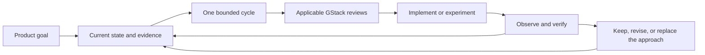

# Adaptive development with GStack

## Operating model

Keep the destination stable and the route revisable. [IMPLEMENTATION.md](IMPLEMENTATION.md) gives the mandatory local execution sequence reached from AGENTS.md: read the assignment, visually inspect the approved image, select acceptance IDs, implement one observable increment, verify and update the handoff. The driving agent uses the relevant GStack skills and grows plan detail only for the current cycle.

GStack supplies specialized review, debugging, QA, and delivery workflows. It does not inherently maintain this project's goal or state files, select a reliable long-term sequence, or prove completion because a skill finished. The driving agent performs that coordination through AGENTS.md.

## Sources of truth

| Artifact | Owner and update rule |
| --- | --- |
| IMPLEMENTATION.md | Local execution sequence, active-goal acceptance map and evidence template. Keep every required feature reachable from AGENTS.md; derive the map from the authoritative contracts and use it to select/check bounded work. |
| PRODUCT_GOAL.md | Final product outcomes. Update only for an explicit user-approved change; increment the goal version and record why. |
| PROJECT_STATE.md | Latest observed capability state, active cycle, uncertainties, and exact resume action. Update after meaningful evidence and at every session/cycle handoff. |
| docs/cycles/NNNN-topic.md | One cycle's hypothesis, scope, plan, checks, observations, evidence, and decision. Update throughout the cycle; retain closed results. |
| DECISIONS.md | Durable product/process/architecture decisions, their source, and supersession. Routine check output stays in the cycle. |
| docs/plans/bundled-codebook-skill.md | Required G12 development/validation contract under D023; pending work, not a second active cycle or implementation evidence. Select bounded work through the active-cycle process. |
| DESIGN.md and docs/designs/ | Stable design entry, behavioral design and the D036 approved v9 PNG/companion. visual-target.json identifies the image, hash and approval. Open and inspect the actual PNG; preserve superseded images as history. Detailed feature contracts live in docs/specs/. |
| TODOS.md, if a skill generates it | Candidate findings only. Reconcile them into the active cycle or the short candidate list; it is not another authoritative roadmap. Preserve the original finding link. |
| GStack files under ~/.gstack | Supplemental review reports, working context, and caches. Reference or preserve useful results in the cycle; never leave the sole project decision/evidence reference only in a chat or temporary file. |

Git records changes together. GitHub issues mirror cycle IDs and links; they do not become a competing product goal. Do not create an external issue or change publication state just to make a planning tool appear complete.

## 1. Resume and select

Read the sources listed in AGENTS.md. Verify current files, branch, and relevant runtime state. If a cycle is open, resume it before starting another.

Choose the next cycle using these questions, in order:

1. Which missing final outcome does this advance, and what prevents proving it now?
2. Is there a high-impact unknown that can invalidate a lot of later work? Prefer a bounded experiment that resolves it.
3. What is the smallest connected behavior the learner can observe, or the smallest concrete blocker whose removal enables that behavior?
4. What observation would disprove the approach, and what artifact will let a later agent inspect the result?

Keep one current plan and a short list of possible follow-ups. Do not create a complete task tree, schedule, or technical design for all remaining capabilities. If the uncertainty is still broad, split it until one experiment has an interpretable result. Do not spend repeated cycles polishing a solved layer while a risk to the core experience remains untested.

## 2. Create or refine one cycle

Per D021 as amended by D030/D036, freshly read the local goal, design, applicable feature specifications and current assignment at every new cycle. Open the approved PNG and record its identity and actual visual observations. Reconcile Issue #1/current cycle tracking when available; issue access is not a prerequisite for authorized local progress because the complete instructions are local. Record a pending remote sync when needed. Then create a `codex/` branch for the selected cycle. Starting with Cycle 0014, each cycle is delivered through a PR; place `@coderabbitai ignore` in its initial Draft description. Retain it under D027 while hosted review is owner-skipped; local review and CI remain separate gates. Use a closing reference only when the cycle issue's required outcome is complete; otherwise keep the issue open with a non-closing reference. The goal issue remains open until final acceptance.

Use [the cycle template](docs/cycles/TEMPLATE.md). Record a small scope, linked goal IDs, one primary question, expected observations, non-goals, and a decision after success/failure. A goal ID link means relevance, not completion.

A cycle may be an experiment, a product increment, or hardening. An experiment can legitimately end with a falsified approach. It cannot mark an unsupported capability verified. Product increments should preserve previously established behavior through appropriate regression checks.

Use a short implementation plan only after enough evidence exists to choose the approach. If a risk requires code to answer, the experiment itself is the bounded plan. Review that scope without pretending its uncertain outcome is already known.

## 3. Select GStack skills by the work

These mappings were checked against the installed skill definitions on 2026-09-18. Read the actual applicable SKILL.md at invocation because workflows can change. Apply the skill fully to the current cycle, not to every future capability.

| Trigger within this cycle | Skill | Useful output to preserve |
| --- | --- | --- |
| Product premise or final behavior needs reconsideration | /office-hours or /plan-ceo-review | A specific premise/goal decision. Routine development does not rerun the whole product brainstorm. |
| A lasting API/MCP interface or integration experience changes | /plan-devex-review | Capability/error/lifecycle contract and agent integration checks. |
| User flow, layout, information hierarchy, or interaction state changes | /plan-design-review | Cycle-specific UX decisions and state coverage, using the approved visuals as context. |
| Architecture, concurrency, storage, or meaningful implementation work | /plan-eng-review | The current cycle's implementation/test plan and failure handling. Run after preceding UX/API amendments. |
| The user chooses a combined review of a bounded cycle | /autoplan | Its CEO → conditional Design → conditional DX → Eng pipeline, scoped to that cycle. It is not a request for a whole-product waterfall plan. |
| Implementation produces an unexplained failure | /investigate | Root-cause evidence and one changed hypothesis before another attempt. |
| A working browser/webview flow needs behavioral validation | /qa or /qa-only | Reproduction, fixes or findings, and live-flow evidence. |
| Implemented UI needs visual/interaction validation | /design-review | Findings and observed fixes. Motion still requires video/frame inspection. |
| A meaningful code diff is ready for review | /review | Findings against the actual diff/revision, resolutions, and any missing review coverage. |
| A releasable increment is authorized for PR delivery | /ship | Commit/PR and required checks. A PR is not proof of merge or installation. |
| An authorized PR is ready to merge/deploy | /land-and-deploy | Actual merge/delivery/verification state; use the extension's established delivery process. |
| Delivered behavior changes public usage documentation | /document-release | Docs matching delivered behavior. Also update this project's state regardless of whether the skill touched it. |
| Pausing or moving to a new session | /context-save, then /context-restore when useful | Supplemental context. Update repository state first and reconcile restored context with it. |

Ordinary implementation is the coding agent's work, not an invented GStack implementation command. Small documentation-only changes do not need a full review pipeline. A failed hypothesis does not require a PR or release before its result can inform the next cycle.

Browser QA alone does not validate a native extension in VS Code or Cursor, DAP targeting, the embedded MCP service, or a packaged VSIX. Use the appropriate actual extension/debug integration harness alongside GStack. Both hosts are required for final acceptance; keep their versions and evidence separate. A cycle may prove behavior in one host without verifying the other. Missing browser/native tools are reported as missing coverage, not silently replaced by static checks.

For G12, select DX/engineering review for the bounded skill/onboarding implementation after the current cycle. Keep the common thin `codebook` body and version in the VSIX, use official VS Code registration and verified Cursor user-directory setup, and preserve existing or manually edited files through owned update/removal/restoration. Public setup establishes shared skill availability and the correct work-window/repository MCP connection for live/replay. Verify ordinary Copilot Chat and Cursor Agent separately: `/codebook` discovery, actual loaded guidance identity, AI-issued `codebook_status` and requested MCP results for live/replay, missing prerequisites and normal restart. Verify DeepWiki generation/update through its shared guidance and ordinary workspace capabilities with runtime MCP unavailable. Packaging or skill loading alone cannot certify either flow. Follow the [required plan](docs/plans/bundled-codebook-skill.md); do not add repository answers or test recipes to make the skill pass.

Starting with the next cycle, apply [D025](DECISIONS.md#d025--use-the-available-vs-code-chat-in-credit-conscious-order-2026-09-25) to VS Code development validation: try Copilot Chat with model **Auto** first; if its credits are exhausted or unavailable, use the installed Claude Code extension on the existing MAX20 subscription; if its quota is exhausted or it is unavailable, use the installed Codex extension. Record which chat actually performed the work and the credit or availability condition that caused a fallback. Do not buy credits or mislabel a fallback as Copilot. Keep Cursor Agent results separate. The final frozen-review protocol has its own acceptance rules.

### Invocation contract

DESIGN.md is a stable discovery entry because installed plan-review skills prefer a root DESIGN.md and otherwise may select the newest file under docs/designs/. It points to the real goal, state, decisions, and approved baseline; it does not duplicate them.

For each review, pass the current cycle file and explain: the final goal is context; this cycle is the review scope; other active capabilities remain in the goal but are not today's implementation. G08/G09 are retired, and distinct replay/Wiki screens are not alternative themes. Preserve skill-required artifacts and summarize their relevant findings in the cycle record. If a skill creates TODOS.md or another follow-up list, reconcile each relevant finding with the active cycle or PROJECT_STATE.md; do not let a second plan silently replace the selected work. Do not assume selecting a recommended option once authorizes every later product change.

Example request for a named scope:

> Run /plan-eng-review on docs/cycles/0001-click-pause-resume.md. Review only its bounded experiment. PRODUCT_GOAL.md defines the destination; it is not the current implementation scope. Incorporate relevant findings into the cycle plan and keep the resume action in PROJECT_STATE.md current.

If the invocation's scope is still unclear, follow the skill's scope gate. Do not claim prior goal approval is approval of an unwritten implementation plan. Conversely, do not ask again for routine work already authorized in the current session.

### CodeRabbit and delegated review

[.coderabbit.yaml](.coderabbit.yaml) defines the repository's CodeRabbit review policy, path exclusions, and review guidelines. Keep its active-cycle guideline mapping synchronized with PROJECT_STATE.md when selecting another cycle. Validate configuration edits with `coderabbit config validate .coderabbit.yaml`.

Under [D027](DECISIONS.md#d027--skip-hosted-coderabbit-pr-review-after-rate-limiting-2026-09-26), retain `@coderabbitai ignore` for this Goal continuation and skip the hosted PR approval gate. Keep local CodeRabbit CLI, CI and findings triage; record the hosted result as owner-skipped, never as APPROVED. This supersedes the earlier re-enable step for current delivery.

Review the bounded cycle against its recorded implementation base. Local CodeRabbit reviews discover the root YAML automatically when no explicit configuration files are supplied. When passing additional context with `--config`, include `.coderabbit.yaml` explicitly alongside the bounded context file. Preserve the CLI's actual completion, covered files, findings, and triage separately from native validation; request-change status is not proof of final acceptance.

The owner requires open-code-review-delegate in addition to CodeRabbit CLI for the review phase (D028). OCR selects files and resolves rules deterministically; the host agent reviews the diff. Record every eligible file as reviewed or skipped with a reason, report default exclusions, and distinguish eligible coverage from all previewed paths. This method is not an independent external-provider review. Local rule files, tools, and private artifacts unavailable to a hosted reviewer remain declared coverage limits.

## 4. Implement and verify

### Required development target before acceptance

Under [D031](DECISIONS.md#d031--use-nextjs-dashboard-for-development-until-final-acceptance-starts-2026-09-26), open **`/Users/ryotamurakami/repository/nextjs-dashboard`** in the actual editor for behavior verification until the nine-project final acceptance begins. This is the owner's existing repository, not a project bundled into Codebook. Use both VS Code and Cursor for required host proof, recheck the target revision/dirty state before every trial, and preserve existing source/settings/work. Record unsupported behavior or missing setup honestly; do not substitute another target to pass.

These are development trials and cannot fill D029 acceptance rows. The nine-project matrix remains unchanged; freeze and start its Stage 1 only when its prerequisites are satisfied. Documentation-only work does not require launching the target or occupying the desktop.

Use an isolated branch/worktree when the cycle needs it, preserving other edits. Reuse current code from the three source projects after checking its actual condition. Freeze expected observations before evaluating results; if assumptions change, record a new expectation version and distinguish previous attempts.

For each observation record: environment and source revision (including dirty state), exact action, expected result, actual result, artifact location, and what the observation cannot prove. A partial capture or mocked harness may answer one question without proving the live product.

Use actual opened GitHub/Laststance projects for practical extension trials. Do not bundle a cart/sample target in the extension or substitute it for real-project evidence. Store sanitized evidence manifests and small isolated unit-test inputs; these inputs are not product demonstrations. Remove the old demo through the active cycle's inventoried implementation work, preserving historical evidence. Large/private recordings may live under ignored artifacts/ or another durable private store; the cycle must identify their path, availability, and checksums where useful. Before team handoff or deleting a workspace, move required evidence to an accessible durable location and update the manifest. A missing artifact makes the affected claim needs-revalidation.

## 5. Close, integrate, and select again

Cycle status: ready → planning → implementing → validating → closed. Use blocked with the exact condition and the next unblocking action. Changes may move an open cycle backward; record why.

Cycle result is separate: pending, demonstrated, falsified, or inconclusive. Delivery is also separate: not-applicable, local-only, committed, PR-open, merged, packaged, published, installed-verified. A local experiment can close without release; a shipping task stays open until its authorized delivery checks finish.

At closure:

1. Write observed results and available evidence; say whether the hypothesis held.
2. Record keep/revise/replace and why. Preserve unsuccessful approaches so the next session does not repeat them blindly.
3. Update PROJECT_STATE.md: only the capabilities this evidence supports, remaining gaps, active cycle or no active cycle, and exact resume action. Invalidate affected old claims when appropriate.
4. Record durable decisions; update implementation-facing documentation where behavior changed.
5. Select at most one next candidate from the new evidence. If more cycles are authorized, open it and repeat. Otherwise report the result and next action.

Run a goal-gap check every closure: which required capability is still furthest from proof, whether the route still reaches live explanation, saved learning replay and independent Wiki in both hosts, and whether the next candidate addresses the actual bottleneck. Run integrated acceptance when multiple capability claims begin to depend on each other, not only after all features are written.

A material change to the product goal is escalated with its evidence and a concrete alternative. The agent can freely adjust the route inside the approved goal. Repeated inconclusive experiments require a smaller question or a different approach; they do not justify quietly dropping a required feature.

## GitHub tracking and reconciliation

The private repository is [laststance/codebook](https://github.com/laststance/codebook). [Goal issue #1](https://github.com/laststance/codebook/issues/1) is the persistent entry point. The active cycle is linked from PROJECT_STATE.md; the first historical cycle was [issue #2](https://github.com/laststance/codebook/issues/2).

- Use the goal label for final-product tracking and the cycle label for a bounded cycle. Keep at most one active cycle; other ideas stay as short candidates in PROJECT_STATE.md until selected.
- A selected cycle gets one document and one issue linked to each other and the goal issue. Link PRs and evidence to that cycle when they exist. Do not invent future implementation issues to fill a roadmap.
- Repository records own requirements, observations and the complete agent execution path. Under D036, issue bodies may duplicate local requirements/checklists for discoverability; reconcile their version, image and remaining work with committed local records. Local instructions must remain sufficient when an issue is unread or unavailable.
- At cycle closure, commit/push the updated cycle and state, complete the cycle PR's review and required checks, then merge it. Close the cycle issue at merge when evidence establishes a demonstrated or falsified outcome and its required records and delivery are complete; otherwise use a non-closing PR reference and retain the open issue with its missing evidence or pending delivery. An inconclusive investigation may end without verifying a capability, while its issue retains the unresolved outcome. Keep `@coderabbitai ignore` under D027; hosted approval remains owner-skipped for this continuation. coderabbit-cli review is still required. Report the actual result and commit/evidence links. Clearly say demonstrated, falsified, or inconclusive; closed never implies the final goal succeeded. If delivery is unavailable, keep the issue open and record the pending step in PROJECT_STATE.md. Cycles closed before D021 retain their historical delivery records.
- Open the next cycle issue only after selecting the next question from evidence. The goal issue remains open until PRODUCT_GOAL.md's final acceptance is demonstrated and accepted.
- On resume, compare issue status with the actual cycle record and code. An issue closed without evidence does not verify a capability; a stale issue summary does not override newer committed observations. Resolve a mismatch and record it before making a completion claim.

These are project tracking operations within the authorized development work. Remote publication, production deployment, and creating separate recurring automations remain separate actions governed by the user's actual request.

## Completion and restart

Apply [FINAL_REVIEW.md](docs/acceptance/FINAL_REVIEW.md) and the fixed nine-project [matrix](docs/acceptance/ACCEPTANCE_MATRIX.md) under D029. First the main agent must pass normal packaged-product practical trials for every project, both hosts and every applicable use case. Only after all Stage 1 rows and the complete candidate are ready, assign nine independent junior-developer SubAgents, one per project, each personally evaluating both standard editor chats. Require grounded PASS and confidence >=9/10 per required assessment; libraries require tests and Examples in each host. Never replace targets, use hidden assistance or promote development preflight to acceptance. Preserve failures, assess candidate/skill/setup/connection changes and retest affected rows so all evidence remains valid for the final fixed VSIX. There is no consecutive-pass/reset counter. Preserve owner acceptance separately and keep Claude Code CLI reviews owner-skipped.

All active requirements (G01–G07, G10–G12), real-project explanation, learning replay with synchronized application video, historical executed source and native debugger values/stack plus summary/sequence diagram, and independent browser Wiki remain required. D032 requires repeated backward/forward seeking without reexecution; summary/video-only replay is insufficient. G08/G09 are retired; functional replay/Wiki navigation remains required. Native debugger values replace duplicate Codebook value UI. Freeze source, VSIX, common skill and setup/guide identities; record actual code-based execution mappings without narrowing required TS/JS runtime support. Keep implementation, development checks, Stage 1, Stage 2, package verification and owner acceptance separate. Optional MCP Skills Extension distribution does not block completion.

A new chat must be able to answer from the repository alone: the final experience, what is proven, what is not, which cycle is active, what failed, and the next executable action. Check that read path at handoff. Context-save is an optional accelerator, not the only continuity mechanism.

Reference: [GStack upstream](https://github.com/garrytan/gstack). Installed skill files under /Users/ryotamurakami/.agents/skills/gstack/ supplied the detailed mappings, including scope gates, review ordering, and separate ship/land/context behavior.
