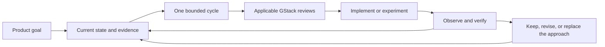

# Adaptive development with GStack

## Operating model

Keep the destination stable and the route revisable. The driving agent reads the product goal and current evidence, chooses one bounded cycle, uses the relevant GStack skills, implements or experiments, verifies what actually happened, and updates the project record. Plan detail grows only for the current cycle.

GStack supplies specialized review, debugging, QA, and delivery workflows. It does not inherently maintain this project's goal or state files, select a reliable long-term sequence, or prove completion because a skill finished. The driving agent performs that coordination through AGENTS.md.

## Sources of truth

| Artifact | Owner and update rule |
| --- | --- |
| PRODUCT_GOAL.md | Final product outcomes. Update only for an explicit user-approved change; increment the goal version and record why. |
| PROJECT_STATE.md | Latest observed capability state, active cycle, uncertainties, and exact resume action. Update after meaningful evidence and at every session/cycle handoff. |
| docs/cycles/NNNN-topic.md | One cycle's hypothesis, scope, plan, checks, observations, evidence, and decision. Update throughout the cycle; retain closed results. |
| DECISIONS.md | Durable product/process/architecture decisions, their source, and supersession. Routine check output stays in the cycle. |
| docs/designs/ | Approved product baseline and visual references. New operational decisions may supersede its build-order suggestions without rewriting historical approval. |
| GStack files under ~/.gstack | Supplemental review reports, working context, and caches. Reference or preserve useful results in the cycle; never leave the sole project decision/evidence reference only in a chat or temporary file. |

Git records changes together. An issue board, if later adopted, mirrors cycle IDs and links; it does not become a competing product goal. Do not create an external issue or change publication state just to make a planning tool appear complete.

## 1. Resume and select

Read the sources listed in AGENTS.md. Verify current files, branch, and relevant runtime state. If a cycle is open, resume it before starting another.

Choose the next cycle using these questions, in order:

1. Which missing final outcome does this advance, and what prevents proving it now?
2. Is there a high-impact unknown that can invalidate a lot of later work? Prefer a bounded experiment that resolves it.
3. What is the smallest connected behavior the learner can observe, or the smallest concrete blocker whose removal enables that behavior?
4. What observation would disprove the approach, and what artifact will let a later agent inspect the result?

Keep one current plan and a short list of possible follow-ups. Do not create a complete task tree, schedule, or technical design for all remaining capabilities. If the uncertainty is still broad, split it until one experiment has an interpretable result. Do not spend repeated cycles polishing a solved layer while a risk to the core experience remains untested.

## 2. Create or refine one cycle

Use [the cycle template](docs/cycles/TEMPLATE.md). Record a small scope, linked goal IDs, one primary question, expected observations, non-goals, and a decision after success/failure. A goal ID link means relevance, not completion.

A cycle may be an experiment, a product increment, or hardening. An experiment can legitimately end with a falsified approach. It cannot mark an unsupported capability verified. Product increments should preserve previously established behavior through appropriate regression checks.

Use a short implementation plan only after enough evidence exists to choose the approach. If a risk requires code to answer, the experiment itself is the bounded plan. Review that scope without pretending its uncertain outcome is already known.

## 3. Select GStack skills by the work

These mappings were checked against the installed skill definitions on 2026-09-18. Read the actual applicable SKILL.md at invocation because workflows can change. Apply the skill fully to the current cycle, not to every future capability.

| Trigger within this cycle | Skill | Useful output to preserve |
| --- | --- | --- |
| Product premise or final behavior needs reconsideration | /office-hours or /plan-ceo-review | A specific premise/goal decision. Routine development does not rerun the whole product brainstorm. |
| A lasting API/MCP interface or integration experience changes | /plan-devex-review | Capability/error/lifecycle contract and agent integration checks. |
| User flow, layout, information hierarchy, or interaction state changes | /plan-design-review | Cycle-specific UX decisions and state coverage, using the approved visuals as context. |
| Architecture, concurrency, storage, or meaningful implementation work | /plan-eng-review | The current cycle's implementation/test plan and failure handling. Run after preceding UX/API amendments. |
| The user chooses a combined review of a bounded cycle | /autoplan | Its CEO → conditional Design → conditional DX → Eng pipeline, scoped to that cycle. It is not a request for a whole-product waterfall plan. |
| Implementation produces an unexplained failure | /investigate | Root-cause evidence and one changed hypothesis before another attempt. |
| A working browser/webview flow needs behavioral validation | /qa or /qa-only | Reproduction, fixes or findings, and live-flow evidence. |
| Implemented UI needs visual/interaction validation | /design-review | Findings and observed fixes. Motion still requires video/frame inspection. |
| A meaningful code diff is ready for review | /review | Findings against the actual diff/revision, resolutions, and any missing review coverage. |
| A releasable increment is authorized for PR delivery | /ship | Commit/PR and required checks. A PR is not proof of merge or installation. |
| An authorized PR is ready to merge/deploy | /land-and-deploy | Actual merge/delivery/verification state; use the extension's established delivery process. |
| Delivered behavior changes public usage documentation | /document-release | Docs matching delivered behavior. Also update this project's state regardless of whether the skill touched it. |
| Pausing or moving to a new session | /context-save, then /context-restore when useful | Supplemental context. Update repository state first and reconcile restored context with it. |

Ordinary implementation is the coding agent's work, not an invented GStack implementation command. Small documentation-only changes do not need a full review pipeline. A failed hypothesis does not require a PR or release before its result can inform the next cycle.

Browser QA alone does not validate a native VS Code extension, DAP targeting, the embedded MCP service, or a packaged VSIX. Use the appropriate actual extension/debug integration harness alongside GStack. Missing browser/native tools are reported as missing coverage, not silently replaced by static checks.

### Invocation contract

For each review, pass the current cycle file and explain: the final goal is context; this cycle is the review scope; other modes and later capabilities remain in the goal but are not today's implementation. Preserve skill-required artifacts and summarize their relevant findings in the cycle record. Do not assume selecting a recommended option once authorizes every later product change.

Example request for a named scope:

> Run /plan-eng-review on docs/cycles/0001-click-pause-resume.md. Review only its bounded experiment. PRODUCT_GOAL.md defines the destination; it is not the current implementation scope. Incorporate relevant findings into the cycle plan and keep the resume action in PROJECT_STATE.md current.

If the invocation's scope is still unclear, follow the skill's scope gate. Do not claim prior goal approval is approval of an unwritten implementation plan. Conversely, do not ask again for routine work already authorized in the current session.

## 4. Implement and verify

Use an isolated branch/worktree when the cycle needs it, preserving other edits. Reuse current code from the three source projects after checking its actual condition. Freeze expected observations before evaluating results; if assumptions change, record a new expectation version and distinguish previous attempts.

For each observation record: environment and source revision (including dirty state), exact action, expected result, actual result, artifact location, and what the observation cannot prove. A partial capture or mocked harness may answer one question without proving the live product.

Store text manifests and small sanitized fixtures in the repository. Large/private recordings may live under ignored artifacts/ or another durable private store; the cycle must identify their path, availability, and checksums where useful. Before team handoff or deleting a workspace, move required evidence to an accessible durable location and update the manifest. A missing artifact makes the affected claim needs-revalidation.

## 5. Close, integrate, and select again

Cycle status: ready → planning → implementing → validating → closed. Use blocked with the exact condition and the next unblocking action. Changes may move an open cycle backward; record why.

Cycle result is separate: pending, demonstrated, falsified, or inconclusive. Delivery is also separate: not-applicable, local-only, committed, PR-open, merged, packaged, published, installed-verified. A local experiment can close without release; a shipping task stays open until its authorized delivery checks finish.

At closure:

1. Write observed results and available evidence; say whether the hypothesis held.
2. Record keep/revise/replace and why. Preserve unsuccessful approaches so the next session does not repeat them blindly.
3. Update PROJECT_STATE.md: only the capabilities this evidence supports, remaining gaps, active cycle or no active cycle, and exact resume action. Invalidate affected old claims when appropriate.
4. Record durable decisions; update implementation-facing documentation where behavior changed.
5. Select at most one next candidate from the new evidence. If more cycles are authorized, open it and repeat. Otherwise report the result and next action.

Run a goal-gap check every closure: which required capability is still furthest from proof, whether the current route still reaches recording and all three modes, and whether the next candidate addresses the actual bottleneck. Run integrated acceptance when multiple capability claims begin to depend on each other, not only after all features are written.

A material change to the product goal is escalated with its evidence and a concrete alternative. The agent can freely adjust the route inside the approved goal. Repeated inconclusive experiments require a smaller question or a different approach; they do not justify quietly dropping a required feature.

## Completion and restart

The product is complete only under PRODUCT_GOAL.md's final acceptance, including both additional modes. Completing one cycle, one plan review, or the default layout is progress, not that acceptance.

A new chat must be able to answer from the repository alone: the final experience, what is proven, what is not, which cycle is active, what failed, and the next executable action. Check that read path at handoff. Context-save is an optional accelerator, not the only continuity mechanism.

Reference: [GStack upstream](https://github.com/garrytan/gstack). Installed skill files under /Users/ryotamurakami/.agents/skills/gstack/ supplied the detailed mappings, including scope gates, review ordering, and separate ship/land/context behavior.
