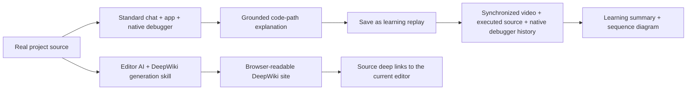
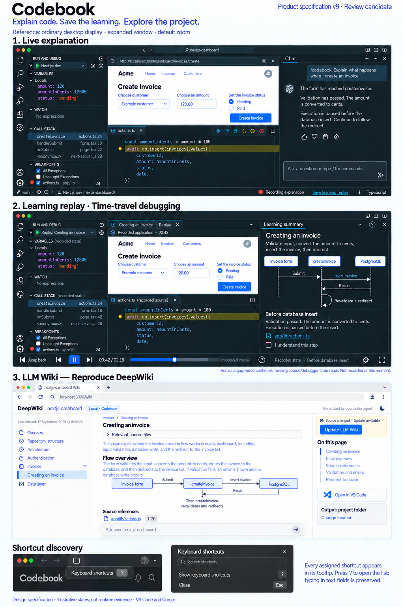
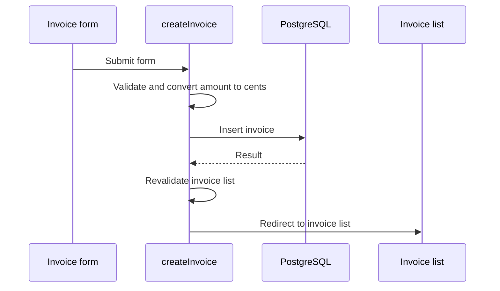

# Product goal

Goal version: 10\
Owner: Raphtalia\
Initial design approved: 2026-09-18\
Product direction: D030–D036 (2026-09-26: synchronized replay, skill-driven DeepWiki, desktop and shortcut contracts, adopted v9 visual target); target operating systems (2026-10-05)

This file owns Codebook's outcomes, feature contracts, design target and acceptance. It specifies outcomes, not implementation. Every section is normative. Read `## Final acceptance protocol` and the archived [skill][skill-plan] and [Wiki-generation][gen-skill] plans when their work is selected. The active cycle Issue holds implementation state and evidence ([AGENTS.md](AGENTS.md#where-things-live)). Historical evidence and external references are reference material. These requirements live here; an Issue may repeat one but is never its only place.

[design]: https://github.com/laststance/codebook/blob/docs-archive-2026-10-20/docs/designs/codebook.md
[design-arch]: https://github.com/laststance/codebook/blob/docs-archive-2026-10-20/docs/designs/codebook.md#architecture-and-evidence-ownership
[review]: https://github.com/laststance/codebook/blob/docs-archive-2026-10-20/docs/plans/cycle-0029-product-design.md
[review-states]: https://github.com/laststance/codebook/blob/docs-archive-2026-10-20/docs/plans/cycle-0029-product-design.md#pass-2--interaction-states-complete
[gen-skill]: https://github.com/laststance/codebook/blob/docs-archive-2026-10-20/docs/plans/deepwiki-generation-skill.md
[skill-plan]: https://github.com/laststance/codebook/blob/docs-archive-2026-10-20/docs/plans/bundled-codebook-skill.md

## Product purpose and feature relationships

Codebook helps the learner understand AI-written code, unfamiliar work codebases and OSS in **both Visual Studio Code and Cursor**:

| Feature | The learner | Result and relationship |
| --- | --- | --- |
| Live code explanation | asks the editor's standard AI chat to explain a real code path; the AI operates the real app and debugger, pauses in actual source, explains and continues. | In Copilot Chat or Cursor Agent, with the application/browser, native source editor and native debugger as execution context. No Wiki needed. |
| Learning replay / time-travel debugging | saves an explained session, then repeatedly plays, seeks backward/forward and revisits its recorded execution. | Application video, executing source and native-debugger history stay synchronized; a learning summary replaces the chat area; a library opens replays ([contract](#contract-learning-replay)). |
| LLM Wiki / DeepWiki | has the editor AI create/update the codebase's DeepWiki with a carefully authored skill; reads it, asks repository questions, follows source links into the local editor. | DeepWiki's full experience with local/configurable output, independent of live explanation, debug MCP, application browser and replay; the skill-driven agent owns generation quality ([contract](#contract-llm-wiki)). |

Replay and Wiki have distinct artifacts and lifecycles; shared source identities and optional source-based links neither merge them nor make one a prerequisite of the other. The screens need not show together.

**One UI design family, multiple feature screens.** The three selectable UI themes/layouts are retired; the replay and Wiki screens stay; no fixed arrangement must hold every feature. The entry is a Codebook icon in the editor's left Activity Bar, exposing Codebook navigation and actions. The owner adopted the v9 visual specification (D036, [Design target](#design-target)).

## Defining live-to-learning experience

In a real project with a purchase flow, the learner might ask:

> /codebook カートに入れてから購入するまでのコードパスを解説して

The chat AI inspects the repository, operates its actual application, pauses the debugger at meaningful source locations and explains, for example, how the purchase button relates to a backend POST request. It must tell a stop before sending from an observed sent request: a source line alone does not prove a completed network operation. The learner inspects variables, watches and call stacks in the **editor's native debugger**, then can save the session as a **learning replay with time-travel debugging**.

Purchase is only an example. Required targets use their own real behavior, including server, Chrome Extension, library test and supplied Example execution, in real opened repositories. The extension bundles no cart/sample target; a fabricated application never replaces a required target. Until final acceptance, development validation uses the owner-designated `nextjs-dashboard` checkout at `/Users/ryotamurakami/repository/nextjs-dashboard` (D031, [AGENTS.md](AGENTS.md#development-target)): development evidence only, not a tenth target, replacing none of the nine and filling or passing no final row. Final acceptance uses the unchanged nine-project matrix.

## Required final capabilities

IDs stay stable for historical evidence. Active: **G01–G07 and G10–G12**. G08/G09 are retired IDs, not pending features or passed checks. Each [AC row](#product-acceptance-map) names its goals.

| ID | Required outcome | Evidence before verification |
| --- | --- | --- |
| G01 | One natural chat request drives a meaningful code path in a real opened project through application/runtime operations, debugger stops, grounded explanations and continuation to an observed result. | Scenario and required causal links frozen before execution; the standard chat AI completes the flow with no prepared answers or manual wiring at any pause. |
| G02 | Reproduce DeepWiki itself for the opened codebase through the editor AI's generation skill. | [Wiki verification](#wiki-verification). |
| G03 | Explanations and replay use the correct target, source/version, pause generation and observed runtime facts. Native debugger views inspect live values during execution and recorded values during replay. | AC-LIVE; [replay contract](#contract-learning-replay). |
| G04 | Save the explained session as synchronized learning replay/time-travel debugging, with processing summary, sequence diagram and explanations. | [Replay acceptance](#replay-acceptance). |
| G05 | The learner owns saved learning material and explicit understanding/progress decisions. | AC-LEARNING. |
| G06 | The extension-owned MCP/native-debugger services support live explanation and synchronized learning replay; independent DeepWiki uses the editor agent's source/file capabilities and generation skill. | Actual external-chat runtime/replay use in each host, with target/source identity, lifecycle/error handling and recovery. Wiki transport: [skill-first generation](#skill-first-generation-architecture). |
| G07 | One coherent UI design supports live explanation, learning library/replay and independent Wiki entry points. | AC-ENTRY, AC-DESKTOP, AC-SHORTCUTS. |
| G08, G09 | **Retired:** the mandatory Living book (G08) and Guided walkthrough (G09) display variants. | D030 removes the selectable-theme requirement and defines learning replay and the independent LLM Wiki; reading/Wiki and live explanation/replay stay required above. |
| G10 | The packaged extension is useful on all nine required real projects, without a bundled target application. | The two-stage [protocol](#final-acceptance-protocol) in both hosts, on TypeScript and JavaScript targets: every applicable Web UI, Node server, Chrome Extension, library test and Example form; every library needs both tests and Examples; browser-only evidence shows no server or Chrome Extension support. |
| G11 | The complete active product experience works in both VS Code and Cursor. | Separate normally installed evidence per editor for standard chat execution, native debugger inspection, learning replay, independent Wiki/update/source links and feature navigation; one host's evidence verifies no other. |
| G12 | One bundled thin skill supports explicit `/codebook` use in standard Copilot Chat and Cursor Agent with ordinary skill/MCP setup. | [Skill section](#bundled-thin-skill-and-explicit-chat-entry); Final acceptance step 8. |

## Bundled thin skill and explicit chat entry

G12 is mandatory for every active capability. The standard chat surfaces are **Copilot Chat in VS Code** and **Agent in Cursor**. Users invoke the common skill explicitly with a natural request, not relying on automatic skill selection:

> /codebook ログイン処理を解説して
>
> /codebook このボタンを押してから画面が変わるまで、関係するコードと実際の値を見ながら説明して

Invocation puts Codebook's usage guidance in the chat AI's context so the AI itself performs the workflow. Discovering or loading the skill and performing the workflow are separate acceptance checks.

**One versioned artifact.** One common `SKILL.md` (frontmatter `name: codebook`) ships in the extension's VSIX, its version and content tracked and distributed with the extension; both editors share one procedure body. VS Code registers it through the official `contributes.chatSkills` contribution. In Cursor, the primary route is a Codebook setup operation in ordinary onboarding that installs it into the officially supported user skill directory (`~/.cursor/skills/codebook/SKILL.md`, to verify in the declared target version). Users never have to find, author or manually copy the skill body. A Cursor plugin-registration API is an alternative only once its normally installed target version shows skill discovery, `/codebook` visibility and actual invocation; an API name in documentation is no compatibility proof.

Track installed-file ownership, originating extension/skill version and content identity; document update, removal and restoration. Never overwrite or delete a pre-existing same-name user skill or later manual edits without the user's informed choice; a conflict keeps those bytes and offers an actionable resolution. User-level skill files are shared across windows, so dedicated windows do not isolate them: check ownership and current bytes before every update, removal or restoration.

**Thin shared procedure.** The skill connects the request to public Codebook capabilities:

- Route by feature. Live/replay uses Codebook's MCP capabilities and starts with `codebook_status` (workspace, instance, current capabilities), disclosing an unavailable connection. A Wiki request is routed before requiring `codebook_status`, to the shared generation guidance and the agent's normal workspace read/write capabilities, with no live run, debugger or debug-MCP connection; unavailable runtime MCP never blocks it.
- Follow the feature's public usage instructions and current state; for live/replay tools, refer to the MCP descriptions and public help instead of copying their contracts.
- Live: source inspection, application operation, actual pauses/values in the native debugger, chat explanation, continuation, synchronized learning replay. Wiki: the [generation skill][gen-skill] inspects the repository, generates/updates full documentation, diagrams/citations and Q&A context, then validates quality. The thin entry may delegate detail within the same versioned distribution; both hosts use one procedure.
- Distinguish observed facts, source reasoning and unverified boundaries. Take continuation arguments from the current execution state; never guess or reuse stale ones.
- Leave understanding checks to the learner; the AI never completes them for the learner.
- State missing connections, unavailable capabilities and unmet prerequisites accurately; general source commentary is no successful Codebook execution or observation.

The skill holds no repository-specific answers, correct stopping locations, expected variable values or test-only recipes: it is guidance, not an extra execution engine or answer key.

**One onboarding experience.** Public setup prepares shared skill availability and, for live/replay, MCP connectivity; registration alone establishes no runtime connection. Bind the dedicated work window and selected repository to the correct current Codebook instance; after a restart, keep a valid connection or follow the documented reconnection flow. Credentials, cookies, bearer tokens, private account material and ephemeral connection details stay out of `SKILL.md`, the VSIX, Git, evidence, public documentation and chat; use the supported private connection mechanism and record only sanitized identities.

**Optional future transport.** MCP Skills Extension / SEP-2640 ([background article](https://azukiazusa.dev/blog/mcp-skills-extension/)) may later distribute this same skill. At the research checkpoint its acquisition, host activation and slash-command availability were unproven in both editors, so product completion and the final campaign never wait for it. Such a route shares the bundled body/version and proves recognition and activation as a skill in each claimed host; text exposed as an MCP resource proves neither.

Specification, upstream documentation and registration metadata are not implementation or ordinary-install validation ([skill plan][skill-plan]).

## Product constraints

- **Architecture B** for live execution and replay: the extension owns runtime state, immutable evidence and recording correspondence; the editor chat AI reasons and explains through the API. The Wiki is [skill-first](#skill-first-generation-architecture) (D033).
- Standard chat is the live explanation surface; native source editors and debugger views serve live and recorded source/value inspection. Codebook's custom runtime-value display (duplicate values panel, Variables/Watch clone) is retired; historical value inspection is not.
- Remove the active cart demo project, its packaged copies/assets, launch entry points and fixture-specific product instructions. Historical reports stay historical evidence; source history is no supported target. Small isolated unit-test inputs may test mechanisms but never replace real-project trials or ship as a demo application.
- Chat, summaries, diagrams and Wiki pages distinguish observations, source-based reasoning and unknown boundaries; source-derived documentation is no evidence of executed behavior.
- Preserve source/version context; disclose missing, truncated, redacted, partial or stale evidence. Learning and saved replay stay available without the original chat.
- **Layout (D034):** an ordinary desktop display, editor/browser window expanded to the available space, normal/default zoom. OS full-screen is optional; extremely small windows and extreme zoom such as 200% are outside mandatory design and acceptance. At this layout, keep keyboard access, meaningful labels, focus/reading return, native themes (the four supported editor themes), readable contrast and reduced-motion behavior.
- **Target operating systems** (owner, 2026-10-05; version 10 adds this constraint and no feature, and the v9 image stays the visual target): macOS, Windows and Linux, with Ubuntu as the supported distribution. Evidence names its system and stays separate per system, as per editor; a result on one verifies no other. Native use in a Windows editor comes in its own feature cycle, which also proposes how final acceptance, the nine-project rows included, covers the three systems; this version does not decide that.
- **Shortcuts (D035):** every assigned shortcut shows in its UI tooltip; **?** opens the list in eligible non-editing contexts ([contract](#contract-keyboard-shortcuts)).
- **Visual target (D036):** implement the corrected v9 hierarchy and accepted interactions with each host's native surfaces ([Design target](#design-target)). The three old images are historical references only.

## Final acceptance

1. Freeze before results: final source revision; distributed VSIX/version/SHA-256; common skill body/version/hash; registration/setup and guide revisions; host/OS/chat/debugger/browser identities and supported dependency versions; target revisions; scenarios, natural questions/objectives and observable criteria. The bundled cart target is gone from source, build and package paths.
2. Per host, standard `/codebook` chat and public onboarding complete meaningful real-project code paths with their required causal boundaries; native debugger/source inspection and truthful failures, with no custom values panel.
3. Saved as replays, those explanations pass the [replay acceptance](#replay-acceptance).
4. The repository's independently generated DeepWiki passes the [Wiki verification](#wiki-verification).
5. Feature screens and entry point match the [Design target](#design-target) at D034, including focus, keyboard/theme/reduced-motion behavior and preservation of unrelated work; the [shortcut acceptance](#shortcut-acceptance) (D035) passes. Switching among the retired theme variants is no acceptance step.
6. [Stage 1](#stage-1-main-agent-practical-validation) completes every project/host/use-case row of the [nine projects](#required-projects) through normal installed use.
7. [Stage 2](#stage-2-nine-independent-junior-developer-reviewers) passes every required assessment ([verdicts](#verdicts-and-evidence)).
8. G12 is verified separately in both stages, as four distinct findings per host: skill discovery and invocation, actual context loading (bundled vs loaded guidance identity), the correct current live/replay MCP connection, and AI-owned results for each feature, with missing-connection guidance, restart/reconnection, unavailable states and protection of existing skills/settings/work. Wiki generation quality and runtime-MCP independence are reported separately, with runtime MCP unavailable.
9. [Retesting](#retesting-and-final-artifact-validity) keeps every final PASS valid for the final fixed distributed VSIX.
10. Closure: all valid Stage 1 and Stage 2 rows; current evidence for all active IDs and integrated feature behavior, linked in the active cycle Issue; a verified distribution artifact; Raphtalia's separately recorded acceptance, which no subagent can give. Goal Issue #1 stays open until then.

Historical protocols and cycles keep the criteria of their time and never override version 10. Claude Code CLI review stays owner-skipped and is not native editor-chat acceptance.

## Design authority

The [Design target](#design-target) is the visual authority. Open and visually inspect [the actual PNG](docs/designs/assets/codebook-product-spec-v9.png). The implementation loop is in [AGENTS.md](AGENTS.md#working-loop); the complete acceptance map is [below](#product-acceptance-map).

## Contract: learning replay

### Purpose and screen hierarchy

Learning replay lets a learner repeatedly inspect how application behavior matches the code that executed and the runtime state at that moment. It is saved from a real code-path explanation in standard Copilot Chat or Cursor Agent while the AI operates the actual project and debugger. Its center is synchronized playback and time-travel debugging; the summary supports it.

The screen keeps the live composition: the recorded application, the historical executed source in a native source editor and historical values/call stacks in the standard debugger. The chat area becomes a **learning summary** (processing summary, saved explanation, sequence diagram): a Codebook-owned replay surface, not a replacement chat client or a change to native chat internals. The Activity Bar entry opens the learning library and the selected replay. A document-like reader with a small video thumbnail and source links never replaces synchronized source/debugger history. The native debugger is the inspection surface, live and in replay.

#### Desktop layout and summary visibility

At D034, video, source, native debugger and summary show together. Approved **5A**: when space is limited, the summary may collapse behind a visible **Learning summary** button, keeping priority for application/source/debugger; opening/closing keeps the selected moment, historical debug context, reading position and keyboard focus. Preserve manual layout choices and unrelated native panes.

### Shared historical moment

Play, pause, step backward/forward and seek share one selected recorded moment. Revisiting it recovers the same application frame, executed source version/location, debugger values/stack and explanation, so earlier and later states compare without rerunning the application.

| Surface | Required correspondence |
| --- | --- |
| Recorded application | The captured frame for the selected time, identified as recorded. Server/test/extension evidence never invents a Web UI. |
| Native source editor | The source version that actually executed, at its location; a current checkout file or a merely related source link is insufficient. |
| Native debugger | Recorded values, scopes and stack of the same context, in a replay debug context labeled so it cannot pass for a running target; required values stay inspectable after the original debugger exits. |
| Learning summary | The overall summary and the selected step's explanation/sequence correspondence, separating the complete path from what had happened at that instant. |
| Playback controls | One playhead/step for every surface. Historical state stays visibly selected while paused; earlier values never mix silently with later video. |

Capture skew, intervals without a source/debug observation and truncated/redacted values stay explicit. Never interpolate a value, fabricate an executing line or carry the last observed state forward as if fresh. Unsupported capture fidelity at a required point is an implementation gap, not an alternative design. Sampling, storage and debug-adapter mechanics belong to engineering planning, under these outcomes.

#### Partial history (approved choice 4A)

Where video exists but source or debugger history is missing, the video keeps playing and the shared timeline marks the interval. Affected source/debugger surfaces show **Not recorded at this moment** (Japanese: **この時点は未記録**), never another moment's line highlight, values or call stack. Genuinely available same-moment evidence stays, with its identity; never imply an absent observation. This holds in playback, direct seeking and backward/forward navigation: entering a gap clears any highlight or debugger state that would look current; a recorded point restores its captured context at the shared playhead. A gap neither pauses playback nor asks for confirmation; the learner can still pause or seek with the ordinary controls. This recovers playback and permits no omitted capture: missing history at a required acceptance point stays unverified and cannot PASS.

### Capture and saved learning artifact

Video/source/runtime capture starts early enough to keep the session; a later save cannot recreate uncaptured execution. Finalization reports complete or partial capture. Private buffering or an explicit start is an engineering choice that must disclose capture state and keep the required history. Owner choice **2A**: during live explanation, the bottom status area shows capture state and **Save learning replay**, extension-owned controls outside the standard chat UI, usable while the learner reads the chat or inspects source/debugger state.

| Content | Required behavior |
| --- | --- |
| Question and source identity | Natural question, project/revision, actual source hashes, session identity, capture time; dirty source identified, never shown as the commit. |
| Processing summary | Purpose, main steps, inputs/results and important branches of the actual explained path; unobserved outcomes identified. |
| Sequence diagram | Participating UI/components/services/functions and ordered interactions; meaningful steps link to their source, explanation and recorded moment. Observed interactions, source-derived relationships and unknown boundaries stay distinct; a stack alone cannot prove every async arrow. |
| Saved explanation | Meaningful-stop explanations, source anchors and supporting evidence, readable after the original chat closes. |
| Execution recording | Application frames where applicable, ordered actions/pauses, historical source, durable values/scopes/stack sufficient for native debugger replay; live debugger handles are never persisted or reused as durable values. |
| Learner state | Selected moment/playhead, reading context, explicitly marked understanding/progress; execution success or saving never marks understanding. |
| Limitations | Partial/interrupted capture, unavailable/redacted facts, skew, source drift; failures stay inspectable. |

Internal evidence still grounds explanations; D032 also requires recorded runtime state in the native debugger during replay, not only private facts or quoted text.

### Time travel and independence

Replay navigates captured history: it never sends another purchase request or reruns other side effects; a deliberate new execution is a separate live run. Replay controls never resume an unrelated live debugger or borrow its state. The native debugger may use a dedicated historical session; this contract does not freeze its implementation.

A replay needs no Wiki or Wiki-generation job. It may link to repository documentation, but its recording storage, playback/debug context, learner progress and source snapshots are independent. Regenerating, relocating or deleting Wiki output never erases a replay or changes its explanation, sequence or captured history. Wiki pages never become lessons or gain learner progress automatically.

### Replay acceptance

Per host, with a real project and a natural question, explain a real code path through standard chat and actual execution, crossing several meaningful source/runtime states, and save it as one replay; complete or partial status is reported. Stop the original application/debugger, close the chat, reopen the replay from the library, then prove:

1. Playback shows the recorded application with the source executing at that moment and the native debugger moving with it; a pause shows that point's recorded values and call stack.
2. Backward/forward steps, non-adjacent seeks and repeated replay of an interval return identical historical state, with no target state change, new application run, side effect or unintended live-debug change.
3. Summary/sequence navigation to a recorded step keeps time, source, debugger and reading context aligned and stays grounded; current source opened separately discloses drift without rewriting the recorded version.
4. Understanding is marked only by explicit learner action; after an editor restart, progress, the saved playhead and its source/debugger context return, and drift never replaces recorded state with current values/files.
5. A controlled interval with video and no source/debugger history shows 4A in playback, direct seeking and repeated traversal; required absent evidence still prevents PASS.
6. Partial, skewed, truncated or unavailable evidence keeps accurate labels and source/time identity; Wiki generation/update leaves the replay and progress unchanged.

Record native operation as video, extract and inspect frames for temporal correspondence and motion, and bind evidence to source/package/host/theme/viewport identity. A static screenshot, generated image, source-link-only reader or video plus summary without native historical inspection does not verify this feature.

## Contract: LLM Wiki

"LLM Wiki" is the feature name. **Its final product target is to reproduce DeepWiki itself: repository documentation, reader/navigation, diagrams, source citations and repository question answering.** At the owner's explicit request DeepWiki is the reference product, not a loose style label.

### DeepWiki is the acceptance target

Reference: the real [DeepWiki repository reader](https://deepwiki.com/microsoft/vscode), inspected read-only on 2026-09-26 (no question, upload or indexing request sent): repository header, indexing context, hierarchical chapter navigation, a substantial article with relevant-source disclosure and inline citations, an on-page outline, diagrams and an anchored repository-question composer. The [official description](https://docs.devin.ai/work-with-devin/deepwiki) names generated architecture documentation, source links and code-grounded Q&A as core functions. Required fidelity:

- A complete, coherent repository-wide chapter hierarchy from the actual source: overview, architecture, major subsystems and modules/responsibilities, important code paths and processing relationships, supporting concepts, with source-cited explanations and diagrams where they clarify the code. A single chat answer, a page about one recorded session or disconnected source excerpts is insufficient.
- DeepWiki's reading/navigation hierarchy, content density, relevant-source disclosure, inline file/location citations, page outline and diagrams. The specification image visibly names **DeepWiki reproduction** as its target.
- Working repository Q&A in the reader, with source-grounded answers and usable citations; a drawn question box is no functional proof. Model/agent prerequisites stay visible; reading continues without them.
- The accepted Codebook additions stay: local/configurable output, explicit chat/browser-button updates, an independent lifecycle and citations into the user's matching local VS Code/Cursor checkout. Source and output stay local under the configured agent's normal setup; indexing in the hosted DeepWiki service is not required.

Codebook's source links and local generation are deliberate adaptations. The reference observation is no evidence that Codebook implements any of them.

### Skill-first generation architecture

Under D033, the primary generator is the **editor's AI agent following a carefully authored DeepWiki generation skill**: it reads the opened codebase and writes/updates the Wiki's files and content. The skill defines source exploration, chapter planning, explanatory depth, diagram construction, file/line citations, cross-links, output structure, update handling and quality checks; the [generation-skill plan][gen-skill] owns this quality contract. `/codebook` delegates Wiki work to it ([routing](#bundled-thin-skill-and-explicit-chat-entry)).

The extension supplies output configuration, update/open actions, source deep links and understandable state. Update/status/source-opening transport between reader and agent is supporting infrastructure: it never requires runtime/debug MCP or replaces the generation skill; no large MCP Wiki engine is required; a thin bridge may start the skill and return status/results. Interactive Q&A uses the configured agent/provider with source context, with no live-debugger or learning dependency.

Generation, updating and browsing need no live explanation, debugger session, application browser, runtime launch, learning replay or learning-item selection. A Wiki describes source-derived structure and logic and never labels unexecuted paths as runtime observations. It may share repository/source-link utilities and optional links with other features, with its own jobs, output and freshness state.

### Output, generation and update

- Durable site files go inside the project folder by default; a setting selects another location, and the resolved destination shows before generation/update. The setting key and folder name are engineering decisions, not frozen UI design.
- The site is browser-readable locally, navigable across overview, architecture and module/detail pages, and readable without a running debugger, application or the original chat; any local serving prerequisite is part of ordinary documented use.
- The primary route is a regular web browser; an in-editor view is an optional convenience, and external-browser use stays required.
- Generation owns only its identified output: it preserves project source, unrelated files and manual edits and discloses conflicts before replacement. Changing the output setting never silently deletes prior output or learning records.
- After an editor restart the Wiki reopens without corrective seeking or hidden repair.

| Action or state | Required behavior |
| --- | --- |
| Generate | From normal chat or Codebook's Wiki entry: inspect the actual included sources; create the navigable site with a source/version manifest and a visible completion state. |
| Source changed | Flag possibly outdated content against the current included source set (additions, edits, deletions) and show the last generation/update context; old pages are never presented as current. Detection/indexing is an implementation choice. |
| Update from chat | A natural request such as "Update the LLM Wiki for this project" starts the update without launching the application or debugger. |
| Update from UI | Owner choice **3A**: an **Update LLM Wiki** button beside the browser Wiki's freshness state hands off to the correct project's editor/agent and starts the same skill update, with no retyped instruction. The site stays readable while the editor is absent or updating. |
| Update processing | Re-read current source; refresh affected explanations, diagrams, navigation and citations, including removed/renamed files and stale pages. Full regeneration is acceptable; no incremental indexing engine is prescribed. |
| Success / failure | Progress and a clear result; a coherent published result. Failure/cancellation keeps the last usable output with accurate freshness; success is never reported while stale pages survive unnoticed. |

Updates come only from explicit chat or button requests; automatic background regeneration is not required. Model/provider orchestration, dependency tracking and publication mechanics are engineering decisions; costs and prerequisites stay visible in normal setup. Generated output and excluded/sensitive paths never feed ingestion recursively. Record the included source scope and revision/content identity so freshness and citations can be checked. Private code and generated pages stay local unless the user separately authorizes publishing them.

### Deep links to source

Citations open the cited file and location in the editor in use: VS Code for a VS Code project, Cursor for a Cursor project. Bind the correct project root, so that a similarly named file or another checkout never receives the link. Moved projects, unavailable files and source drift get understandable guidance. Cited version context stays visible; current navigation stays distinct from historical cited text. Delivered reference, no further requirement: besides the inline citations, every page's right rail has **Open in VS Code** (**Open in Cursor** when Cursor's reader serves the page), which opens the page's first cited source at its cited line and names that file and line under its label.

One generated site may be opened from either editor. Its durable static pages keep a VS Code protocol fallback; the Codebook reader serves source and update links with the active host's registered scheme without changing the published files. A Cursor update keeps the VS Code fallback and both-host reader behavior. Direct offline file browsing stays readable, but its source/update links open only the editor named by the static fallback. Browser/OS protocol permission and editor installation belong in ordinary onboarding; generated pages never embed credentials or private connection tokens.

### Wiki verification

Per host, with no runtime/replay prerequisite and debug MCP unavailable, the normal editor AI uses the shared generation skill (identity verified) on a real opened project. Verify every rule of this contract against the reference and the accepted image: navigate several chapters, ask a real repository question and follow citations to the correct editor, checking actual browser-to-editor activation and source selection (plain source text or a clickable-looking label proves no deep link). Mutation controls (additions/edits/deletions, failure/cancellation, manual-file conflicts) use isolated owned copies; required real-project trials preserve owner work. Saved replay/debug history and learner progress stay intact. The reader follows the [Design target](#design-target) and [shortcut contract](#contract-keyboard-shortcuts) at D034; the [working loop](AGENTS.md#working-loop) requires actual image inspection and applicable acceptance evidence.

## Contract: keyboard shortcuts

### Every assigned shortcut is visible

- An action with a shortcut shows its operation name and key combination in its UI tooltip, as in the owner's reference: plain operation text, then a distinct key label. Pointer hover and keyboard focus both show it. The action has its own meaningful accessible name; a shortcut alone is no action label.
- Use the correct editor/browser, platform notation and active feature context. Tooltips, the list and actual behavior agree, accounting for supported rebinding and conflicts; a known stale/default binding is never presented as current.
- No invented shortcuts for unassigned actions. Native editor controls keep their host behavior and key labels. The supplied Codex screenshot assigns no Cmd+B or other Codex binding to Codebook.

### Question-mark shortcut list

**?** in a Codebook-owned, non-editing UI context opens **Keyboard shortcuts**, as does a visible **Keyboard shortcuts** control with a **?** key label and matching tooltip. The generated browser Wiki offers the same pattern, independent of runtime/debug MCP. As in the owner's reference, the list is titled and searchable: operation names on the left, key combinations on the right, grouped by feature, the help-opening shortcut included, only real assigned actions, each with its context. An empty search says that no shortcuts match and lets the query be cleared. A Wiki does not give its browser-only bindings the power to invoke arbitrary native editor commands.

The list is a keyboard-accessible dialog: opening places focus inside; search/filtering and scrolling work by keyboard; Escape and a clearly labeled close control dismiss it; closing returns focus to the invoking control/context without changing the replay playhead, reading position or learner state. Repeated **?** never opens duplicate dialogs. The search/index mechanism is an implementation choice.

### Preserve normal typing and host behavior

Unmodified **?** acts only while a Codebook UI context is active and the user is not editing text. In chat, Wiki questions/search, source editing, terminals, other text inputs/contenteditable fields and IME composition it is never intercepted and inserts/composes text normally. No global system binding or replacement native chat/debugger shortcut is authorized. The visible control and ordinary host command discovery give access when text focus makes **?** inappropriate. Respect active context, unavailable actions and existing user key assignments. Supported binding resolution, event routing and host APIs are established during engineering implementation, not inferred from this contract.

### Shortcut acceptance

At D034, in VS Code, Cursor and the generated browser Wiki, verify every rule above against actual bindings and available contexts, plus platform notation, supported binding changes/conflicts, disabled states and a no-match search; replay time, source/debugger identity and reading context stay unchanged. A key label drawn in a mockup proves no working shortcut. Keep the ordinary keyboard, focus, theme, contrast and reduced-motion checks. Record actual interaction and inspect video frames where motion/focus transitions matter.

## Design target

Status: owner approved on 2026-09-26 (D036); the corrected iteration 8 is adopted unchanged. Authority: this goal, D030–D036 and the archived [behavioral design][design].

### Open this image before implementing

**This is the product's visual target. Open the actual PNG and inspect it with an image-viewing tool.** Read the required contracts in full and record entry and verification receipts, this inspection included, in the active cycle Issue ([Mandatory entry](AGENTS.md#mandatory-entry), [Working loop](AGENTS.md#working-loop)). The image header's "Review candidate" predates adoption; the approval and D036 set its status, and its bytes are unchanged since. GStack design discovery uses this section. Read the [behavioral design][design] before runtime/capture/replay changes and the [state/interaction review][review] before UI implementation.

The sheet is a specification board of one design family with separate feature screens, not one screen with every feature. Host-owned VS Code/Cursor chrome uses each editor's native UI. Sample values, filenames, line numbers and timestamps are illustrative: neither pixel-exact native requirements nor execution evidence.

### Required visible outcomes

| Image region | Outcome | Acceptance |
| --- | --- | --- |
| 1 — Live explanation | Explanation in standard Copilot Chat/Cursor Agent beside the actual app, stopped source and native debugger, with native source/value inspection; bottom status with capture and **Save learning replay** (2A). | G01/G03/G06/G11/G12; AC-LIVE/AC-SAVE |
| 2 — Learning replay | The [replay](#contract-learning-replay): live composition with **Learning summary** in place of chat; one recorded playhead for video, executed source and historical native-debugger values/scopes/stack. | G03/G04/G05/G07; D032 |
| 2 — Summary and gaps | Summary/sequence for time travel, explicit understanding, 5A collapse/reopen, 4A gaps. | AC-REPLAY/AC-GAPS/AC-LEARNING; D032/D034 |
| 3 — Independent DeepWiki | [DeepWiki reproduction](#contract-llm-wiki) by the editor agent's generation skill, independent of live/replay and runtime/debug MCP. | G02/G06/G12; D033 |
| 3 — Update/output/source | Browser **Update LLM Wiki** (3A), freshness, project-local/configurable output (Change location reaches ordinary settings), citations into the local editor. | AC-WIKI-UPDATE/AC-SOURCE-LINKS |
| Shortcut strip | Assigned shortcuts in action tooltips; **?** opens the searchable **Keyboard shortcuts** list; question-mark typing works. | D035; [shortcut contract](#contract-keyboard-shortcuts); AC-SHORTCUTS |

The Activity Bar entry and learning library are required, although the board emphasizes an opened learning item. The image does not exhaust loading, empty, error or unavailable states: implement the full [review state table][review-states] and the contracts. The board adds no selectable theme trio.

### Layout and accessibility baseline

D034 is set in [Product constraints](#product-constraints). Verify actual UI and motion in both hosts: visual comparison and motion evidence come from real UI, and this raster, the target, proves none of those behaviors.

### Example causality and evidence boundary

The illustration uses the owner's `nextjs-dashboard` at the inspected source revision `26e5b2c`. Read-only inspection of `app/ui/invoices/create-form.tsx` and `app/lib/actions.ts` established this source path:

Both compact raster diagrams keep ownership: PostgreSQL returns a result; createInvoice revalidates and redirects (a self-loop in the replay sequence, a note in the Wiki figure); the flow above expands that simplification. Failed validation/database operations take their actual paths in real explanations. No application, database, debugger or editor AI flow ran for this image; the sample amount/customer, frames, line numbers, times and URLs are illustrative. The selected before-insert moment is distinct from the full summary and does not establish that insertion or redirect has completed. Never embed this example as an answer key in skills or acceptance.

### Approval and verification boundary

GStack evaluated all seven design passes; the owner answered **採用する。修正版v9を視覚仕様にする（推奨）**; D036 adopts the corrected image. Design review and approval establish no implementation, native proof, accessibility, motion, packaging or final acceptance.

### Inspected references

Native editor surfaces follow [VS Code Views](https://code.visualstudio.com/api/ux-guidelines/views) and [Webviews](https://code.visualstudio.com/api/ux-guidelines/webviews): the Activity Bar exposes navigation rather than directly launching a webview; Codebook actions use appropriate view controls; native editor vocabulary rules over generic marketing typography. The D033 [DeepWiki reference](#deepwiki-is-the-acceptance-target) had reader typography Geist 16px/24px body, 22px/30px headings, text `#333333`, background `#F8F7F6` (the generated raster is no CSS measurement). Local source links replace hosted destinations; hosted publishing/promotional actions are outside this local product requirement.

| Field | Value |
| --- | --- |
| Current approved file | `docs/designs/assets/codebook-product-spec-v9.png` |
| Dimensions / bytes | 1024 × 1536 / 1,878,402 |
| SHA-256 | `f189ee82541a72ed981e3f7a0e21bd35a19b6601df1c7208671117a335caf2aa` |

## Product acceptance map

This map covers G01–G07 and G10–G12 (G08/G09 retired) and defines outcomes; the linked contracts control details; the active cycle Issue records implementation, proof and next actions. Keep all 13 rows when updating it.

### Observable completion checks

| Check | Goals | Outcome and required failure/preservation checks | Image region |
| --- | --- | --- | --- |
| AC-LIVE | G01, G03, G06, G11, G12 | G01 from a natural `/codebook` request in ordinary Copilot Chat and Cursor Agent, with native source/debugger usable beside the application. Wrong/background target, stale pause or reference, manual resume, source drift, an unavailable connection and missing/unresolved causal links stay explicit. [Defining experience](#defining-live-to-learning-experience); [runtime ownership][design-arch]. | 1 |
| AC-SAVE | G04, G05, G07, G11 | The [saved artifact](#capture-and-saved-learning-artifact) via bottom capture status and **Save learning replay**; saved items open through the learning library. Empty/loading/finalizing/failure/partial states are truthful; a failed save claims no durable completion; existing saved material and manual edits survive. [Review state table][review-states]. | 1 bottom, 2 |
| AC-REPLAY | G03, G04, G06, G07, G11 | [Shared historical moment](#shared-historical-moment) and [replay acceptance](#replay-acceptance) (D032, 5A). | 2 |
| AC-GAPS | G03, G04 | [Partial history](#partial-history-approved-choice-4a), also under direct seeking and repeated traversal. Required positive-flow history gaps still fail acceptance; the negative-control pass only proves truthful handling. | 2 timeline/caption |
| AC-LEARNING | G05 | Learner state, summary and sequence of the [saved artifact](#capture-and-saved-learning-artifact) and [replay acceptance](#replay-acceptance) 3–4. AI execution, a save or a Wiki update never marks understanding or rewrites past learning; Wiki generation needs no learner ledger; source changes signal review without erasing history. | 2 summary |
| AC-WIKI | G02, G06, G11, G12 | [DeepWiki fidelity](#deepwiki-is-the-acceptance-target) through the shared [generation skill][gen-skill], with runtime/debug MCP unavailable ([Wiki verification](#wiki-verification)). An outline, stub Q&A or generic Markdown viewer cannot pass. | 3 |
| AC-WIKI-UPDATE | G02, G11 | [Output, generation and update](#output-generation-and-update), including 3A. | 3 update/output |
| AC-SOURCE-LINKS | G02, G03, G11 | [Deep links to source](#deep-links-to-source). Replay citations keep their recorded-source context; reading return restores the originating location; reading stays usable if opening the editor fails. [Behavioral design][design]. | 2/3 source references |
| AC-ENTRY | G07, G11 | The left Activity Bar icon leads to the learning library/replay and the independent Wiki, distinct screens of one coherent design. Unrelated editor groups, focus and reading state survive; old theme-selection/product flows are removed. [Behavioral design][design], [review][review]. | 1–3 |
| AC-DESKTOP | G07, G11 | The D034 layout rules in both hosts and the Wiki browser, with usable controls/text and summary collapse/open keeping the learning context. Record the actual host/display/window/theme/zoom. | all |
| AC-SHORTCUTS | G07, G11 | [Shortcut contract](#contract-keyboard-shortcuts) (D035). | shortcut strip |
| AC-SKILL | G06, G11, G12 | [Bundled thin skill](#bundled-thin-skill-and-explicit-chat-entry) in both standard chats through ordinary setup, verified as in Final acceptance step 8. Packaging, registration, discovery or loaded guidance alone is not workflow success. [Skill plan][skill-plan]. | — |
| AC-REAL-PROJECTS | G10, G11 | Cart removal ([Product constraints](#product-constraints)), the dashboard for development ([Defining experience](#defining-live-to-learning-experience)) and the [nine projects](#required-projects) in both hosts at final acceptance. Inspect the final VSIX contents; preserve unrelated projects. | — |

## Final acceptance protocol

D029 fixes nine projects, each mandatory in both VS Code and Cursor, in two ordered stages; D030/D032/D033 define the evaluated behavior. The set is fixed, not a candidate pool: no deletion, easier substitution, demo or fixture replacement; historical fixture, demo and development preflight results fill no cell. Version 5's ten consecutive fresh reviewers, random selection, ten-repository recommendation, reuse and reset-to-zero (reviewer 1) policies are replaced; no consecutive-pass counter applies.

### Required projects

| ID | Required project (P02–P09 on `https://github.com/`) | Execution mapping |
| --- | --- | --- |
| P01 | Designated private work application (`zumen-fe`) | Next/React Pages Router |
| P02 | `TanStack/query` | Library tests + browser/Node SSR Examples |
| P03 | `reduxjs/redux` | Library tests + browser Examples |
| P04 | `reduxjs/react-redux` | Library tests + Next RSC Example |
| P05 | `reduxjs/redux-toolkit` | Library tests + browser and Node Examples |
| P06 | `laststance/bookmark-xp-explorer` | Chrome MV3 popup/fullpage + service worker |
| P07 | `laststance/nsx` | Vite Web UI + Express Node server + Chrome MV3 popup/content/service worker |
| P08 | `laststance/switch-time` | Web app + Hono Node API |
| P09 | `laststance/gitbox` | Next Web UI + server-side actions/authentication |

The library labels encode the owner's mandatory test-plus-Example requirement, not inspection results. The D034 layout changes no project or runtime row.

### Mapping and evidence rules

TypeScript and JavaScript are required. Before trials, inspect each repository's code/configuration at a pinned revision and expand it into rows for every applicable form: Web UI interaction, Node.js server processing, Chrome Extension contexts, library tests, library Examples. Record the mapping's source/configuration paths, entry points, real commands, dependencies, normal setup burden and required use cases. Never infer forms from repository names or assume a browser/Next.js-only scope; browser-only evidence establishes no server or Chrome Extension support. Per host, as separate rows, every library needs real test-executed code explained step by step and an executed Example's code/behavior explained; static source summaries cannot pass. Necessary unsupported forms are development gaps; support never narrows after finding them. NOT APPLICABLE needs code-based grounds and never removes a required target or its applicable runtime. Missing prerequisites or external dependencies are NOT RUN or BLOCKED with reasons, never PASS.

An Example that loads a library from a remote or unpinned source does not count as the checked-out library: establish a pinned correspondence first, and where an Example depends on a published version, verify that it matches the checked-out source before the trial. Chrome Extension rows need real extension contexts and isolated test data, not an HTTP-only reproduction. An internal test bypass never rescues an acceptance flow: establish the normal local service, dependency, auth and database prerequisites, without production data.

Each stage has at least 18 project-host assessments, more with expanded use cases. Per host, the three feature areas are verified independently (Final acceptance 2–4); retired display themes are no rows; a new specification, an old fixture run or a coupled Wiki reader earns no PASS.

**P01** is exactly the owner's existing private work checkout named in the request, not an interchangeable application; its absolute local locator lives only in ignored private campaign metadata. Inspect it without changing the working tree, inventory existing changes, use authorized isolation when needed. Publish only the P01 alias and sanitized outcomes, never private source, business data, credentials or recordings; private evidence needs stable restricted locations and hashes, not copied contents.

### Stage 1: main-agent practical validation

When the complete candidate reaches the campaign, freeze it (Final acceptance 1; unknown identities recorded honestly) and run the actual rows with the packaged, normally installed extension and published setup/operations, as a paying customer would, in ordinary Copilot Chat and Cursor Agent with explicit `/codebook`. A development extension host is no acceptance evidence. The main agent personally completes every project/host/use-case row first, through ordinary onboarding and the stages below, stepping and resuming as needed, and verifies the features' ownership and independence. Record setup effort and whether ordinary users understand errors and can follow documented recovery. When development repairs are needed, preserve the failures, then install a newly identified package and retest normally.

**Stage 2 starts only after all nine projects, both hosts and every required use case pass Stage 1, and the complete candidate has every active capability and integrated feature evidence under version 10.** Development successes never become Stage 1 passes later.

### Stage 2: nine independent junior-developer reviewers

One fresh independent SubAgent per project (nine, owner-authorized), a junior developer new to the project's internals, personally operates and evaluates it in both hosts, results separate, across all required use cases. It gets only the frozen candidate, normal product documents, available target documentation, neutral natural understanding tasks and this protocol; never forked development history, main-agent model answers, internal workarounds, right stops/value lists, previous evaluations or prior verdicts. Reviewers may inspect actual source and runtime for their own understanding; the main agent never performs missing operations or finishes their interpretation. Serialize native operations against contention when needed. Passes need not be consecutive; one failure never blocks independent evaluation of another ready target.

The central question: does normal use make this project's code easier to understand, without a material obstacle for a paying user, and can the reviewer justify that with confidence of at least 9/10? Confidence is subjective assurance about the evaluation, never a statistical success probability, unset until an actual evaluation.

### Mandatory stages in each editor

| Stage | Required operation and proof |
| --- | --- |
| Normal installation | The frozen VSIX through the documented ordinary-editor path; verify archive hash, loaded extension version/build, host/debugger/browser identity, bundled skill version/content identity and no cart/sample target inside. Development-host or source-loaded execution fails. |
| Public onboarding | Dedicated work window on the selected repository; published setup for skill guidance and the live/replay MCP connection (G12 routes); record prerequisites, settings, owned-file receipts and integration steps. No hidden test wiring. |
| Loaded skill and explicit entry | The skill the host actually resolved/loaded (path/origin, version, content hash) against the VSIX, same-name overrides included; `/codebook` discovery and explicit context loading observed separately. A slash label or equal disk bytes alone is insufficient. |
| Actual AI chat | Computer Use or equivalent native UI control submits the same preregistered natural `/codebook` question in real Copilot Chat and Cursor Agent; record timestamps, host/chat/provider/model identity, visible response and actions. No terminal AI, synthetic chat or reviewer MCP client substitutes. |
| AI-driven live execution | The **chat AI itself** follows the skill's live route (`codebook_status` for the correct workspace/instance, public help, current-state arguments) to operate the applicable app, server, extension, test or Example, pause actual execution, inspect bound source and captured values, explain and continue to the observed result, on the project's real scenario and causal links. Skill loading, general commentary or a bundled checkout fixture does not qualify. |
| Unavailable states | Via public controls, an absent MCP connection and an unavailable capability or unmet prerequisite: accurate guidance and documented recovery, no claimed unobserved execution, no source-only answer hiding the problem. An intentional negative passes only on its frozen expected refusal and recovery; a failed required positive workflow stays FAIL. |
| Explanation correctness | Claims against the actual source revision, target/pause identity, captured values and application result. Required unresolved causal links fail. |
| Learning replay, partial history (4A) | [Replay acceptance](#replay-acceptance) with the controlled gap; that negative control never excuses absent required history in a positive workflow. |
| Saved learning navigation | Traverse summary, sequence steps, explanation, source and recorded moments, keeping replay/citation/reading context; explicit understanding checks persist as **reviewer test progress**, never Raphtalia's understanding or acceptance. |
| Independent DeepWiki | [Wiki verification](#wiki-verification). |
| Feature screens | Via the Activity Bar entry and learning library: live chat, the D032 replay composition and independent Wiki access against the design, keeping focus, reading context, historical debug selection and playhead. |
| Restart and recovery | After a normal restart: `/codebook` discovery/invocation, the same loaded guidance identity and, for live/replay, a valid or publicly re-established MCP connection to the correct window/repository/instance, which the chat AI confirms via `codebook_status`. Saved learning (summary/diagram/selection/progress, paused replay) and, independently, the Wiki reopen before any corrective seeking or hidden repair. Exercise required interruption/recovery and unrelated-target cases; record every failure and explicit recovery. |
| Shortcut discovery (D035) | [Shortcut acceptance](#shortcut-acceptance) in both editors and the generated Wiki. |
| Skill lifecycle and preservation | Published update, removal and restoration, plus existing-name and later-manual-edit conflicts, on controlled owned test material; record baseline, ownership/version/hash and before/after bytes. Restore the frozen skill identity before the positive workflow; preserve real user skills, settings and work. |
| Visible usability and cleanup | Video of on-screen operation, frames inspected for motion, transitions and understandable correspondence, with host, viewport, theme, revision and capture method; renderer assertions alone prove no native usability. At D034: the four supported editor themes, visible focus, D034 accessibility, 5A keeping playback context. Verify unrelated drafts and owned-resource cleanup. |

Nobody, main agent or reviewer, rescues a flow or manufactures success: no repository answers, correct stopping locations, exact breakpoints, expected variable/runtime values or per-stop tool instructions for the chat; no internal or background MCP calls for steps the chat AI failed; no direct source fixes, patches, developer-only operations, unpublished setup or wiring. Publicly documented debugger configuration and natural follow-up questions and actions the public guide permits are allowed, with exact wording/actions, steps, burden and assistance recorded. A required flow that succeeds only with prohibited assistance is FAIL. Read-only evidence inspection may verify a performed action, never complete a missing one retroactively or turn an incomplete flow into a pass.

### Logged-in profiles and existing work

Raphtalia permits existing logged-in profiles in both editors for their AI features. Use dedicated work windows and separately checked-out trial targets; preserve unrelated windows, worktrees, files, dirty buffers, progress and native groups; never kill unrelated editor processes to simplify a trial. Before testing, inventory relevant extension versions/enabled states, settings and same-name skills; record changes and restoration procedures; restore as appropriate without overwriting intervening user changes.

Credentials stay out of chat, Git and evidence ([onboarding](#bundled-thin-skill-and-explicit-chat-entry)). Pause capture for authentication; exclude sensitive screens from retained material. For reauthentication or two-factor authentication, ask Raphtalia to perform **only that manual step**. Pending authentication never establishes PASS; an uncompletable required trial follows the failure rules. Profile authorization covers no real purchases or production transactions: use the project's authorized local/test environment and non-production data, never the retired bundled checkout target.

### Verdicts and evidence

An unattempted row is NOT RUN; an attempt issues PASS, FAIL or BLOCKED (not a PASS). Distinguish product defects, external/editor/provider prerequisites, observer failures and missing evidence. Each project/host/use-case row records:

- pinned target revision, question and objective, setup prerequisites, source/build revision and other frozen identities (Final acceptance 1), actually loaded skill/setup and public connection identities;
- stage/operator, actual operations, timestamps, host order and assistance;
- processing followed, pause identities, observed actions/stops/values/state/arguments/call stacks, source/runtime correspondence;
- replay (synchronized history, repeated seeking, summary/sequence, learner-owned test progress), Wiki generation/update and browser-to-editor links, feature-screen usability, with stable sanitized evidence references;
- stuck points, support needed, misleading explanations, errors/help, unknowns and unverified items, videos/inspected frames, cleanup;
- verdict per host/use case and report link.

A Stage 2 report adds the junior's own-word explanation of what was learned, evidence that it is correct against source and execution, the confidence score with specific reasons, the project verdict and an independence attestation.

A score alone never passes: an unexecuted mandatory use case, a material source/behavior mismatch, prohibited or indispensable developer-only assistance, or an important unknown prevents PASS at any confidence. Every required Stage 2 assessment (all nine projects, both hosts, all required use cases) must PASS with concrete evidence and evidence-grounded confidence >=9/10. The main agent checks completeness but never rewrites a reviewer's adverse verdict. Implementation, development checks, Stage 1, independent Stage 2, package/distribution verification and owner acceptance stay distinct.

### Retesting and final artifact validity

Keep an append-only attempt ledger in linked reports, with failed attempts and fix explanations; retest failed or affected target/host/use cases. Any extension, common skill, registration/setup or connection-path change needs a recorded impact assessment against existing passes: old/new identities and hashes, changed paths/mechanisms, affected rows, rationale, regression evidence, any justified byte-equivalent/unaffected carry-forward. A change to shared execution, recording or explanation requires retesting all affected targets. An unaffected conclusion needs explicit technical grounds, never unchanged version labels or test counts. A validity map links each final PASS to the final fixed distributed VSIX, skill and setup identities; different or incompatible versions never add up to a claimed final pass. The assigned independent reviewer evaluates reviewer fixes; the main agent never completes them on its behalf.
