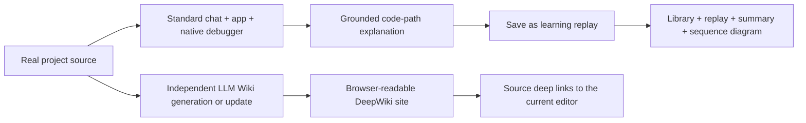

# Product goal

Goal version: 7\
Owner: Raphtalia\
Initial design approved: 2026-09-18\
Current product direction: 2026-09-26, [D030](DECISIONS.md#d030--separate-live-explanation-learning-replay-and-independent-wiki-2026-09-26)

This file owns final outcomes and acceptance. Detailed feature contracts live in the linked specifications; PROJECT_STATE.md owns implementation evidence. Version 7 records the owner's change and clarification. It does not claim those changes are implemented.

## Product purpose and feature relationships

Codebook helps the learner understand AI-written code, unfamiliar work codebases and OSS in **both Visual Studio Code and Cursor**. It has three related feature areas:

| Feature | What the learner does | Result and relationship |
| --- | --- | --- |
| Live code explanation | Ask the editor's standard AI chat to explain a real code path. The AI operates the real app and debugger, pauses in actual source, explains and continues. | The explanation happens in Copilot Chat or Cursor Agent. Application/browser, native source editor and native debugger provide the execution context. A Wiki is not a prerequisite. |
| Learning replay | Save an explained session as learning material, then open and replay it later. | A saved replay contains the explanation, processing summary, sequence diagram describing the logic flow, source links and corresponding recorded execution. It is derived from the explained session and has its own library/replay screen. |
| LLM Wiki / DeepWiki | Generate or update a repository-wide Wiki from the project's source. Open the generated site in a web browser and follow source links back to the editor. | A complete navigable documentation site, independent of live explanation, debugging, the application browser and learning replay. Its generation/update requires neither an executed session nor a saved replay. |

Sharing source identities and optional links does not merge these lifecycles. A replay can be saved and viewed without generating a Wiki. A Wiki can be generated, updated and read without debugging, using the application browser or saving learning material. The learner does not need to show all these screens together.

**One UI design family, multiple feature screens.** The requirement for three selectable UI themes/layouts is retired. This does not remove learning replay or Wiki screens, and does not require one fixed arrangement containing every feature. The proposed extension entry is a Codebook icon in the editor's left Activity Bar; selecting it exposes Codebook navigation and actions. Detailed screen composition will be reviewed separately after this specification update.

## Defining live-to-learning experience

In a real project with a purchase flow, the learner might ask:

> /codebook カートに入れてから購入するまでのコードパスを解説して

The chat AI inspects that repository, operates its actual application, pauses the debugger at meaningful source locations and explains what is happening. For example, it may explain the relationship between the purchase button and a backend POST request. It must distinguish a stop before sending from an observed sent request; a source line alone does not prove a completed network operation. The learner inspects variables, watches and call stacks in the **editor's native debugger**. Codebook does not provide a duplicate runtime-values panel.

The explained session can then be saved as a **learning replay**. On reopening it, the learner can review the processing summary and sequence diagram, follow the saved explanation and source, and replay corresponding execution moments after the app/debugger have stopped. This is the learning feature; generation of a separate repository Wiki is optional for this flow.

Purchase is an example of a natural understanding question. Required targets use their own real behavior, including server, Chrome Extension, library test and supplied Example execution. The extension must not bundle a cart/sample project as a target. Use real opened repositories. Until final acceptance begins, development validation uses the owner-designated `nextjs-dashboard` checkout under [D031](DECISIONS.md#d031--use-nextjs-dashboard-for-development-until-final-acceptance-starts-2026-09-26) and [DEVELOPMENT.md](DEVELOPMENT.md#required-development-target-before-acceptance); final acceptance uses the unchanged nine-project matrix. Never substitute a fabricated application for a required target.

## Required final capabilities

IDs remain stable for historical evidence. Active requirements are **G01–G07 and G10–G12**. G08/G09 are retired identifiers, not pending features or passed checks.

| ID | Required outcome | Evidence before verification |
| --- | --- | --- |
| G01 | One natural chat request drives a meaningful code path in a real opened project through application/runtime operations, debugger stops, grounded explanations and continuation to an observed result. | Freeze the scenario and required causal links before execution. The standard chat AI completes the flow without prepared answers or manual wiring at every pause. |
| G02 | Generate a complete, independently usable LLM Wiki / DeepWiki site from repository sources. | Browser-readable project/architecture/module explanations and source-linked relationships; default project-local output and configurable location; explicit chat and **Update LLM Wiki** button updates; visible freshness/failure state; links to the correct file/location in each host. Prove independence from debug, application-browser and replay state. See the [Wiki contract](docs/specs/llm-wiki.md). |
| G03 | Explanations use the correct target, source/version, pause generation and observed runtime facts. Values are inspected through the native debugger. | Real-debugger checks for wrong/background targets, stale references, manual resume, source drift and unresolved causal links. Required unresolved links prevent success. Internal evidence capture remains available to ground explanations and recordings; no custom values display is required or added. |
| G04 | Save the explained session as learning replay, including a processing summary, a sequence diagram, explanations, source correspondence and recorded execution. | Reopen the learning library and replay after the app/debugger exit. Inspect meaningful stops, screen/code/explanation timing, recorded motion, source drift and partial recordings. Review summary/diagram links against evidence; no duplicate Variables/Watch UI. See the [replay contract](docs/specs/learning-replay.md). |
| G05 | The learner owns saved learning material and explicit understanding/progress decisions. | Save and reopen a replay; persist learner decisions separately from execution status. Saving or successful execution never auto-marks understanding. Source changes signal review without rewriting prior learning history. Wiki generation has no dependency on this ledger. |
| G06 | The extension-owned MCP service exposes the host capabilities needed for live explanation, learning replay and independent Wiki generation/update. | Actual external-chat use in each host, explicit target/source identity, lifecycle/error handling and recovery. Existing separate tools alone do not prove this. |
| G07 | One coherent UI design supports the distinct live explanation, learning library/replay and Wiki entry points. | Codebook's Activity Bar entry reaches its features; standard chat/source/debugger remain usable for live explanation; replay has its own screen; Wiki opens in a browser. Verify feature navigation, focus/reading state, constrained sizes and accessibility. Final geometry awaits separate design review. |
| G08 | **Retired:** mandatory Living book display variant. | D030 removes the selectable-theme requirement. Reading and Wiki capabilities are specified independently above. |
| G09 | **Retired:** mandatory Guided walkthrough display variant. | D030 removes the selectable-theme requirement. Live explanation and replay remain required above. |
| G10 | The packaged extension is useful on all nine required real projects, without a bundled target application. | Complete the two-stage matrix in FINAL_REVIEW.md in both hosts. Cover all applicable TS/JS Web UI, Node server, Chrome Extension, library tests and Examples; every library requires tests and Examples. Verify the final VSIX contains no cart demo source or assets. |
| G11 | The complete active product experience works in both VS Code and Cursor. | Separate normally installed evidence per editor for standard chat execution, native debugger inspection, learning replay, independent Wiki/update/source links and usable feature navigation. One host's evidence does not verify the other. |
| G12 | One bundled thin skill supports explicit `/codebook` use in standard Copilot Chat and Cursor Agent with ordinary skill/MCP setup. | Compare bundled and actually loaded identities; verify discovery, invocation, AI-owned results, missing-connection guidance, restart/reconnection and preservation of existing skills/settings/work. Registration alone is insufficient. |

## Bundled thin skill and explicit chat entry

G12 is mandatory under [D023](DECISIONS.md#d023--bundle-one-thin-codebook-skill-for-explicit-editor-chat-entry-2026-09-21). It applies to the active capabilities below. D030 retires the former display-mode requirements and defines learning replay and independent LLM Wiki. The standard chat surfaces are **Copilot Chat in VS Code** and **Agent in Cursor**. Users must be able to explicitly invoke the common skill with a natural request, without depending on automatic skill selection:

> /codebook ログイン処理を解説して
>
> /codebook このボタンを押してから画面が変わるまで、関係するコードと実際の値を見ながら説明して

The invocation must place Codebook's usage guidance in the chat AI's context so that the AI itself can use Codebook's MCP capabilities. Discovering or loading the skill and successfully performing the requested Codebook workflow are separate acceptance checks.

**One versioned artifact.** Bundle a common `SKILL.md` with frontmatter `name: codebook` in the same VSIX as the extension. Track and distribute its version and content with the extension; do not maintain different procedure bodies for the two editors. VS Code must register the bundled skill through the official `contributes.chatSkills` contribution. The primary Cursor route is a Codebook setup operation in the ordinary onboarding flow that installs the bundled skill into Cursor's officially supported user skill directory (`~/.cursor/skills/codebook/SKILL.md`, subject to verification in the declared target version). Users must not have to find, author or manually copy the skill body.

Track installed-file ownership, originating extension/skill version and content identity. Provide documented update, removal and restoration procedures. Never overwrite or delete a pre-existing same-name user skill or later manual edits without the user's informed choice; conflicts must preserve those bytes and expose an actionable resolution. A Cursor plugin-registration API is an alternative only after its normal installed target version demonstrates skill discovery, `/codebook` visibility and actual invocation. An API name in documentation is not compatibility proof.

**Thin shared procedure.** The skill connects the user's request to public Codebook capabilities. Its required guidance is:

- Begin with `codebook_status` to establish the current workspace, connected instance, available capabilities and prerequisites. If the tool/connection is unavailable, disclose that condition instead of pretending this check succeeded.
- Follow the public usage instructions and the state returned at that moment to select tools and resources; refer to the existing MCP descriptions and public help for detailed contracts instead of duplicating them in the skill.
- According to the request, proceed through source inspection, application operation, real execution pauses, actual values through the native debugger, chat explanation, continuation and learning replay using supported product capabilities. Independent Wiki requests use repository sources and the Wiki generation/update path without starting a debug run.
- Distinguish observed facts, reasoning from source and unverified boundaries. Obtain continuation arguments from the current execution state; do not guess or reuse stale arguments.
- Leave understanding checks to the learner; the AI must never mark them complete on the learner's behalf.
- State missing connections, unavailable capabilities and unmet prerequisites accurately. General source commentary is not a successful Codebook execution or observation.

Do not embed repository-specific answers, correct stopping locations, expected variable values or test-only recipes in the skill. The skill is guidance, not an additional execution engine or an answer key.

**One onboarding experience.** Public setup must prepare both skill availability and MCP connectivity. Registration alone does not establish a connection. Bind the dedicated work window and selected repository to the correct current Codebook instance, and verify that restart retains a valid connection or follows the documented reconnection flow. Keep credentials and ephemeral connection details out of `SKILL.md`, the distributed VSIX, public documentation and chat explanations. Use the supported private connection mechanism and record only sanitized identity evidence.

**Optional future transport.** Record MCP Skills Extension / SEP-2640, introduced in the [requested background article](https://azukiazusa.dev/blog/mcp-skills-extension/), as an additional possible distribution route for this same skill. At this decision's research checkpoint, acquisition, host activation and slash-command availability through that extension have not been demonstrated in both required editors. Product completion must not wait for that route. Any later MCP distribution must share the bundled skill's body/version and prove host recognition and activation as a skill; exposing text as an MCP resource alone is insufficient.

The [implementation and validation plan](docs/plans/bundled-codebook-skill.md) tracks this added work. Specification, upstream documentation and registration metadata do not count as implementation or ordinary-install validation.

## Product constraints

- Architecture B: the extension owns runtime state, immutable evidence and recording correspondence; the editor chat AI reasons and explains through the API.
- Standard chat is the live explanation surface. Use native source editors and debugger views for source and variable inspection. Retire Codebook's dedicated runtime-value display in live and replay UI; keep bounded internal evidence needed to substantiate saved explanations.
- Learning replay and independent Wiki have distinct artifacts and lifecycles. Optional source-based cross-links must not make one a prerequisite for the other.
- Generate the Wiki within the project folder by default; allow a configured output location. Source changes make existing documentation potentially stale. The learner explicitly requests an update in chat or uses **Update LLM Wiki**. An automatic background regeneration mechanism is not required by this decision.
- Remove the active cart demo project, its packaged copies/assets, launch entry points and fixture-specific product instructions. Retain historical reports as historical evidence; source history does not become a supported target. Small isolated unit-test inputs may test mechanisms but cannot replace real-project trials or ship as a demo application.
- Distinguish observations, source-based reasoning and unknown boundaries in chat, summaries, diagrams and Wiki pages. Source-derived documentation is not evidence of executed behavior.
- Preserve source/version context and disclose missing, truncated, redacted, partial or stale evidence. Learning and saved replay remain available independently of the original chat's continued availability.
- Exact pane geometry, visual styling and the replacement concept image belong to the separate design review after the written specification. The three old images are historical references only.

## Final acceptance

1. Freeze the final source, distributed VSIX/version/hash, common skill/setup/guide identities, target revisions, scenarios and supported host/dependency versions. Verify removal of the bundled cart target from source/build/package paths.
2. In each host, use standard `/codebook` chat and public onboarding to complete meaningful real-project code paths, including required causal boundaries. Verify native debugger/source inspection and truthful failures without a custom values panel.
3. Save those explanations as learning replays. Verify processing summaries, evidence-linked sequence diagrams, source and execution correspondence; replay after runtime exit, restart, motion and partial/source-drift behavior. Persist explicit learner progress.
4. Independently generate and open a full repository Wiki without starting a runtime or creating a replay. Verify default/configured output, source freshness and updates through both chat and **Update LLM Wiki**, plus source deep links in each host. Existing replays must remain readable and unchanged when the Wiki updates.
5. Verify the separate feature screens and Codebook entry point against the later approved design, including focus, constrained windows, keyboard/theme/reduced-motion behavior and preservation of unrelated work. Theme switching among the retired variants is not an acceptance step.
6. Complete every Stage 1 main-agent project/host/use-case row in the [fixed nine-project matrix](docs/acceptance/ACCEPTANCE_MATRIX.md) through normal installed use. Library tests and supplied Examples are both mandatory; browser-only evidence does not establish server or Chrome Extension support.
7. Only after all Stage 1 rows and all active capabilities are ready, assign nine independent junior-developer SubAgents, one per project, each evaluating both hosts. Every required assessment needs concrete PASS evidence and justified confidence >=9/10. Missing mandatory work, material mismatch, prohibited assistance or important unknowns prevent PASS regardless of score.
8. Verify G12 separately in both stages: discovery, actual loaded skill identity, current correct MCP connection and AI-owned results; include restart, unavailable states and protection of existing skills/settings/work.
9. Preserve failures and retest affected rows after extension/skill/setup/connection changes. Assess impact and justify any unaffected carry-forward. All final PASS evidence must remain valid for the final fixed distributed VSIX; no consecutive-pass/reset counter applies.
10. Link current evidence for all active IDs and integrated feature behavior in PROJECT_STATE.md, and separately record Raphtalia's acceptance. Keep Goal Issue #1 open until all conditions hold.

[FINAL_REVIEW.md](docs/acceptance/FINAL_REVIEW.md) owns the detailed protocol. D029 preserves the nine required projects and two ordered stages; D030 changes the product behavior those stages evaluate. Protect the designated private checkout and private evidence. Historical protocols/cycles preserve the criteria used at the time and do not override version 7. Claude Code CLI review remains owner-skipped and distinct from native editor-chat acceptance.

## Design authority

Read [DESIGN.md](DESIGN.md), the [current behavioral design](docs/designs/codebook.md) and the [visual reference status](docs/designs/README.md). The owner's functional decisions are recorded; the replacement screen design and concept image are pending a separate review.
