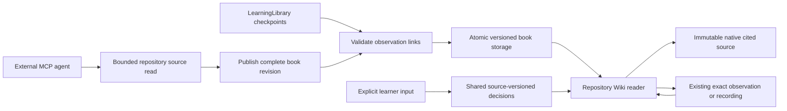

# Cycle 0009 — Source-grounded repository learning content

Type: product-increment
Status: planning
Result: pending
Delivery: planning records committed; source draft tested locally, implementation paused for formal reviews
Goal version: 3
Tracking issue: https://github.com/laststance/codebook/issues/10
Goal issue: https://github.com/laststance/codebook/issues/1
Goal links: G02; supporting G05, G06, G07, G10, G11
Source state: [Cycle 0008](0008-recording-replay.md), implementation `1740e34`, qualified evidence `7330a3a`

## Question and expected value

Can an external agent create a useful, source-grounded repository Wiki and codemap whose learning items connect to exact source, existing observations and recorded moments, with the learner retaining selection and personal progress?

Authority: agent-selected next cycle under D008/D015 and Raphtalia's continuous delegation. No new product scope or owner approval is inferred. Fixed demonstration overviews are the current macro-content bottleneck; an actual repository document is the smallest next step toward studying unfamiliar code. Reading source does not prove that repository's runtime works.

## Hypothesis and scope

- Reuse the extension-owned MCP service, source identity/hashing, learning selection/history and existing reader; external agents author explanations, while the extension verifies references and persists them.
- Smallest observable outcome: create a source-backed learning document for this actual codebook repository through public discovery/read/write APIs; navigate its article and codemap to native source. Link established demo learning items to their retained observations/replay where evidence exists. Navigate back without executing the app or changing understanding.
- Keep agent interpretation, source-derived structure and observed runtime facts distinct. A graph edge is not an observed call path merely because an agent wrote it.
- Source changes retain historical text/anchors and surface staleness. Unknown items or missing evidence have no fabricated live/replay destination.
- Preserve all current fixed-profile runtime/replay behavior and durable learner choices. New content does not launch, continue or replay input automatically.
- Not this cycle: arbitrary-workspace runtime adapters, new debugger/language support, both alternate layouts, package/publication, final host acceptance. These remain mandatory final capabilities. Native phase-ACK reliability remains unresolved from Cycle 0008 and is not reclassified by static source reading.
- Falsify if source references cannot be verified, authoring silently overwrites learner decisions, navigation mixes observation identities, or repository documentation has to be hand-coded into a fixture catalog.

## Plan and selected skills

1. Inspect existing source, learning schemas, navigation and persisted identity. Inventory reusable code before choosing an API/schema.
2. `/plan-devex-review` on this cycle: repository source discovery/read/reveal, authored-content validation, version/conflict/error and observed-link contracts.
3. `/plan-design-review`: reading/codemap navigation, source-derived versus observed labeling, stale/empty/error states within Study workspace. Raphtalia explicitly selected this cycle's plan in the target question on 2026-09-19; the formal seven-pass review is complete with D3–D6 approved. Earlier primary assessment is not retroactively a completed skill. Final design is context; later layouts are not this implementation scope.
4. `/plan-eng-review`: bounded file access/storage, source anchors, identity/history, persistence and regressions, after formal UX decisions. The same owner answer explicitly selected this plan for engineering. Freeze reviewed amendments before continuing implementation; earlier primary assessments are not formal or independent results.
5. Implement one connected slice; actual external-agent authoring and actual-host navigation in VS Code and Cursor; browser interaction QA and meaningful `/review`. Investigate unexplained failures before retries.

These are review tasks, not a pre-approved implementation design. Routine reversible decisions stay agent-owned under D008; independent reviewers remain unavailable at the previously observed thread limit until that condition changes. Record coverage honestly; no substitute counts toward the final ten-review gate.

## Validation contract

Plan review will fix exact schema, bounds, source set, host versions and reproducible commands before execution.

| Check | Expected observable result | Required evidence |
| --- | --- | --- |
| Public authoring | External agent discovers source/content contracts and creates the repository document without a prewritten private sequence | Actual MCP discovery/request/response transcript, immutable source hashes |
| Source fidelity | Every source anchor resolves to the referenced bytes; changed/missing/outside-workspace source is explicit | Native reveal plus hash/path/drift negative cases; no silent retargeting |
| Macro/micro continuity | Article/codemap/established item/observation/replay navigation retains the exact selected item and source version | Two-direction navigation and no additional application operations |
| Evidence classification | Source-derived graph/text never becomes observed evidence without existing recorded proof | Unobserved/partial/wrong-reference tests and visible labels |
| Learning independence | Authoring/navigation/restart preserves learner decisions; only explicit learner action changes understanding | Before/after persisted decision records |
| Recovery | Conflict, bounded storage, missing data and restart preserve prior valid content with actionable recovery | Actual filesystem/protocol tests and explicit error UI |
| Required hosts | Supported reading/navigation works independently in actual VS Code and Cursor | Host/version/build-separated evidence; native pixels remain distinct from API/renderer assertions |

## Developer experience review

Scope: this cycle only, on `codex/cycle-0009-repository-learning-book`, starting at `7330a3a`. GitHub/default review base is `origin/main` (`6840178`), which also contains the unmerged Cycle 0008 delta; that larger diff is not silently treated as this cycle. `/plan-devex-review` session `52288-1789805867-7096c886`, DX POLISH. The primary agent selected routine, reversible choices below under D008 and the owner's continuous delegation. These are not invented owner answers or a spawned/plan-mode auto-selection. The explicitly accepted product/persona remains unchanged.

### Persona and developer perspective

Who: Raphtalia, a TypeScript developer learning AI-authored code, unfamiliar work repositories and interesting OSS. The external agent is the authoring client; the learner owns selection and understanding. Context: an already trusted local repository in VS Code or Cursor. Expectations: explanations cite inspectable source and clearly state what was actually executed. Abandonment tolerance is not known. Target: one useful, source-backed article within five minutes after an already connected agent starts; cold installation and model inference time are measured separately.

> I open the repository README and see “Learn an unfamiliar codebase.” The Start here table helps me find the final goal and current evidence, but the runnable instructions live in `extension/README.md`. I install three linked packages, build the extension and start a development host. I still need to start the agent server and copy its connection into my client. Those are development prerequisites, not a one-click product installation. Once connected, I can discover `checkout-demo`, run its four stops and inspect captured source. That proves useful runtime behavior, but my real question is about this repository. The current tool catalog has no way to list its source or save a reusable explanation of its architecture. The reader's outline is also tied to the demo items. I do not want an impressive graph that silently claims it ran my project. I want to read an explanation, open exactly the cited bytes, and see whether an attached observation actually exists. If I later edit the code, I want the old explanation and my learning decision retained, with the mismatch visible. If I go to a recorded stop, I want a direct route back to the same article. I should never need to run checkout just to read about codebook's own MCP boundary.

This is an agent-authored empathy hypothesis grounded in the current README/API, not a new owner interview or observed usability session.

### Benchmark and first useful moment

Aside is not installed (`command -v aside` returned no path); official web documentation was used. No competitor was timed locally. Documentation claims are not codebook acceptance evidence.

| Reference | Documented behavior | Time-to-first-result evidence | Adopted lesson |
| --- | --- | --- | --- |
| [Cursor installation](https://docs.cursor.com/get-started/installation) | Automatic indexing with visible progress | Documentation estimates 1–15 minutes for indexing, not an equivalent learning task | Show which files were included and why a source is unavailable |
| [DeepWiki repository wikis](https://docs.devin.ai/work-with-devin/deepwiki) | Generated architecture documentation and source links, with explicitly configured pages | No comparable timing established; the old English planning URL now redirects | Make explanation citations inspectable and document the selected source coverage |
| [VS Code webview guidance](https://code.visualstudio.com/api/ux-guidelines/webviews) | Themeable, accessible task views with native command actions | No comparable timing established | Reuse Study workspace/native source instead of another application |
| codebook before this cycle | Connected agent can operate the demo but cannot author repository content | Repository article path does not yet exist | Add discover → read source → publish → reveal, then measure it |

Selected first useful moment: a guided action using the learner's actual repository. After connection: (1) discover repository/source capabilities and read selected files, (2) publish a small explained path, (3) open an article citation in native source. Target budget: discovery/read ≤90 seconds, authored publish ≤120 seconds including separately reported model work, source navigation ≤30 seconds; remaining minute is recovery margin. These are targets, not measured promises. A copy-paste SDK example validates mechanics but does not substitute for actual agent authoring.

### Journey and confusion trace

| Stage | Current evidence / friction | Selected resolution |
| --- | --- | --- |
| Discover | `service.ts:65` describes only fixed runtime profiles | Add an independently discoverable repository section, example and honest source-only capability label |
| Install | `extension/README.md` needs linked packages and development host | Retain explicit prerequisites; no VSIX claim or additional service installation |
| First article | `resources.ts` has run/recording resources; no repository sources | Bounded source listing/read and one atomic book publication with a returned readable URI |
| Real use | `studyModel.ts` and `studySchemas.ts` restrict selection to demo IDs | Repository nodes keep their own stable identity; explicit links select an existing observation/item without rewriting its identity |
| Debug | Existing structured `StudyError` has code/message/recovery but no authoring errors | Exact invalid field, expected/current revision or source hash, and next read/retry action; unchanged prior content |
| Upgrade | Existing v1/v2 runtime history and learner decisions survive upgrades | Version repository content independently; preserve all old runtime files and choices, reject unknown future formats visibly |

First-time roleplay (simulated timestamps, not timed observation): T+0:00 README promises codebase learning; T+0:30 Start here leads to development records, not agent authoring; T+1:00 the extension README's MCP sequence only names checkout; T+2:00 discovery confirms no repository operation; T+3:00 the learner cannot create the requested article. Address all four content-discovery gaps with the tutorial, discovered source scope, publish example and visible reader entry. Cold install remains an explicit later product acceptance item rather than an invented sub-five-minute result.

### Eight DX passes and decisions

Hall-of-fame references were read for each dimension; their marketing speed/statistical claims are not used as measured evidence here. Scores assess this bounded plan's specificity, not delivered quality. No prior DX review was found on this new branch. All findings below remain implementation/validation work.

| Pass | Before → after | Finding and complete planned response |
| --- | --- | --- |
| 1. Getting started | 3 → 9 | Repository first result impossible today. Document three user-visible steps above; provide an executable SDK example, required host/trust/connection prerequisites and timed real-agent receipt. No new account or service is needed. Full installation time remains unverified. |
| 2. API/SDK | 3 → 10 | Reuse authenticated MCP object-schema registration, canonical resource URIs and structured receipts. Add explicit source list/read, atomic publish and navigation; no arbitrary HTML, shell, URL fetch or agent-side understanding mutation. Exact hashes, stable node IDs, expected content revision and request keys prevent silent stale writes. |
| 3. Errors | 4 → 10 | Source mismatch: reject with anchor index, expected/current hash and re-read action. Revision conflict: retain current document and return its URI/revision. Missing observation: reject the link with study/observation identity and library discovery action. Never retry execution as recovery. Invalid payloads must remain intelligible even when SDK validation occurs before the handler. |
| 4. Documentation | 4 → 10 | Put one real repository tutorial next to the existing demo tutorial; separate reference schema/limits/errors/migration notes. Discovery links to local getting-started content. Explain that verified citation bytes do not make agent prose an observed fact. |
| 5. Migration | 5 → 10 | Independent versioned repository content, immutable prior revisions and explicit conflict checks. No rewrite of runtime archive validation or automatic deletion. If shared progress needs a schema extension, preserve old bytes and test old/new-reader failure behavior before committing it. |
| 6. Environment | 6 → 9 | Native source reveal and restart in each editor, macOS arm64 versions recorded independently. SDK tests use the real installed MCP registration. Local Git and text-file bounds are reported by discovery. Other OS and installed-extension support are not inferred; native pixel access remains unresolved. |
| 7. Ecosystem | 7 → 10 | Private single-owner product: existing GitHub cycle issue is the feedback path, runnable typed example is the integration reference. No invented public community, license, pricing, cloud upload or extra language SDK. Document exact local prerequisites and unsupported repository types. |
| 8. Measurement | 3 → 10 | Record actual discovery, source reads, publish, first reveal and return timestamps, validation errors and recovery. Report model time separately; local evidence only. Count unintended runtime/progress mutations (expected zero), and identify unsupported/error states per host. No background analytics. |

Principles: zero friction after connection has a concrete bounded path; learn-by-doing uses actual source; uncertainty has exact revision/error labels; opinionated defaults retain explicit repository/file selection; explanations keep source context; the useful moment is source navigation. Overall planning specificity: 4.4 → 9.8/10; runtime quality and target timing are unmeasured. Remaining concerns are evidence collection and prior native presentation reliability, not unanswered product-scope choices.

### Reuse and bounded API direction

- Reuse `LearningLibrary`, source SHA-256, `readBoundedFile`, `atomicPrivateWrite`, `withStorageLock`, canonical error envelopes, captured-source document providers and playback controller. Search found no existing repository-book store or generic source catalog to reuse.
- Add a versioned repository book, not an unvalidated arbitrary-runtime profile. Nodes contain bounded section text, verified source anchors, explicit relations and optional existing observation references. HTML is generated from escaped structured content; authored strings cannot become commands/HTML.
- Source discovery lists a bounded eligible set from the trusted workspace, reports excluded/oversized/binary files, and reads one exact path/hash at a time. No implicit secret upload, arbitrary filesystem paths or traversal. Engineering review will fix the allowlist, symlink/race behavior and exact limits.
- Publication checks every node/anchor/edge/link first and commits a whole revision only after successful validation. Repeated identical intent returns the existing receipt; changed intent or stale expected revision fails without altering content. Historical revisions remain available.
- Runtime links resolve to existing archive/checkpoint/item/observation and source version. Related source is not relabeled as executed. A linked partial study stays partial. Recorded navigation follows stored elapsed time; input is never replayed.
- Repository selection and progress survive restart. Existing linked runtime-item understanding has one authority; article publication cannot overwrite it. Engineering review fixes whether generic progress is an additive schema or a separate persisted record before implementation.

### Implementation tasks and checklist

- [ ] **T1 (P1, human: ~1 day / agent: ~1 hour)** — repository source service: bounded discovery/read/hash/reveal and actionable rejection; derives from passes 1/2/3. Files: new repository source module, protocol/resources/service and source tests. Verify traversal, drift, unsupported files, stale identity, SDK discovery and actual native reveal.
- [ ] **T2 (P1, human: ~1 day / agent: ~1 hour)** — versioned learning content: validated atomic authoring, retained history and progress independence; derives from passes 2/5. Files: book schema/store and persistence tests. Verify conflict/idempotency, failure recovery, upgrade and exact observation links.
- [ ] **T3 (P1, human: ~1 day / agent: ~1 hour)** — connected reader: article/flow/source/evidence/recording navigation with exact identity, return and explicit unknown/stale/partial states; derives from passes 2/4/6. Files: Study workspace, view module and interaction/native checks.
- [ ] **T4 (P2, human: ~4 hours / agent: ~45 minutes)** — reproducible tutorial and measured agent run in both hosts; derives from passes 1/4/7/8. Files: extension README/example, native harness and sanitized evidence. Verify actual timings, restart, zero execution/understanding mutation and explicit evidence limits.

Acceptance checklist: public schemas/examples complete; three-step connected-agent flow timed; every error identifies problem/cause/fix/reference; source and evidence labels understandable; old archives/decisions preserved; TypeScript checks and actual SDK tests pass; both hosts independently exercised; recorded motion checked if introduced. One-command packaged installation, public community, hosted playground, new SDK languages and other OS claims remain outside this cycle's acceptance. They are not manufactured checklist passes. No extra TODO file duplicates PRODUCT_GOAL or existing unresolved native findings.

## Formal design review checkpoint

- Target: this plan, explicitly selected by Raphtalia for `/plan-design-review` and `/plan-eng-review`. Design session: `52288-1789806897-7824ad63`. Initial overall impression: 8/10; individual pass scores below assess plan specificity, not delivered UX.
- D1 answered: “A — 7項目すべて確認（推奨）.” Review all seven dimensions. This approves coverage, not a visual direction or any remedy.
- Three generated mockups are ready. A emphasizes one article column; B adds adjacent navigation/context; C uses compact navigation. They illustrate the Wiki reader inside the default Study workspace, not replacements for the three approved product layouts. Example code/text is fictional presentation content, not observed application behavior.
- All current images passed the designer's automated image-quality check. Primary visual inspection rejected the original A/C collages despite their automated passes; those originals remain in `initial-generated/`, and A/C were regenerated as individual screens and checked again. An image-quality pass is not a plan review or native UX proof.
- Durable local directory: `/Users/ryotamurakami/.gstack/projects/codebook/designs/cycle0009-repository-wiki-20260919`. It contains current PNGs, briefs, quality results, a SHA-256 manifest, generation sessions, `design-board.html` and the owner-confirmed `approved.json`.
- Comparison board: `http://127.0.0.1:55031/boards/b-20260919-084919-rzgkcn/`. The designer emitted `BOARD_URL`, and an independent GET returned HTTP 200. This URL is local to this machine, not a remote issue attachment.
- D2 feedback received through the board: B rated 5/5, A/C unrated; action `more_like_B`. Owner comment: “I understand this source revisionがでかすぎ、シンプルに小さいunderstandチェックボックスでいい”. Preserve B's composition and simplify that control. Original feedback is retained in `feedback-round-1.json`; consuming the pending request does not manufacture final approval.
- The built-in imagegen editor produced `variant-B-compact.png`, removing the large acknowledgement panel and its helper text in favor of a small `understand` checkbox. Other composition remains. The image passed automated checking, and the board was reloaded. An HTTP response's three embedded image hashes match the exact current A/B-compact/C files; B-compact SHA-256 is `9fe687a6ff72923d70f55db20065f00e6d7a9518368af70361679996b6d41e8a`.
- D3 answered: “はい、修正版 B でレビューを進める（推奨）”. B's composition with the compact checkbox is the approved seven-pass review reference; `approved.json` preserves the actual answer and image hash. Do not re-ask the variant or checkbox choice.
- D4 answered “A”: a change to any cited source places the article in Review needed without deleting historical understanding. D5 answered “A — 記事を1列にし、関係図は下へ（推奨）”: the narrow reader uses one article column. D6 answered “A — 読んでいた位置まで戻す（推奨）”: returning from an observation or recording restores the original section and reading position within the exact article/revision. All seven passes are reconciled below, with no unresolved design decision. Engineering follows the completed design amendments. Independent plan coverage remains unavailable at the previously observed provider/thread boundaries; the image checker is not a fresh independent final-product reviewer.

### Approved mockup

| Screen | Full mockup path | Direction | Constraint |
| --- | --- | --- | --- |
| Repository Wiki within Study workspace | `/Users/ryotamurakami/.gstack/projects/codebook/designs/cycle0009-repository-wiki-20260919/variant-B-compact.png` | B: native source beside article with adjacent article/relationship navigation | Compact `understand` checkbox, without the large acknowledgement panel or helper paragraph. Mockup copy/code is illustrative, not the implementation contract. |

Post-pass supplementary illustration: `/Users/ryotamurakami/.gstack/projects/codebook/designs/cycle0009-repository-wiki-20260919/reader-narrow-supplement.png`. It renders the already approved D4/D5 outcomes as a single-column reader with relationships below. It is not a new choice, an owner-approved replacement for B, a measured CSS viewport or native UI evidence. One additional image brings total generated artifacts to seven; the approved image count remains one. Exact responsive behavior is governed by Pass 6 and requires implementation QA.

### Pass 1 — Information architecture

Score: 8 → 10/10 for plan specificity after the owner's D3 visual-direction decision. No additional unresolved information-architecture finding. This is not a usability-test result.

The three priorities are: (1) selected article and its explanation, (2) exact source citation and native source, (3) related source structure and retained observations. Repository/article navigation identifies location; revision and source/evidence labels identify context. Progress remains a small learner action, not a competing panel. The diagram records the approved composition and already planned navigation; it adds no unapproved feature.

```text
codebook / Repository Wiki
├─ Book + revision / article tree
├─ Native cited TypeScript source
└─ Wiki reader
   ├─ Article title + Source-derived / Agent interpretation
   ├─ Sections + exact source citations  |  On this page / source relations
   ├─ Related retained study (explicit partial/unknown status)
   └─ [ ] understand

Article / relation → selected node → immutable native cited source
Article → View observation → exact saved observation → Return to Wiki
Article → View recording  → paused recorded moment  → Return to Wiki
Return restores the original book / revision / node / section / reading position.
Neither reading nor return issues application input or changes understanding.
```

### Pass 2 — Interaction states

Score: 8 → 10/10 after D4. Raphtalia answered “A”: compare all sources cited by the selected article; any changed source produces an article-level Review needed status near its revision. Keep the compact checkbox and historical decisions. The first anchor still identifies the native source/default runtime alias; it cannot exempt secondary citations from the article's review state. Understanding the retained historical text never acknowledges unseen current bytes. Unavailable sources remain explicitly unverified, not current. Engineering must preserve this outcome across shared runtime-item aliases and repository identities.

| Feature | Loading | Empty | Error | Success | Partial / stale |
| --- | --- | --- | --- | --- | --- |
| Book/article selection | Retain navigation and selected title; disable actions against unresolved content | Explain that a connected agent can create the first source-backed article; show connection/help actions | Identify the unavailable book and Retry; keep other valid books accessible | Exact book/revision/node and article sections | New revision available with Load latest; keep historical selection until explicit navigation |
| Source citations | Citation remains named while its current status is checked | A valid article always has an anchor; absent/invalid anchors are an error, not a blank success | Name changed/missing/unreadable source; retain captured-source access where intact | Open the exact captured source/range; current-file action remains separate | Any changed citation gives article-level Review needed; show old/current source identity; no claim of current understanding |
| Source relationships | Keep article readable while loading its validated revision | State that this revision has no related nodes; article citations remain available | Malformed endpoints invalidate the revision with an actionable error | Labeled, keyboard-operable related-node links | Label all relations Source-derived; no visual implication that the path ran |
| Observations/recording | Name the chosen retained study/moment; disable unresolved destination | Explain that no observed/recorded moment is linked; reading remains available | Missing/corrupt link shows its reason instead of a working-looking destination | Exact observation or paused replay moment, with Return to Wiki | Preserve Partial recorded study and source-version differences; no input playback |
| Learner understanding | Retain last committed check; disable save while pending | Unchecked until an explicit learner decision | Retain committed state and expose Retry | Compact understand checkbox reflects that historical source context | Retain historical check/history with Review needed; authoring and observation never auto-check it |

The table expands already accepted state requirements and D4; it adds no authoring operation or runtime behavior. No other unresolved state finding remains.

Historical blocker: D4 was unanswered across its question turn and two automatic continuations, so the goal was marked blocked. The owner's actual “A” answer resolves that condition and review work resumes here. No elapsed-time default was used. The app's goal API exposes no resume operation; the saved product/cycle state reflects resumed work without claiming an API status change.

### Pass 3 — Journey and emotional arc

Score: 8 → 10/10 after D6 A. The first pass appeared 9/10, but Pass 7 exposed the unspecified return position and corrected the pre-fix score to 8. The owner's actual answer resolves that gap: restore the original section and reading position in the exact retained article, including saved-reader restart. Emotional descriptions are design hypotheses, not owner usability evidence.

| Step | Learner does | Intended feeling | Supporting accepted behavior |
| --- | --- | --- | --- |
| First 5 seconds | Opens Repository Wiki and selects an article | Oriented | Selected book/revision/title, current tree node and Source-derived / Agent interpretation labels |
| First useful minutes | Reads a section and opens its citation | Able to verify the explanation | Immutable source/range beside article; no debugger prerequisite for reading |
| Follows a relation | Selects the next explained node | Understands the structure | Named relation and exact article/source selection; no fabricated observed edge |
| Inspects evidence | Opens a saved observation or recorded moment | Can distinguish explanation from proof | Exact source-bound observation, partial status and paused replay |
| Returns to reading | Uses Return to Wiki | Continues the same explanation | Original book/revision/node, section and reading position restored, including saved-reader restart; resized/zoomed panels retain the logical reading location |
| Marks understanding | Toggles understand | Owns learning progress | One compact learner control, committed-save feedback, independent from agent/runtime actions |
| Returns after edits or months | Revisits an older article | Can trust the history | Retained explanation/decisions; any cited-source change shows Review needed; explicit Load latest |

The five-minute connected-agent target remains unmeasured. Long-term confidence comes from retained versions and evidence, not a guessed completion percentage. Return preserves keyboard context and never issues runtime input or a learner decision. No unresolved journey requirement remains; implementation and measured return behavior are still pending.

### Pass 4 — Visual specificity

Score: 10 → 10/10 for this bounded plan. Mode: READ for article content; OPERATE for native editor, navigation and evidence actions. Approved B supplies the composition; existing native theme/typography supplies implementation values. Generated example prose and oversized raster text are not literal product copy or token values.

| Hard rejection | Result / evidence |
| --- | --- |
| Generic SaaS card grid | No: article/source/editor structure, not a feature grid |
| Beautiful image with weak product identity | No: codebook native activity and repository navigation; no decorative image |
| Strong headline with no action | No: citations, source relations and named observation/replay actions |
| Busy imagery behind text | No: native editor surfaces and text |
| Repeated mood sections | No: each article section explains a cited responsibility |
| Unmotivated carousel | No carousel |
| Stacked decorative cards as app layout | No: article is continuous; outlined relation entries are interactive destinations, not ornamental panels |

Litmus: product identifiable YES (codebook activity/title); primary anchor YES (selected article); headline scan YES (article/section responsibilities); one job per section YES; necessary grouping YES (interactive relation destinations and a distinct saved-study context); motion improves this reading surface NO (no new animation is needed); understandable without decorative shadows YES. The NO does not prescribe unnecessary motion. Existing moving replay is separate behavior with its own recording/frame evidence requirement. No unresolved visual-specificity finding.

### Pass 5 — Design system alignment

Score: 9 → 10/10 after mapping the existing approved native vocabulary. No new brand or component decision. Reuse `extension/src/ui/constants.ts`: host font via `--vscode-font-family`, source via `--vscode-editor-font-family`, 16 px body, 20 px title, 16 px section heading, 1.5 body line-height, 16 px outer padding, existing 8/12/16/20 px spacing, 4 px control corners. Colors use `--vscode-editor-background`, `--vscode-foreground`, `--vscode-descriptionForeground`, `--vscode-panel-border`, `--vscode-button-*`, `--vscode-textLink-*` and `--vscode-focusBorder`; high-contrast boundaries retain `--vscode-contrastBorder`.

Native editor/tree controls remain native. Webview citations reuse visibly linked/visited styling and focus treatment. The compact understand row reuses the small native checkbox and label; a generous transparent hit area does not reintroduce the rejected panel. Semantic states use words as well as color. The approved image is a composition reference; implementation inherits the learner's actual VS Code/Cursor theme rather than hard-coding the mockup's dark colors. No issues found; continue.

### Pass 6 — Responsive and accessibility

Score: 8 → 10/10 after D5 A. At reader content widths below 800 CSS px, use one article column, an On this page disclosure near the title and source relationships after article sections. At 800 px and above, use approved B's article plus adjacent navigation/relationship context. The threshold is the implementation fit for a readable column plus secondary context, not a new product mode. Native source remains a separate editor group; the reader never forces window resizing. Cap reading measure at 72ch where space permits, use available width below it, wrap long paths and preserve the DOM reading order. Do not shrink body type to fit columns.

At 320/390/600 px and 200% zoom, show title/revision/status first, then article/citations, relationships, related observations and the compact checkbox. Controls may wrap; article text has no horizontal scrollbar. No new tab system or mandatory animation. Native disclosure/buttons support keyboard activation. Semantic main/article/nav regions and ordered headings identify context; source status and revision describe the small checkbox without restoring its rejected visible helper panel. Keep visible focus on live updates, a 44 px interactive label area around the visually small check, text/contrast checks in host light/dark/high-contrast themes, visited citation distinction and textual state labels. Record browser behavior and actual-host evidence separately. No unresolved responsive/accessibility decision.

### Pass 7 — Decision reconciliation

| Decision | Status / impact |
| --- | --- |
| Wide composition and learner check | D3 approved: B with compact understand; do not reopen |
| Source change scope | D4 A approved: any cited source can require article review; preserve historical understanding |
| Narrow reader | D5 A approved: one column, small disclosure and relationships below; wide B retained |
| Return reading position | D6 A approved: restore the original section/reading position within the exact book/revision/node, including saved-reader restart. Resizing/zoom retains the logical reading location; no runtime or understanding mutation. |

Approval reconciliation: four distinct design decisions (D3–D6) have actual owner answers. Scope/focus answers and the board regeneration request add no remedy approvals. No decision is deferred or unanswered. No out-of-scope TODO proposal or new product requirement was selected.

## NOT in scope

- Living book and Guided walkthrough: required later layouts; this reader belongs to the existing Study workspace.
- Ordinary-repository runtime adapters: reading real source does not establish arbitrary application/debugger operation.
- New languages, remote workspaces or operating systems: no compatible execution evidence or declared support matrix for them in this cycle.
- Package, publication and installed-extension acceptance: development-host evidence remains separate from distribution.
- Cycle 0008 native phase-ACK repair: retain its inconclusive result until a changed, measured hypothesis supports another experiment.
- Final product/owner acceptance and ten fresh sequential reviews: require all product capabilities and frozen integrated evidence, not this plan.

These are existing cycle boundaries, not dropped final requirements or newly deferred design defects. No additional TODO is proposed.

## What already exists

- `DESIGN.md` and D016 provide stable entry points to the approved product and reader direction.
- `extension/src/studyWorkspace.ts` supplies native tree/selection/document integration; reuse its explicit source and observation identities.
- `extension/src/ui/studyHtml.ts` and `extension/src/ui/constants.ts` supply native theme tokens, readable typography, focus and error-state conventions.
- `LearningLibrary`, atomic private writes and the shared storage lock retain learner history, checkpoints and source versions; extend their contracts without a competing authority.
- The existing playback controller can open retained evidence without application input. Return context belongs to the reader selection, separate from playback/runtime control.

## Implementation Tasks

These four design tasks refine DX tasks T2/T3; they do not add a parallel implementation track. All remain unchecked until behavior is implemented and verified. Planned filenames may change during engineering review while their accepted outcomes remain fixed.

- [ ] **DT1 (P1, human: ~2h / agent: ~20min)** — Build approved B's reader composition, compact `understand` and distinct source/evidence labels. Surfaced by Pass 1 / D3. Files: `extension/src/studyWorkspace.ts`, `extension/src/ui/studyHtml.ts`, `extension/src/ui/constants.ts`, planned `extension/src/ui/repositoryHtml.ts`. Verify article/source/relation hierarchy, no large acknowledgement panel and no observed-path claim from authored relations.
- [ ] **DT2 (P1, human: ~3h / agent: ~30min)** — Make every citation participate in article Review needed; preserve historical/shared learner decisions. Surfaced by Pass 2 / D4. Files: `extension/src/learningLibrary.ts`, `extension/src/repositorySchemas.ts`, planned reader/store tests. Verify secondary-only drift, unreadable sources, original captured bytes, unchanged primary source and runtime-item aliases.
- [ ] **DT3 (P1, human: ~2h / agent: ~20min)** — Implement the one-column narrow reader with relationships below and accessible controls. Surfaced by Pass 6 / D5. Files: planned `extension/src/ui/repositoryHtml.ts`, existing UI constants and reader behavior tests. Verify 320/390/600 px, 200% zoom, wide B, wrapped paths, keyboard/focus, light/dark/high-contrast themes and visually small checkbox with 44 px hit area.
- [ ] **DT4 (P1, human: ~2h / agent: ~20min)** — Restore the original article section and reading position after observation/replay and saved-reader restart. Surfaced by Pass 3 / Pass 7 / D6. Files: `extension/src/learningLibrary.ts`, `extension/src/service.ts`, `extension/src/studyWorkspace.ts`, planned reader and behavior tests. Verify both evidence destinations, resize/zoom, keyboard context, unavailable-history recovery and zero application/understanding mutations.

No additional tasks arise from Passes 4/5; their token/specificity checks constrain these tasks. Pass 7 reconciles DT4 rather than duplicating it. Machine-readable tasks: `/Users/ryotamurakami/.gstack/projects/codebook/tasks-design-review-20260919-092944.jsonl` (four `jq -nc` records, design session `52288-1789806897-7824ad63`). Estimates describe implementation, not completed work.

## Design completion summary

| Dimension | Before → after | Basis |
| --- | --- | --- |
| System audit | Existing DESIGN.md | Repository reader in Study workspace; no new product layout |
| Step 0 impression | 8/10 | Owner requested all seven passes |
| Pass 1: information architecture | 8 → 10 | D3 B composition with compact learner check |
| Pass 2: interaction states | 8 → 10 | D4 every-citation review state and preserved history |
| Pass 3: journey | 8 → 10 | D6 original section/reading position; pre-fix score corrected during Pass 7 |
| Pass 4: visual specificity | 10 → 10 | Concrete native article/source/evidence structure |
| Pass 5: design alignment | 9 → 10 | Existing host theme, type, spacing and focus conventions |
| Pass 6: responsive/accessibility | 8 → 10 | D5 one column below 800 CSS px, keyboard/theme/zoom checks |
| Pass 7: reconciliation | Four resolved; zero deferred | Individually answered D3–D6 |
| Required outputs | Six scope exclusions; reuse recorded | Four implementation tasks; zero new TODO proposals |
| Approved references | Seven images generated; one approved | Three initial, two corrected collages, one compact B edit, one narrow supplement; the supplement is illustrative only |
| Overall minimum of Passes 1–6 | 8 → 10/10 | Planning specificity, not delivered or independently tested UX |

The plan is design-complete. Perform `/design-review` and behavior/native checks after implementation. Independent plan voices remain unavailable; no final acceptance review is counted. The engineering review is already explicitly authorized for this same plan, so its target is not requested again.

## Selected implementation contract

The initial contract was a primary-agent engineering/UX assessment under D008, not a retroactive formal review. Both skill definitions require an explicit owner-named target outside Plan mode: “only if the user EXPLICITLY names the target.” Raphtalia answered the scope question, “Cycle 0009 の計画を対象にする（推奨）.” The target gate is resolved. The completed formal design review adds the individually approved D3–D6 outcomes: B with compact checkbox, any-citation review state, one-column narrow layout and return reading position. Engineering mechanics below remain subject to `/plan-eng-review`; scope/focus answers approve no additional remedy. Further implementation is paused during these plan reviews; the source/schema draft below remains unvalidated at runtime.

### Architecture and alternatives

Use one repository source service, a versioned book store and a thin native reader, composed at extension activation beside the existing study service. Preserve the fixed runtime schemas/adapter. Reject widening runtime profiles into arbitrary strings: that would remove validation without providing any runtime adapter. Reject an agent-written standalone HTML page: it would duplicate identity/progress and allow unsupported evidence claims. The book uses structured text and edges rendered by the extension, with native source documents and explicit navigation callbacks into the existing study reader.



Content publication, selection, understanding and runtime control have separate authority. Publishing never navigates or starts execution; opening an article never changes understanding. Source reading is available even when Chrome/debug prerequisites for runtime are absent. Connection/trust/instance checks still apply.

### Source scope and fidelity

- Scope is the currently trusted, local, single selected workspace root, which must itself be a Git working-tree root. Discovery declares that boundary; unsupported subfolder, remote, virtual or non-Git workspaces receive an actionable prerequisite error. No remote Git fetch.
- Enumerate tracked names with fixed `git ls-files --cached -z --` arguments, cwd fixed to the verified root, a 5-second timeout and 2 MiB output bound. No caller-supplied executable or command fragments. At most 5,000 entries; at most 100 entries per returned page. Exact paths, not shell globs, select reads.
- Accept bounded UTF-8 text in `.ts`, `.tsx`, `.mts`, `.cts`, `.js`, `.jsx`, `.mjs`, `.cjs`, `.md`, `.mdx`, `.css`, `.html`, `.json`, `.jsonc`. Exclude dot-path components, dependency/build/coverage/artifact directories, lockfiles, credential/private-key names, symbolic links and nonregular files. These rules limit the read surface; they are not a promise to detect secrets inside allowed source. No code is uploaded except what the authorized MCP client explicitly requests.
- Limit a source file to 256 KiB and paths to 512 characters. Reject absolute, traversal, empty, control-character or backslash paths. Require tracked membership on every acquisition. Use no-follow file opening, checked file identity and bounded reads; verify root containment/identity before and after I/O. Reject modification, invalid UTF-8 and NUL data. Inspect source hashes again during publication; do not silently accept a changed file.
- Source read returns relative path, full-byte SHA-256, line count and text. Anchor uses that hash plus inclusive one-based start/end lines. Publishing copies the verified full source into the revision, deduplicated by path/hash; at most 32 distinct sources. Later drift changes a status label, never the retained bytes. Native current-file reveal also checks unsaved editor text; otherwise offer the immutable cited version.
- No recursive parser or language-server claim. Edges are authored source interpretation, with labels `calls`, `uses`, `contains`, `related`; none means observed execution.

### Document, identity and storage

- Stable `bookId` and node IDs are lowercase slugs (maximum 64 characters); revision is a positive integer. Document contains title, summary, 1–64 nodes and 0–128 directed edges. Each node has title, up to 12 titled text sections (each text ≤12,000 characters), 1–8 source anchors, and up to 8 optional observation links. Whole submitted document ≤1 MiB; sealed revision ≤4 MiB. Duplicate IDs, unknown edge endpoints and invalid ranges fail before any write.
- Primary anchor is explicitly the first anchor. A repository node's default learning identity is `repository/<bookId>/<nodeId>`. An optional existing runtime `learningItemId` is accepted only when a verified linked observation names that item and the initial primary source hash matches its capture. That binding cannot change in later revisions. Under approved D4, article-level Review needed checks every cited source, including secondary anchors; primary identity cannot suppress that state. Preserve old learner decisions and observations with their own source versions. Engineering must bind the full citation context without duplicating or overwriting the shared runtime-item history.
- A runtime observation link carries `studyId`, `observationId` and captured `sourceHash`. Resolve it against `LearningLibrary.readCheckpoint`, require a saved checkpoint and exact observation identity/hash. Preserve the checkpoint's outcome, including partial. A later annotation/checkpoint may append facts; it must not retarget or replace the linked observation. Missing/corrupt history disables the destination with its reason.
- One private atomic file per book retains at most 20 revisions within an 8 MiB file limit; at most 16 books. No eviction. `withStorageLock` serializes publication with learner/recording storage. Read/schema/hash validation happens on every public read; corruption must not fall back to an older valid revision silently. A revision includes its request key, input digest, immutable copied source and publication time.
- Publication accepts `expectedRevision` (0 for creation) and a stable key. Under the writer lock, re-read current content; identical key/input returns its original receipt, changed input under that key fails, stale expected revision fails. Validate all sources and observation references before atomic commit. A failed temporary write, bound or validation retains the previous file.
- Upgrade shared learner progress to a new v3 file/decoder that admits repository identities while preserving existing runtime selection and decisions. Read v3 by existence, otherwise normalize validated v2/v1 in memory. First explicit write creates v3; retain old files. Malformed or unknown-version v3 never falls back. Older builds may read retained old files and cannot overwrite v3; document that their later old-format decisions are not automatically merged. Reuse the existing append-only intent/lock implementation and generic source-understanding projection. Agent APIs expose no understanding mutation.

### Public API and recovery

API version advances additively. MCP tools keep object-shaped discoverable schemas:

| Operation | Result / rejection |
| --- | --- |
| `codebook_sources` (`instanceId`, optional cursor) | Bounded source listing and declared exclusions/limits; no file contents |
| `codebook_source` (`instanceId`, `path`, optional expected hash) | Exact current eligible text/hash/range metadata; mismatch returns SOURCE_CHANGED |
| `codebook_publish_book` (`instanceId`, `bookId`, `key`, `expectedRevision`, `document`) | Committed revision/hash and current-instance book URI; same intent safe to retry |
| `codebook_open_book` (`instanceId`, `bookId`, `revision`, `nodeId`, optional anchor index) | Exact article/source selection receipt; no application input |
| Repository/book resources | Discover books and retained revisions; read exact revision and its verified links; canonical instance-owned URIs only |

Every error keeps the existing `code/message/recovery` envelope. Reuse SDK pre-handler text errors for invalid schema arguments. Dedicated book conflicts, unsupported source, missing source, wrong instance, corrupt storage and unavailable historical links identify the failing field/reference and next safe read/retry. Partial pagination is explicit; bad/stale cursors do not silently restart. Status distinguishes source capability prerequisites from runtime prerequisites.

### Reader interaction and accessibility

- Add a Repository Wiki entry to the existing codebook activity container. The reader is a document tab within Study workspace, not a fourth display mode. It contains a book/revision selector, article list, current title, “Source-derived · Agent interpretation” label, sections with source buttons, a labeled relationship list, learner checkbox and related observed moments.
- Selection is one explicit `book/revision/node/anchor` record, persisted independently of authoring. Click a node/relationship to select it; click a citation to open its immutable native source. “Open current file” is separate and rejects changed/unsaved bytes. A newer book revision announces availability and offers Load latest; it never steals historical selection or rewrites an open article.
- “View observation” opens exactly the existing saved study and observation in Study workspace with follow disabled. “View recording” opens that study's existing replay, then seeks its recorded elapsed time without play or runtime input. Before leaving, retain the exact book/revision/node plus the current section, reading position within that section and keyboard return context. A visible Return to Wiki action restores that location, including after a saved-reader restart. Use a section-relative reading location so width/zoom changes cannot apply an unrelated page offset; immutable revision identity prevents applying it to a different article. Missing/corrupt return content shows an explicit recovery state rather than silently selecting another revision. Unknown/unrecorded evidence shows a reason instead of a false active link.
- The compact `understand` checkbox records explicit learner understanding of the retained source context. Existing runtime-item aliases use the same learner record; repository-only nodes use new stable identities. Any changed cited source produces article-level Review needed near the revision, even if the primary source still matches. Preserve historical decisions; checking an old article never acknowledges changed current bytes. Saving is disabled during pending storage; failure retains the last committed checkbox and exposes explicit Retry. Historical understanding is labeled as historical; unreadable sources are unverified and source drift never shows a current completion claim.
- Empty: explain how a connected agent authors the first article and expose connection/help actions. Loading: retain navigation but disable stale destination/checkbox actions. Stale: show old/current hashes and retain cited-source access. Corrupt/missing: show the affected book or link with retry, without hiding other valid books. Partial runtime: label the linked study partial. No unlabeled success colors or invented coverage percentage.
- Semantic headings, native buttons/selects, keyboard Tab/Enter/Space, visible focus, 44-pixel hit areas around the small checkbox, theme tokens and wrapped content at 320/390/600 px and 200% zoom. Under D5, readers below 800 CSS px use one article column, a small On this page disclosure and relationships below; wider readers retain B's adjacent context. Keep 16 px body text and cap measure at 72ch, without forced horizontal article scrolling. Relationship list remains usable without graph layout; no forced animation or drag interaction. Only changed content replaces DOM nodes so focus survives live status updates. Normal browser checks validate these states; native API/pixels are separately classified.

### Build and evidence sequence

1. Source service and schema tests: a real temporary Git repository, tracking/path/encoding/size/identity changes; no mock replaces filesystem membership. Public SDK discovery tests inspect the actual advertised schema and error behavior.
2. Store/progress tests: concurrent writers, stale revisions, lost response/idempotency, source changes during validation, atomic failure, bounds, malformed/unknown history, retained revisions, v1/v2 migration and failed v3 without fallback. Runtime partial/wrong observation links and alias binding are explicit cases. D4 regression: changing only a secondary cited file must produce article-level Review needed while retaining the historical checkbox/decision and original captured bytes; an unchanged primary file cannot clear it.
3. Reader/native bridge: repository source provider, article navigation, existing exact observation/replay opening, native source hash/selection and independent learner progress. D6 regression: leave a long article midway through a section for an observation and for replay, then restore that section/reading position; repeat after saved-reader restart and width/zoom changes, preserving keyboard context. Missing/corrupt historical content must not restore another revision. Confirm zero application operations and unchanged learner decisions from all reading/return paths. Validate D5 at 320/390/600 px and 200% zoom.
4. Actual driving-agent authoring of codebook source in each host: discover → choose/read source → create at least three useful nodes/relations → publish → open → inspect source → navigate retained observation/replay and return → restart. Preserve both host versions, clean source/build identity, request transcript, elapsed times and state before/after. A scripted publisher is fixture evidence only.
5. Browser interaction QA on the real rendering module plus native host checks, then `/review` where its applicable gates permit. Retain missing independent/native pixel coverage; a primary review is not one of the final ten.

Performance expectations: no repository scan on each UI repaint, no binary/frame payloads in a source listing, no unbounded parallel file reads. Source enumeration has an explicit deadline, and publication is bounded by declared file/document limits. Record operation timings; no unsupported throughput claim. Reuse current code/tests before adding abstractions; each new module has one ownership boundary. Exact numeric limits live in `constants.ts`.

## Attempts and evidence

Initial uncommitted draft: repository source service, input schemas, source bounds/errors and eleven filesystem/schema regression cases. On 2026-09-19, `pnpm --dir extension typecheck`, `pnpm --dir extension exec tsc -p tsconfig.json` and `node --test extension/dist/tests/repositorySource.test.js` passed (11 tests, zero skipped/cancelled/failed). Tests use real temporary Git repositories and files, including changed bytes, traversal, symlinks, unsupported/binary data and stale discovery. No public API/reader/native integration is implemented. The draft compilation did not regenerate clean build provenance; no native capability follows from it. Cycle 0008's source/runtime/replay checks remain historical evidence with their exact revision and limitations; they do not verify this increment.

## Result and decision

Pending. No capability state advances merely because this plan/issue exists. Keep one active cycle; choose its successor only after evidence.

## Handoff

Next: run the already authorized engineering review on this Cycle 0009 plan, then resume source/store/reader implementation after reviewed amendments. D3–D6 are resolved by actual owner answers; do not restart scope, visual selection or those choices. DX and design reviews are recorded separately from implementation evidence. Branch `codex/cycle-0009-repository-learning-book` starts at `7330a3a`, preserving the unmerged Cycle 0008 increment; no separate task or background automation created. Temporary Cycle 0008 native/QA processes are closed. Product final gate remains 0/10 and owner acceptance outstanding.

## GSTACK REVIEW REPORT

| Review | Trigger | Why | Runs | Status | Findings |
| --- | --- | --- | --- | --- | --- |
| DX Review | `/plan-devex-review` | Agent source/content contract | 1 primary, Codex host | CLEAR (PLAN); actual DX unmeasured | Eight passes, four implementation tasks; planning specificity 4.4 → 9.8; zero unresolved decisions; log commit `0b5c690` |
| Outside Review | Installed workflow; known provider/thread restrictions | Independent challenge | 0 completed | unavailable | Recorded `source: none`, `outside_provider: none`; DX phase `cycle-0009-dx-plan` and design phase `cycle0009-design` remain uncovered |
| Design Review | `/plan-design-review` | Reader UX | 1 primary, Codex host | CLEAR (FULL PLAN) | Seven passes complete; D3–D6 individually approved; minimum specificity 8 → 10, four tasks, zero unresolved; log commit `7b078e7` |
| Eng Review | `/plan-eng-review` | Storage, identity, source scope | 0 | required; target selected | Next review; earlier primary engineering contract is not a formal skill result |
| CEO Review | Existing goal/design | Product scope unchanged | 0 this cycle | not requested | Existing product direction retained |

OUTSIDE COVERAGE: unavailable for both current plan phases; no independent result or cross-model agreement inferred. Primary reviews ran in the Codex host with unknown recorded model identity. Prior Cycle 0008 reviews do not cover this increment.

VERDICT: DX and design plans are clear with no unanswered decisions. Engineering review required before implementation continues. Source draft passes typecheck and 11 filesystem/schema tests only; implementation, native UX and final acceptance remain unverified for this cycle.

NO UNRESOLVED DECISIONS
