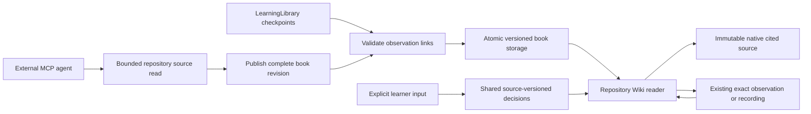

# Cycle 0009 — Source-grounded repository learning content

Type: product-increment
Status: closed
Result: demonstrated within the bounded source-authoring and reader scope
Delivery: committed and pushed — implementation `1bd10b3`, closure records `0313c33`; matching clean source fingerprint verified; Issue #10 closed
Goal version: 3
Tracking issue: https://github.com/laststance/codebook/issues/10
Goal issue: https://github.com/laststance/codebook/issues/1
Goal links: G02; supporting G05, G06, G07, G10, G11
Source state: [Cycle 0008](0008-recording-replay.md), implementation `1740e34`, qualified evidence `7330a3a`

## Question and expected value

Can an external agent create a useful, source-grounded repository Wiki and codemap whose learning items connect to exact source, existing observations and recorded moments, with the learner retaining selection and personal progress?

Authority: agent-selected next cycle under D008/D015 and Raphtalia's continuous delegation. No new product scope or owner approval is inferred. Fixed demonstration overviews are the current macro-content bottleneck; an actual repository document is the smallest next step toward studying unfamiliar code. Reading source does not prove that repository's runtime works.

## Hypothesis and scope

- Reuse the extension-owned MCP service, source identity/hashing, learning selection/history and existing reader; external agents author explanations, while the extension verifies references and persists them.
- Smallest observable outcome: create a source-backed learning document for this actual codebook repository through public discovery/read/write APIs; navigate its article and codemap to native source. Link established demo learning items to their retained observations/replay where evidence exists. Navigate back without executing the app or changing understanding.
- Keep agent interpretation, source-derived structure and observed runtime facts distinct. A graph edge is not an observed call path merely because an agent wrote it.
- Source changes retain historical text/anchors and surface staleness. Unknown items or missing evidence have no fabricated live/replay destination.
- Preserve all current fixed-profile runtime/replay behavior and durable learner choices. New content does not launch, continue or replay input automatically.
- Not this cycle: arbitrary-workspace runtime adapters, new debugger/language support, both alternate layouts, package/publication, final host acceptance. These remain mandatory final capabilities. Native phase-ACK reliability remains unresolved from Cycle 0008 and is not reclassified by static source reading.
- Falsify if source references cannot be verified, authoring silently overwrites learner decisions, navigation mixes observation identities, or repository documentation has to be hand-coded into a fixture catalog.

## Plan and selected skills

1. Inspect existing source, learning schemas, navigation and persisted identity. Inventory reusable code before choosing an API/schema.
2. `/plan-devex-review` on this cycle: repository source discovery/read/reveal, authored-content validation, version/conflict/error and observed-link contracts.
3. `/plan-design-review`: reading/codemap navigation, source-derived versus observed labeling, stale/empty/error states within Study workspace. Raphtalia explicitly selected this cycle's plan in the target question on 2026-09-19; the formal seven-pass review is complete with D3–D6 approved. Earlier primary assessment is not retroactively a completed skill. Final design is context; later layouts are not this implementation scope.
4. `/plan-eng-review`: bounded file access/storage, source anchors, identity/history, persistence and regressions, after formal UX decisions. The same owner answer explicitly selected this plan for engineering. Freeze reviewed amendments before continuing implementation; earlier primary assessments are not formal or independent results.
5. Implement one connected slice; actual external-agent authoring and actual-host navigation in VS Code and Cursor; browser interaction QA and meaningful `/review`. Investigate unexplained failures before retries.

Routine reversible decisions stay agent-owned under D008. The fresh 2026-09-19 session successfully created an independent plan reviewer; its two P2 amendments are recorded below. Same-host independent development coverage is separate from outside-model coverage and the final ten-review gate.

## Validation contract

Plan review will fix exact schema, bounds, source set, host versions and reproducible commands before execution.

| Check | Expected observable result | Required evidence |
| --- | --- | --- |
| Public authoring | External agent discovers source/content contracts and creates the repository document without a prewritten private sequence | Actual MCP discovery/request/response transcript, immutable source hashes |
| Source fidelity | Every source anchor resolves to the referenced bytes; changed/missing/outside-workspace source is explicit | Native reveal plus hash/path/drift negative cases; no silent retargeting |
| Macro/micro continuity | Article/codemap/established item/observation/replay navigation retains the exact selected item and source version | Two-direction navigation and no additional application operations |
| Evidence classification | Source-derived graph/text never becomes observed evidence without existing recorded proof | Unobserved/partial/wrong-reference tests and visible labels |
| Learning independence | Authoring/navigation/restart preserves learner decisions; only explicit learner action changes understanding | Before/after persisted decision records |
| Recovery | Conflict, bounded storage, missing data and restart preserve prior valid content with actionable recovery | Actual filesystem/protocol tests and explicit error UI |
| Required hosts | Supported reading/navigation works independently in actual VS Code and Cursor | Host/version/build-separated evidence; native pixels remain distinct from API/renderer assertions |

## Developer experience review

Scope: this cycle only, on `codex/cycle-0009-repository-learning-book`, starting at `7330a3a`. GitHub/default review base is `origin/main` (`6840178`), which also contains the unmerged Cycle 0008 delta; that larger diff is not silently treated as this cycle. `/plan-devex-review` session `52288-1789805867-7096c886`, DX POLISH. The primary agent selected routine, reversible choices below under D008 and the owner's continuous delegation. These are not invented owner answers or a spawned/plan-mode auto-selection. The explicitly accepted product/persona remains unchanged.

### Persona and developer perspective

Who: Raphtalia, a TypeScript developer learning AI-authored code, unfamiliar work repositories and interesting OSS. The external agent is the authoring client; the learner owns selection and understanding. Context: an already trusted local repository in VS Code or Cursor. Expectations: explanations cite inspectable source and clearly state what was actually executed. Abandonment tolerance is not known. Target: one useful, source-backed article within five minutes after an already connected agent starts; cold installation and model inference time are measured separately.

> I open the repository README and see “Learn an unfamiliar codebase.” The Start here table helps me find the final goal and current evidence, but the runnable instructions live in `extension/README.md`. I install three linked packages, build the extension and start a development host. I still need to start the agent server and copy its connection into my client. Those are development prerequisites, not a one-click product installation. Once connected, I can discover `checkout-demo`, run its four stops and inspect captured source. That proves useful runtime behavior, but my real question is about this repository. The current tool catalog has no way to list its source or save a reusable explanation of its architecture. The reader's outline is also tied to the demo items. I do not want an impressive graph that silently claims it ran my project. I want to read an explanation, open exactly the cited bytes, and see whether an attached observation actually exists. If I later edit the code, I want the old explanation and my learning decision retained, with the mismatch visible. If I go to a recorded stop, I want a direct route back to the same article. I should never need to run checkout just to read about codebook's own MCP boundary.

This is an agent-authored empathy hypothesis grounded in the current README/API, not a new owner interview or observed usability session.

### Benchmark and first useful moment

Aside is not installed (`command -v aside` returned no path); official web documentation was used. No competitor was timed locally. Documentation claims are not codebook acceptance evidence.

| Reference | Documented behavior | Time-to-first-result evidence | Adopted lesson |
| --- | --- | --- | --- |
| [Cursor installation](https://docs.cursor.com/get-started/installation) | Automatic indexing with visible progress | Documentation estimates 1–15 minutes for indexing, not an equivalent learning task | Show which files were included and why a source is unavailable |
| [DeepWiki repository wikis](https://docs.devin.ai/work-with-devin/deepwiki) | Generated architecture documentation and source links, with explicitly configured pages | No comparable timing established; the old English planning URL now redirects | Make explanation citations inspectable and document the selected source coverage |
| [VS Code webview guidance](https://code.visualstudio.com/api/ux-guidelines/webviews) | Themeable, accessible task views with native command actions | No comparable timing established | Reuse Study workspace/native source instead of another application |
| codebook before this cycle | Connected agent can operate the demo but cannot author repository content | Repository article path does not yet exist | Add discover → read source → publish → reveal, then measure it |

Selected first useful moment: a guided action using the learner's actual repository. After connection: (1) discover repository/source capabilities and read selected files, (2) publish a small explained path, (3) open an article citation in native source. Target budget: discovery/read ≤90 seconds, authored publish ≤120 seconds including separately reported model work, source navigation ≤30 seconds; remaining minute is recovery margin. These are targets, not measured promises. A copy-paste SDK example validates mechanics but does not substitute for actual agent authoring.

### Journey and confusion trace

| Stage | Current evidence / friction | Selected resolution |
| --- | --- | --- |
| Discover | `service.ts:65` describes only fixed runtime profiles | Add an independently discoverable repository section, example and honest source-only capability label |
| Install | `extension/README.md` needs linked packages and development host | Retain explicit prerequisites; no VSIX claim or additional service installation |
| First article | `resources.ts` has run/recording resources; no repository sources | Bounded source listing/read and one atomic book publication with a returned readable URI |
| Real use | `studyModel.ts` and `studySchemas.ts` restrict selection to demo IDs | Repository nodes keep their own stable identity; explicit links select an existing observation/item without rewriting its identity |
| Debug | Existing structured `StudyError` has code/message/recovery but no authoring errors | Exact invalid field, expected/current revision or source hash, and next read/retry action; unchanged prior content |
| Upgrade | Existing v1/v2 runtime history and learner decisions survive upgrades | Version repository content independently; preserve all old runtime files and choices, reject unknown future formats visibly |

First-time roleplay (simulated timestamps, not timed observation): T+0:00 README promises codebase learning; T+0:30 Start here leads to development records, not agent authoring; T+1:00 the extension README's MCP sequence only names checkout; T+2:00 discovery confirms no repository operation; T+3:00 the learner cannot create the requested article. Address all four content-discovery gaps with the tutorial, discovered source scope, publish example and visible reader entry. Cold install remains an explicit later product acceptance item rather than an invented sub-five-minute result.

### Eight DX passes and decisions

Hall-of-fame references were read for each dimension; their marketing speed/statistical claims are not used as measured evidence here. Scores assess this bounded plan's specificity, not delivered quality. No prior DX review was found on this new branch. All findings below remain implementation/validation work.

| Pass | Before → after | Finding and complete planned response |
| --- | --- | --- |
| 1. Getting started | 3 → 9 | Repository first result impossible today. Document three user-visible steps above; provide an executable SDK example, required host/trust/connection prerequisites and timed real-agent receipt. No new account or service is needed. Full installation time remains unverified. |
| 2. API/SDK | 3 → 10 | Reuse authenticated MCP object-schema registration, canonical resource URIs and structured receipts. Add explicit source list/read, atomic publish and navigation; no arbitrary HTML, shell, URL fetch or agent-side understanding mutation. Exact hashes, stable node IDs, expected content revision and request keys prevent silent stale writes. |
| 3. Errors | 4 → 10 | Source mismatch: reject with anchor index, expected/current hash and re-read action. Revision conflict: retain current document and return its URI/revision. Missing observation: reject the link with study/observation identity and library discovery action. Never retry execution as recovery. Invalid payloads must remain intelligible even when SDK validation occurs before the handler. |
| 4. Documentation | 4 → 10 | Put one real repository tutorial next to the existing demo tutorial; separate reference schema/limits/errors/migration notes. Discovery links to local getting-started content. Explain that verified citation bytes do not make agent prose an observed fact. |
| 5. Migration | 5 → 10 | Independent versioned repository content, immutable prior revisions and explicit conflict checks. No rewrite of runtime archive validation or automatic deletion. If shared progress needs a schema extension, preserve old bytes and test old/new-reader failure behavior before committing it. |
| 6. Environment | 6 → 9 | Native source reveal and restart in each editor, macOS arm64 versions recorded independently. SDK tests use the real installed MCP registration. Local Git and text-file bounds are reported by discovery. Other OS and installed-extension support are not inferred; native pixel access remains unresolved. |
| 7. Ecosystem | 7 → 10 | Private single-owner product: existing GitHub cycle issue is the feedback path, runnable typed example is the integration reference. No invented public community, license, pricing, cloud upload or extra language SDK. Document exact local prerequisites and unsupported repository types. |
| 8. Measurement | 3 → 10 | Record actual discovery, source reads, publish, first reveal and return timestamps, validation errors and recovery. Report model time separately; local evidence only. Count unintended runtime/progress mutations (expected zero), and identify unsupported/error states per host. No background analytics. |

Principles: zero friction after connection has a concrete bounded path; learn-by-doing uses actual source; uncertainty has exact revision/error labels; opinionated defaults retain explicit repository/file selection; explanations keep source context; the useful moment is source navigation. Overall planning specificity: 4.4 → 9.8/10; runtime quality and target timing are unmeasured. Remaining concerns are evidence collection and prior native presentation reliability, not unanswered product-scope choices.

### Reuse and bounded API direction

- Reuse `LearningLibrary`, source SHA-256, `readBoundedFile`, `atomicPrivateWrite`, `withStorageLock`, canonical error envelopes, captured-source document providers and playback controller. Search found no existing repository-book store or generic source catalog to reuse.
- Add a versioned repository book, not an unvalidated arbitrary-runtime profile. Nodes contain bounded section text, verified source anchors, explicit relations and optional existing observation references. HTML is generated from escaped structured content; authored strings cannot become commands/HTML.
- Source discovery lists a bounded eligible set from the trusted workspace, reports excluded/oversized/binary files, and reads one exact path/hash at a time. No implicit secret upload, arbitrary filesystem paths or traversal. Engineering review will fix the allowlist, symlink/race behavior and exact limits.
- Publication checks every node/anchor/edge/link first and commits a whole revision only after successful validation. Repeated identical intent returns the existing receipt; changed intent or stale expected revision fails without altering content. Historical revisions remain available.
- Runtime links resolve to existing archive/checkpoint/item/observation and source version. Related source is not relabeled as executed. A linked partial study stays partial. Recorded navigation follows stored elapsed time; input is never replayed.
- Repository selection and progress survive restart. Existing linked runtime-item understanding has one authority; article publication cannot overwrite it. Engineering review fixes whether generic progress is an additive schema or a separate persisted record before implementation.

### Implementation tasks and checklist

- [x] **T1 (P1, human: ~1 day / agent: ~1 hour)** — repository source service: bounded discovery/read/hash/reveal and actionable rejection; derives from passes 1/2/3. Files: new repository source module, protocol/resources/service and source tests. Verify traversal, drift, unsupported files, stale identity, SDK discovery and actual native reveal.
- [x] **T2 (P1, human: ~1 day / agent: ~1 hour)** — versioned learning content: validated atomic authoring, retained history and progress independence; derives from passes 2/5. Files: book schema/store and persistence tests. Verify conflict/idempotency, failure recovery, upgrade and exact observation links.
- [x] **T3 (P1, human: ~1 day / agent: ~1 hour)** — connected reader: article/flow/source/evidence/recording navigation with exact identity, return and explicit unknown/stale/partial states; derives from passes 2/4/6. Files: Study workspace, view module and interaction/native checks.
- [x] **T4 (P2, human: ~4 hours / agent: ~45 minutes)** — reproducible tutorial and measured agent run in both hosts; derives from passes 1/4/7/8. Files: extension README/example, native harness and sanitized evidence. Verify actual timings, restart, zero execution/understanding mutation and explicit evidence limits.

Acceptance checklist: public schemas/examples complete; three-step connected-agent flow timed; every error identifies problem/cause/fix/reference; source and evidence labels understandable; old archives/decisions preserved; TypeScript checks and actual SDK tests pass; both hosts independently exercised; recorded motion checked if introduced. One-command packaged installation, public community, hosted playground, new SDK languages and other OS claims remain outside this cycle's acceptance. They are not manufactured checklist passes. No extra TODO file duplicates PRODUCT_GOAL or existing unresolved native findings.

## Formal design review checkpoint

- Target: this plan, explicitly selected by Raphtalia for `/plan-design-review` and `/plan-eng-review`. Design session: `52288-1789806897-7824ad63`. Initial overall impression: 8/10; individual pass scores below assess plan specificity, not delivered UX.
- D1 answered: “A — 7項目すべて確認（推奨）.” Review all seven dimensions. This approves coverage, not a visual direction or any remedy.
- Three generated mockups are ready. A emphasizes one article column; B adds adjacent navigation/context; C uses compact navigation. They illustrate the Wiki reader inside the default Study workspace, not replacements for the three approved product layouts. Example code/text is fictional presentation content, not observed application behavior.
- All current images passed the designer's automated image-quality check. Primary visual inspection rejected the original A/C collages despite their automated passes; those originals remain in `initial-generated/`, and A/C were regenerated as individual screens and checked again. An image-quality pass is not a plan review or native UX proof.
- Durable local directory: `/Users/ryotamurakami/.gstack/projects/codebook/designs/cycle0009-repository-wiki-20260919`. It contains current PNGs, briefs, quality results, a SHA-256 manifest, generation sessions, `design-board.html` and the owner-confirmed `approved.json`.
- Comparison board: `http://127.0.0.1:55031/boards/b-20260919-084919-rzgkcn/`. The designer emitted `BOARD_URL`, and an independent GET returned HTTP 200. This URL is local to this machine, not a remote issue attachment.
- D2 feedback received through the board: B rated 5/5, A/C unrated; action `more_like_B`. Owner comment: “I understand this source revisionがでかすぎ、シンプルに小さいunderstandチェックボックスでいい”. Preserve B's composition and simplify that control. Original feedback is retained in `feedback-round-1.json`; consuming the pending request does not manufacture final approval.
- The built-in imagegen editor produced `variant-B-compact.png`, removing the large acknowledgement panel and its helper text in favor of a small `understand` checkbox. Other composition remains. The image passed automated checking, and the board was reloaded. An HTTP response's three embedded image hashes match the exact current A/B-compact/C files; B-compact SHA-256 is `9fe687a6ff72923d70f55db20065f00e6d7a9518368af70361679996b6d41e8a`.
- D3 answered: “はい、修正版 B でレビューを進める（推奨）”. B's composition with the compact checkbox is the approved seven-pass review reference; `approved.json` preserves the actual answer and image hash. Do not re-ask the variant or checkbox choice.
- D4 answered “A”: a change to any cited source places the article in Review needed without deleting historical understanding. D5 answered “A — 記事を1列にし、関係図は下へ（推奨）”: the narrow reader uses one article column. D6 answered “A — 読んでいた位置まで戻す（推奨）”: returning from an observation or recording restores the original section and reading position within the exact article/revision. All seven passes are reconciled below, with no unresolved design decision. Engineering follows the completed design amendments. Independent plan coverage remains unavailable at the previously observed provider/thread boundaries; the image checker is not a fresh independent final-product reviewer.

### Approved mockup

| Screen | Full mockup path | Direction | Constraint |
| --- | --- | --- | --- |
| Repository Wiki within Study workspace | `/Users/ryotamurakami/.gstack/projects/codebook/designs/cycle0009-repository-wiki-20260919/variant-B-compact.png` | B: native source beside article with adjacent article/relationship navigation | Compact `understand` checkbox, without the large acknowledgement panel or helper paragraph. Mockup copy/code is illustrative, not the implementation contract. |

Post-pass supplementary illustration: `/Users/ryotamurakami/.gstack/projects/codebook/designs/cycle0009-repository-wiki-20260919/reader-narrow-supplement.png`. It renders the already approved D4/D5 outcomes as a single-column reader with relationships below. It is not a new choice, an owner-approved replacement for B, a measured CSS viewport or native UI evidence. One additional image brings total generated artifacts to seven; the approved image count remains one. Exact responsive behavior is governed by Pass 6 and requires implementation QA.

### Pass 1 — Information architecture

Score: 8 → 10/10 for plan specificity after the owner's D3 visual-direction decision. No additional unresolved information-architecture finding. This is not a usability-test result.

The three priorities are: (1) selected article and its explanation, (2) exact source citation and native source, (3) related source structure and retained observations. Repository/article navigation identifies location; revision and source/evidence labels identify context. Progress remains a small learner action, not a competing panel. The diagram records the approved composition and already planned navigation; it adds no unapproved feature.

```text
codebook / Repository Wiki
├─ Book + revision / article tree
├─ Native cited TypeScript source
└─ Wiki reader
   ├─ Article title + Source-derived / Agent interpretation
   ├─ Sections + exact source citations  |  On this page / source relations
   ├─ Related retained study (explicit partial/unknown status)
   └─ [ ] understand

Article / relation → selected node → immutable native cited source
Article → View observation → exact saved observation → Return to Wiki
Article → View recording  → paused recorded moment  → Return to Wiki
Return restores the original book / revision / node / section / reading position.
Neither reading nor return issues application input or changes understanding.
```

### Pass 2 — Interaction states

Score: 8 → 10/10 after D4. Raphtalia answered “A”: compare all sources cited by the selected article; any changed source produces an article-level Review needed status near its revision. Keep the compact checkbox and historical decisions. The first anchor still identifies the native source/default runtime alias; it cannot exempt secondary citations from the article's review state. Understanding the retained historical text never acknowledges unseen current bytes. Unavailable sources remain explicitly unverified, not current. Engineering must preserve this outcome across shared runtime-item aliases and repository identities.

| Feature | Loading | Empty | Error | Success | Partial / stale |
| --- | --- | --- | --- | --- | --- |
| Book/article selection | Retain navigation and selected title; disable actions against unresolved content | Explain that a connected agent can create the first source-backed article; show connection/help actions | Identify the unavailable book and Retry; keep other valid books accessible | Exact book/revision/node and article sections | New revision available with Load latest; keep historical selection until explicit navigation |
| Source citations | Citation remains named while its current status is checked | A valid article always has an anchor; absent/invalid anchors are an error, not a blank success | Name changed/missing/unreadable source; retain captured-source access where intact | Open the exact captured source/range; current-file action remains separate | Any changed citation gives article-level Review needed; show old/current source identity; no claim of current understanding |
| Source relationships | Keep article readable while loading its validated revision | State that this revision has no related nodes; article citations remain available | Malformed endpoints invalidate the revision with an actionable error | Labeled, keyboard-operable related-node links | Label all relations Source-derived; no visual implication that the path ran |
| Observations/recording | Name the chosen retained study/moment; disable unresolved destination | Explain that no observed/recorded moment is linked; reading remains available | Missing/corrupt link shows its reason instead of a working-looking destination | Exact observation or paused replay moment, with Return to Wiki | Preserve Partial recorded study and source-version differences; no input playback |
| Learner understanding | Retain last committed check; disable save while pending | Unchecked until an explicit learner decision | Retain committed state and expose Retry | Compact understand checkbox reflects that historical source context | Retain historical check/history with Review needed; authoring and observation never auto-check it |

The table expands already accepted state requirements and D4; it adds no authoring operation or runtime behavior. No other unresolved state finding remains.

Historical blocker: D4 was unanswered across its question turn and two automatic continuations, so the goal was marked blocked. The owner's actual “A” answer resolves that condition and review work resumes here. No elapsed-time default was used. The app's goal API exposes no resume operation; the saved product/cycle state reflects resumed work without claiming an API status change.

### Pass 3 — Journey and emotional arc

Score: 8 → 10/10 after D6 A. The first pass appeared 9/10, but Pass 7 exposed the unspecified return position and corrected the pre-fix score to 8. The owner's actual answer resolves that gap: restore the original section and reading position in the exact retained article, including saved-reader restart. Emotional descriptions are design hypotheses, not owner usability evidence.

| Step | Learner does | Intended feeling | Supporting accepted behavior |
| --- | --- | --- | --- |
| First 5 seconds | Opens Repository Wiki and selects an article | Oriented | Selected book/revision/title, current tree node and Source-derived / Agent interpretation labels |
| First useful minutes | Reads a section and opens its citation | Able to verify the explanation | Immutable source/range beside article; no debugger prerequisite for reading |
| Follows a relation | Selects the next explained node | Understands the structure | Named relation and exact article/source selection; no fabricated observed edge |
| Inspects evidence | Opens a saved observation or recorded moment | Can distinguish explanation from proof | Exact source-bound observation, partial status and paused replay |
| Returns to reading | Uses Return to Wiki | Continues the same explanation | Original book/revision/node, section and reading position restored, including saved-reader restart; resized/zoomed panels retain the logical reading location |
| Marks understanding | Toggles understand | Owns learning progress | One compact learner control, committed-save feedback, independent from agent/runtime actions |
| Returns after edits or months | Revisits an older article | Can trust the history | Retained explanation/decisions; any cited-source change shows Review needed; explicit Load latest |

The five-minute connected-agent target remains unmeasured. Long-term confidence comes from retained versions and evidence, not a guessed completion percentage. Return preserves keyboard context and never issues runtime input or a learner decision. No unresolved journey requirement remains; implementation and measured return behavior are still pending.

### Pass 4 — Visual specificity

Score: 10 → 10/10 for this bounded plan. Mode: READ for article content; OPERATE for native editor, navigation and evidence actions. Approved B supplies the composition; existing native theme/typography supplies implementation values. Generated example prose and oversized raster text are not literal product copy or token values.

| Hard rejection | Result / evidence |
| --- | --- |
| Generic SaaS card grid | No: article/source/editor structure, not a feature grid |
| Beautiful image with weak product identity | No: codebook native activity and repository navigation; no decorative image |
| Strong headline with no action | No: citations, source relations and named observation/replay actions |
| Busy imagery behind text | No: native editor surfaces and text |
| Repeated mood sections | No: each article section explains a cited responsibility |
| Unmotivated carousel | No carousel |
| Stacked decorative cards as app layout | No: article is continuous; outlined relation entries are interactive destinations, not ornamental panels |

Litmus: product identifiable YES (codebook activity/title); primary anchor YES (selected article); headline scan YES (article/section responsibilities); one job per section YES; necessary grouping YES (interactive relation destinations and a distinct saved-study context); motion improves this reading surface NO (no new animation is needed); understandable without decorative shadows YES. The NO does not prescribe unnecessary motion. Existing moving replay is separate behavior with its own recording/frame evidence requirement. No unresolved visual-specificity finding.

### Pass 5 — Design system alignment

Score: 9 → 10/10 after mapping the existing approved native vocabulary. No new brand or component decision. Reuse `extension/src/ui/constants.ts`: host font via `--vscode-font-family`, source via `--vscode-editor-font-family`, 16 px body, 20 px title, 16 px section heading, 1.5 body line-height, 16 px outer padding, existing 8/12/16/20 px spacing, 4 px control corners. Colors use `--vscode-editor-background`, `--vscode-foreground`, `--vscode-descriptionForeground`, `--vscode-panel-border`, `--vscode-button-*`, `--vscode-textLink-*` and `--vscode-focusBorder`; high-contrast boundaries retain `--vscode-contrastBorder`.

Native editor/tree controls remain native. Webview citations reuse visibly linked/visited styling and focus treatment. The compact understand row reuses the small native checkbox and label; a generous transparent hit area does not reintroduce the rejected panel. Semantic states use words as well as color. The approved image is a composition reference; implementation inherits the learner's actual VS Code/Cursor theme rather than hard-coding the mockup's dark colors. No issues found; continue.

### Pass 6 — Responsive and accessibility

Score: 8 → 10/10 after D5 A. At reader content widths below 800 CSS px, use one article column, an On this page disclosure near the title and source relationships after article sections. At 800 px and above, use approved B's article plus adjacent navigation/relationship context. The threshold is the implementation fit for a readable column plus secondary context, not a new product mode. Native source remains a separate editor group; the reader never forces window resizing. Cap reading measure at 72ch where space permits, use available width below it, wrap long paths and preserve the DOM reading order. Do not shrink body type to fit columns.

At 320/390/600 px and 200% zoom, show title/revision/status first, then article/citations, relationships, related observations and the compact checkbox. Controls may wrap; article text has no horizontal scrollbar. No new tab system or mandatory animation. Native disclosure/buttons support keyboard activation. Semantic main/article/nav regions and ordered headings identify context; source status and revision describe the small checkbox without restoring its rejected visible helper panel. Keep visible focus on live updates, a 44 px interactive label area around the visually small check, text/contrast checks in host light/dark/high-contrast themes, visited citation distinction and textual state labels. Record browser behavior and actual-host evidence separately. No unresolved responsive/accessibility decision.

### Pass 7 — Decision reconciliation

| Decision | Status / impact |
| --- | --- |
| Wide composition and learner check | D3 approved: B with compact understand; do not reopen |
| Source change scope | D4 A approved: any cited source can require article review; preserve historical understanding |
| Narrow reader | D5 A approved: one column, small disclosure and relationships below; wide B retained |
| Return reading position | D6 A approved: restore the original section/reading position within the exact book/revision/node, including saved-reader restart. Resizing/zoom retains the logical reading location; no runtime or understanding mutation. |

Approval reconciliation: four distinct design decisions (D3–D6) have actual owner answers. Scope/focus answers and the board regeneration request add no remedy approvals. No decision is deferred or unanswered. No out-of-scope TODO proposal or new product requirement was selected.

## NOT in scope

- Living book and Guided walkthrough: required later layouts; this reader belongs to the existing Study workspace.
- Ordinary-repository runtime adapters: reading real source does not establish arbitrary application/debugger operation.
- New languages, remote workspaces or operating systems: no compatible execution evidence or declared support matrix for them in this cycle.
- Package, publication and installed-extension acceptance: development-host evidence remains separate from distribution.
- Cycle 0008 native phase-ACK repair: retain its inconclusive result until a changed, measured hypothesis supports another experiment.
- Final product/owner acceptance and ten fresh sequential reviews: require all product capabilities and frozen integrated evidence, not this plan.

These are existing cycle boundaries, not dropped final requirements or newly deferred design defects. No additional TODO is proposed.

## What already exists

- `DESIGN.md` and D016 provide stable entry points to the approved product and reader direction.
- `extension/src/studyWorkspace.ts` supplies native tree/selection/document integration; reuse its explicit source and observation identities.
- `extension/src/ui/studyHtml.ts` and `extension/src/ui/constants.ts` supply native theme tokens, readable typography, focus and error-state conventions.
- `LearningLibrary`, atomic private writes and the shared storage lock retain learner history, checkpoints and source versions; extend their contracts without a competing authority.
- The existing playback controller can open retained evidence without application input. Return context belongs to the reader selection, separate from playback/runtime control.

## Implementation Tasks

These four design tasks refine DX tasks T2/T3; they do not add a parallel implementation track. Their bounded behaviors are implemented and verified below. Theme checks use browser host-token emulation; normal/200% return checks use actual native hosts. Checked tasks do not imply full native-theme, installed-product or final acceptance. Planned filenames were adjusted without changing the accepted outcomes.

- [x] **DT1 (P1, human: ~2h / agent: ~20min)** — Build approved B's reader composition, compact `understand` and distinct source/evidence labels. Surfaced by Pass 1 / D3. Files: `extension/src/studyWorkspace.ts`, `extension/src/ui/studyHtml.ts`, `extension/src/ui/constants.ts`, planned `extension/src/ui/repositoryHtml.ts`. Verify article/source/relation hierarchy, no large acknowledgement panel and no observed-path claim from authored relations.
- [x] **DT2 (P1, human: ~3h / agent: ~30min)** — Make every citation participate in article Review needed; preserve historical/shared learner decisions. Surfaced by Pass 2 / D4. Files: `extension/src/learningLibrary.ts`, `extension/src/repositorySchemas.ts`, planned reader/store tests. Verify secondary-only drift, unreadable sources, original captured bytes, unchanged primary source and runtime-item aliases.
- [x] **DT3 (P1, human: ~2h / agent: ~20min)** — Implement the one-column narrow reader with relationships below and accessible controls. Surfaced by Pass 6 / D5. Files: planned `extension/src/ui/repositoryHtml.ts`, existing UI constants and reader behavior tests. Verify 320/390/600 px, 200% zoom, wide B, wrapped paths, keyboard/focus, light/dark/high-contrast themes and visually small checkbox with 44 px hit area.
- [x] **DT4 (P1, human: ~2h / agent: ~20min)** — Restore the original article section and reading position after observation/replay and saved-reader restart. Surfaced by Pass 3 / Pass 7 / D6. Files: `extension/src/learningLibrary.ts`, `extension/src/service.ts`, `extension/src/studyWorkspace.ts`, planned reader and behavior tests. Verify both evidence destinations, resize/zoom, keyboard context, unavailable-history recovery and zero application/understanding mutations.

No additional tasks arise from Passes 4/5; their token/specificity checks constrain these tasks. Pass 7 reconciles DT4 rather than duplicating it. Machine-readable tasks: `/Users/ryotamurakami/.gstack/projects/codebook/tasks-design-review-20260919-092944.jsonl` (four `jq -nc` records, design session `52288-1789806897-7824ad63`). Estimates describe implementation, not completed work.

Engineering findings add two tasks to the same sequential implementation:

- [x] **ET1 (P1, human: ~half day / agent: ~30min)** — Bind shared understanding to the complete canonical citation context; preserve typed legacy single-source decisions. Surfaced by Architecture finding 1 / engineering D2 A. Files: `extension/src/studySchemas.ts`, `extension/src/studyModel.ts`, `extension/src/learningLibrary.ts`, shared migration/learning tests. Verify secondary/range/set changes, prose-only reuse, runtime aliases, exact uncheck and failed migration.
- [x] **ET2 (P1, human: ~half day / agent: ~30–45min)** — Prepare sources outside the shared writer queue, then revalidate and atomically publish. Surfaced by Architecture finding 2 / engineering D3 A. Files: `extension/src/repositorySource.ts`, planned `extension/src/repositoryBook.ts`, existing storage utilities and book/protocol tests. Verify concurrent learner/recorder writes, stale publication, bounded preparation, cancellation/lost receipt and retained old bytes after failure.

No new tasks from Code Quality, Tests or Performance; those sections specify verification and constraints for the existing tasks. Machine-readable engineering tasks: `/Users/ryotamurakami/.gstack/projects/codebook/tasks-eng-review-20260919-185532.jsonl` (two `jq -nc` records). QA handoff: `/Users/ryotamurakami/.gstack/projects/codebook/ryotamurakami-codex-cycle-0009-repository-learning-book-eng-review-test-plan-20260919-185532.md`.

## Design completion summary

| Dimension | Before → after | Basis |
| --- | --- | --- |
| System audit | Existing DESIGN.md | Repository reader in Study workspace; no new product layout |
| Step 0 impression | 8/10 | Owner requested all seven passes |
| Pass 1: information architecture | 8 → 10 | D3 B composition with compact learner check |
| Pass 2: interaction states | 8 → 10 | D4 every-citation review state and preserved history |
| Pass 3: journey | 8 → 10 | D6 original section/reading position; pre-fix score corrected during Pass 7 |
| Pass 4: visual specificity | 10 → 10 | Concrete native article/source/evidence structure |
| Pass 5: design alignment | 9 → 10 | Existing host theme, type, spacing and focus conventions |
| Pass 6: responsive/accessibility | 8 → 10 | D5 one column below 800 CSS px, keyboard/theme/zoom checks |
| Pass 7: reconciliation | Four resolved; zero deferred | Individually answered D3–D6 |
| Required outputs | Six scope exclusions; reuse recorded | Four implementation tasks; zero new TODO proposals |
| Approved references | Seven images generated; one approved | Three initial, two corrected collages, one compact B edit, one narrow supplement; the supplement is illustrative only |
| Overall minimum of Passes 1–6 | 8 → 10/10 | Planning specificity, not delivered or independently tested UX |

The plan is design-complete. Perform `/design-review` and behavior/native checks after implementation. Independent plan voices remain unavailable; no final acceptance review is counted. The engineering review is already explicitly authorized for this same plan, so its target is not requested again.

## Engineering review preflight

Scope: this Cycle 0009 plan, explicitly selected by Raphtalia for both formal reviews. `/plan-eng-review` session `52288-1789810435-2fc76fc8`, started after design completion at `be52f13`. Interactive mode; no invented owner answer or auto-selection. Product/recent-decision brain digests are unavailable; the committed product, cycle and D016 records retain the actual accepted context.

Step 0 reuse inventory: `LearningLibrary` already owns source-versioned learner decisions, saved checkpoints and cross-window storage coordination; `atomicPrivateWrite` and `withStorageLock` supply bounded replacement and writer ownership. `StudyWorkspace` supplies native selection, captured-source documents and paused recording navigation. Repository discovery/read and a versioned authored book are the missing behaviors. Keep the existing runtime schemas and checkpoint validation. No new server, database, package dependency or artifact distribution type is necessary for this increment. No TODOS.md is present; the six recorded scope exclusions retain packaging/final acceptance explicitly.

Search-before-building findings: [Layer 1] reuse the existing storage primitives rather than introducing another locking mechanism; Node 24 documents that asynchronous filesystem operations do not synchronize concurrent modifications ([Node 24 filesystem API](https://nodejs.org/docs/latest-v24.x/api/fs.html#promises-api)). [Layer 1] Git's tracked-name enumeration is a built-in, so a custom recursive repository crawler is unnecessary ([git ls-files](https://git-scm.com/docs/git-ls-files)). [Layer 1] the host already offers JSON webview state and panel serialization; retaining a hidden DOM is not required merely to remember a reading position ([VS Code webview persistence](https://code.visualstudio.com/api/extension-guides/webview#persistence)). Context7 and official primary documentation were consulted; Aside is absent. A panel's own state is destroyed when that panel is disposed, and restart restoration requires a serializer or extension-owned persistent selection. These facts inform the upcoming mechanics review; they do not change D6's accepted outcome or verify Cursor behavior.

Complexity gate: the current plan necessarily touches more than eight files (source/schema/store/reader, extension activation, protocol/resources, shared progress and tests) and proposes at least two new services/classes. The installed skill requires an owner decision before Architecture / Code Quality / Tests / Performance. Raphtalia answered engineering D1, “B — 現在の責務分離を維持する（推奨）”. Retain the dedicated small book persistence/validation module and thin reader, reusing existing history and storage primitives. No scope reduction is adopted; do not reopen this boundary during later sections. Architecture review can now proceed. Design D3–D6 remain approved.

## Engineering review — Architecture

Prior learnings applied: `recorded-context-read-checkpoint` (confidence 10/10, 2026-09-19), `recorder-learner-shared-local-lock` (9/10, 2026-09-19) and `mcp-union-discovery-object-boundary` (9/10, 2026-09-19). Public reads must validate retained observation facts, shared stores must use the existing canonical-directory writer queue, and MCP discovery must be checked against installed SDK 1.30.0. Source-only authoring must remain available without runtime prerequisites. These are existing contract requirements, not new approvals or runtime evidence.

### Finding 1 — Understanding context (P1, confidence 9/10)

Motivating plan requirement: “Engineering must bind the full citation context without duplicating or overwriting the shared runtime-item history” (Document, identity and storage). Existing interface: `extension/src/studySchemas.ts:34` defines `learnerDecisionSchema` with one `sourceHash`; `extension/src/studyModel.ts:25` projects decisions using `latest.set(decision.sourceHash, decision)`. That existing single-source context cannot by itself acknowledge a multi-citation article. This is a missing proposed integration contract, not a demonstrated regression.

Engineering D2 A approved: “A — 引用するコードの組み合わせ（推奨）”. Store the stable learning item plus a canonical citation-context identity, computed from the validated path/full-byte hash/inclusive line ranges; exact duplicates and ordering do not create a different set. Shared learner history retains every prior intent. Agent prose edits or unrelated book revisions do not clear a matching citation-context decision. Adding/changing/removing a citation or changing its range produces a different context. Runtime single-source decisions remain explicitly single-source; they never acknowledge an article's additional unreviewed citations. Any cross-view equivalence must prove the same represented source context, not only a matching primary hash.

Migrate old decisions without changing IDs, times, boolean values or their single-source meaning; keep v1/v2 files. Reject corrupt/unknown v3 instead of falling back. Checking/unchecking affects only the selected retained context, and a stale reader context cannot issue a decision for another revision. Authoring and navigation cannot create learner decisions. Required tests: secondary-only drift, same cited code with edited prose, changed ranges/set, runtime aliases with additional citations, exact-context uncheck, legacy migration, duplicate intent/conflict, failed write preserving old state and unavailable current source. This refines DT2/T2/T3 and resolves the understanding-context remedy across later review sections.

### Finding 2 — Publication blocks shared writers (P1, confidence 8/10)

Motivating original plan text: “Under the writer lock, re-read current content” followed by “Validate all sources and observation references before atomic commit” (Document, identity and storage). `extension/src/repositorySource.ts:37` executes `await this.catalog()` on every read; lines 72/74 call Git twice. `extension/src/utils/withStorageLock.ts:15` holds the shared writer lock across `await operation()`. Performing all preparation there can delay learner/recording writes; this is a proposed integration risk, not measured production latency.

Engineering D3 A approved: “A — 準備と最後の保存を分ける（推奨）”. Prepare source/catalog acquisition, anchor validation and observation-link checks outside the shared lock. Use one bounded acquisition context for the publication instead of two Git processes per anchor; deduplicate path/hash acquisitions. Retain per-source full-byte hashes, identity and acquisition/check times, not an atomic whole-workspace revision claim. Under the existing writer lock, re-read book state, resolve same-key retry/conflict, revalidate prepared source identity/current hashes and exact saved observation facts, then atomically publish. A source/index/root or reference change invalidates preparation; preserve the old book and require explicit refresh/retry. No long Git enumeration, model work or source fetching belongs inside the final commit section.

Apply a 20-second publication budget checked throughout preparation and before commit, with at most four concurrent source reads and the existing byte/file bounds. These are implementation targets, not measured service promises. Expired/cancelled preparation cannot begin publication. Once an atomic write is in flight, retain ownership until its outcome is known; response loss or cancellation is not proof of rollback. Identical request-key recovery must report the actual committed receipt if rename succeeded. Never release a lock around still-running writes, retry application input or publish a late preparation through a new request. Measure preparation, lock wait and lock-held time separately.

Required tests: slow preparation allows learner/recording writers to complete; same/different-key concurrent publishers; source and tracked-set changes during preparation; stale expected revision; changed observation checkpoint/facts; timeout before commit; cancellation and late I/O completion; failed temporary write/rename; lost response after successful commit; exact retained old book on rejected publication. Assert identical-key retry does not create another revision. Maximum-source/document cases must demonstrate bounded work without claiming platform-wide latency. Later Performance review checks this remedy rather than reopening it.

```text
publish intent
  → validate object / bounds / instance
  → existing immutable key? identical receipt / conflict [before mutable preparation]
  → prepare catalog + exact source + saved-link evidence   [no shared lock]
  → reserve existing writer lock
      → existing key? identical receipt / conflict
      → expected revision + source identities + linked facts still valid?
          no  → reject; old book retained
          yes → atomic publish → committed receipt
  → release after owned I/O settles
source/edit/deadline during preparation → reject; no later publication
transport response lost after commit → inspect/retry SAME key; no extra revision
```

### Architecture coverage and failure handling

| Boundary | Realistic failure | Required response already in scope |
| --- | --- | --- |
| Auth/instance/workspace → source service | Agent reuses a connection after a folder/trust change | Reject wrong or retired instance; dispose owned observers; no implicit new target |
| Git catalog → bounded source | Stale cursor, symlink, oversized/binary/deleted/changed file | Explicit rejection and rediscovery; no traversal or fallback to another file |
| Source/document → book store | Invalid anchor/edge, changed source, duplicate retry or simultaneous revision | Whole-document validation, D3 preparation/commit checks and retained prior content |
| Saved checkpoint → observation/replay link | Valid-looking JSON has changed captured facts or history is missing | Compare exact saved identities/hashes on public read; unavailable destination with a reason |
| Learner action → shared progress | Secondary citation changed, old intent retried or migration/write fails | D2 exact context, idempotent append, old files/decisions retained, explicit save recovery |
| Native reader → citation/return | Unsaved current editor bytes, stale navigation response or missing old book | Immutable cited source remains the authority; validate navigation generation and D6 exact return context; never silently select latest |
| Reader → runtime | A graph entry looks observed or reading auto-starts execution | Authored source labels; read/open/return paths have zero application operations |
| Shutdown/restart | Accepted storage or selection write is still pending | Drain owned writes; recover committed immutable revision/selection, never restore runtime authority |
| Distribution | Development host works but installed extension does not | Keep packaged installation explicitly outside this cycle and required for final G10/G11 |

No additional architecture finding remains after D1–D3. No new service deployment, background indexer, language parser, graph engine or dependency is introduced. Book storage remains separate under D1 B; shared identity/storage primitives remain authoritative. Native editor evidence, ordinary-repository runtime and final acceptance remain unverified.

## Engineering review — Code quality

No additional issues found. D1 keeps source acquisition, book persistence and native reader ownership explicit; D2 extends the shared learner ledger instead of creating a second understanding store. Reuse `StudyError`, schema-derived types, bounded file reads, `atomicPrivateWrite`, `withStorageLock` and existing checkpoint/source navigation. The renderer uses structured text, nonce CSP and `textContent`; authored text does not become executable HTML. Keep protocol handlers thin and put numeric bounds in `constants.ts`. Existing lifecycle/request-generation checks must cover new reader callbacks. Do not widen fixed runtime profiles to accommodate repository nodes.

The existing `StudyWorkspace` is a coupling hotspot, so the new reader composes its exact observation/replay navigation rather than taking over runtime polling or recording. This implements D1's accepted boundary; it is not a second architecture choice. No obsolete inline diagram was found in the touched draft. Add a short prepare → validate → commit diagram beside the new publication owner; retain the existing ownership comments around shared storage. Short descriptor reads fail safely in the draft; implementation should handle bounded partial reads without claiming a source edit solely because one read returned fewer bytes.

## Engineering review — Tests

Detected framework: `node:test` with `node:assert/strict`, from `extension/package.json` and current tests; `CLAUDE.md` delegates to AGENTS.md and declares no separate framework or prompt-pattern suite. Commands: `pnpm --dir extension typecheck`, focused compiled tests while implementing, then `pnpm --dir extension test` for the integrated candidate. Browser/native flows complement these tests. No new framework is required.

The source draft has eleven previously passing real-filesystem/schema cases, including exact BOM/CRLF bytes, stale hashes, traversal, tracking changes, symlinks, invalid data, mutation during reading and pagination. Those results do not cover a book store or reader. Existing runtime/recording tests are regression references, not Cycle 0009 integration evidence. There is no measured full-branch coverage percentage yet.

```text
ENTRY / CODE PATH                                      LEARNER / AGENT FLOW
MCP status + object-schema discovery [planned E2E]      discover source-only capability
  |- trusted local root / wrong instance / bad input      |- no debugger prerequisites
  |- bounded list / empty / next page / stale cursor       `- clear unsupported-root error
  `- acquire source [11 draft source/schema tests]
      |- tracked + regular + UTF-8 + exact hash            inspect exact cited bytes
      `- absent / excluded / link / changed / too large    recover by read, never execute

publish book [planned E2E, D3]                         author -> publish -> retained receipt
  |- shape / IDs / edges / range / byte-count guards       |- invalid citation names its cause
  |- deduplicated bounded preparation outside lock        |- another learner save can finish
  |- source + checkpoint + alias validation               `- timeout retains original book
  `- shared writer queue -> re-read current file
      |- same key+input -> original receipt                recover lost response, no new revision
      |- key reuse / stale revision -> conflict            read current revision, explicit retry
      |- revalidation / expired preparation -> reject
      `- atomic write -> success OR retained old file      no late unowned commit / no fallback

read book / resources [planned E2E]                    reopen exact book/revision/node
  |- schema + hash + source + checkpoint verification      |- unavailable link has a reason
  `- corrupt / unknown / missing -> explicit failure       `- other valid books remain usable

shared progress v3 [planned regression, D2]            compact understand checkbox
  |- v3 exists -> validate; else normalize v2/v1            |- source-set match survives prose edit
  |- single-source != additional citation context          |- secondary drift -> Review needed
  |- exact set/ranges -> stable context identity            |- old understanding stays historical
  `- intent retry / conflict / failed save                  `- retry preserves original target

reader messages / native source [planned E2E]          select -> citation -> observation/replay
  |- current revision + lifetime guard                     |- no app input / no learner mutation
  |- immutable source / changed or unsaved current file     |- Return restores section + position
  |- exact retained observation + partial state            |- repeat after restart / resize / zoom
  `- newer revision / obsolete completion / close          `- never substitute another revision

rendered reader [planned browser + native QA]          keyboard / focus / narrow layouts
  |- normal / loading / empty / stale / corrupt             |- 320 / 390 / 600 px + 200% zoom
  |- text-only authored content / CSP / bounded messages    |- small checkbox, usable hit area
  `- stable DOM + section-relative restoration              `- relations below article when narrow

actual external agent [planned EVAL, existing DX scope]
  discovery -> read -> >=3 nodes + relations -> publish -> source -> return -> restart
  validation error -> discovered recovery -> retained prior content; no runtime/progress mutation
  VS Code and Cursor: separate host/build/transcript/timing records, never one inferred from another
```

Legend: draft tests are existing local evidence; every `planned` branch remains unverified until implemented and run. E2E means actual boundaries rather than a replacement mock; EVAL means the driving agent chooses calls from public discovery. The existing DX measurement contract already includes validation errors and recovery; this diagram makes that requirement explicit without adding a new feature or a new approval choice. No additional missing *plan requirement* was found; the unimplemented paths above are implementation work, not completed tests.

| Test owner | Required behavior and failure assertions |
| --- | --- |
| `repositorySource.test.ts` | Retain the eleven cases; add empty/exact/over-limit source and catalog bounds, unavailable/timed-out/oversized Git output, bounded short reads, changed tracking/root during acquisition and deduplicated batch concurrency. Four reads maximum; source identity/hash checks remain per file. |
| `repositoryBook.test.ts` (new) | Exact duplicate intent returns one receipt; changed input/key or stale expected revision fails. Prepare while a learner/recorder save completes; edit during preparation or final checks rejects publication. Late preparation cannot begin a write; accepted writer ownership lasts until its outcome is known. Failed rename, malformed/unknown file, 17th book, 21st revision and combined byte overflow retain prior bytes. Repeated anchors copy one source; inconsistent hashes for one path fail. Validate range endpoints and exact checkpoint/partial/alias identity on publication and public read. |
| `learning.test.ts`, `legacyMigration.test.ts` | **Critical regression protection:** v1/v2 IDs/times/values and runtime selection survive v3; corrupt v3 never falls back. D2 canonical sets ignore ordering/exact duplicates, but changed ranges, added/removed/secondary citations differ. Prose-only updates keep the check. Old single-source decisions cannot check a larger article. Check/uncheck/retry acts once on the original context and failed migration leaves old files intact. No regression has been observed yet. |
| `protocol.test.ts`, repository protocol cases | Real installed SDK discovery advertises object-shaped arguments and source-only availability. Invalid inputs dispatch no work; foreign/stale identities and malformed resource URIs fail. Public receipt/read/retry survives response loss followed by source deletion/change or checkpoint updates. A schema-valid document over 64 KiB and the exact 1 MiB document plus envelope reach publication; document and envelope overflow preserve prior bytes. A cancelled transport does not release an in-flight file writer or repeat publication. Existing authentication, session limits and runtime calls retain their behavior. |
| `repositoryReader.test.ts` (new), `studyWorkspace.test.ts` | Exact selection/source/observation/recording and return; saved restart and section-relative restore. Missing destination keeps a recovery action, never another article. Changed secondary source, unsaved current text, failed checkbox save, stale revision message, late success/failure, rapid navigation, close during startup and runtime retirement cannot change a newer target or resurrect panels. Compare app-operation and learner-decision counts before/after navigation. |
| Actual renderer / each native host | The approved B hierarchy, narrow layout, theme, keyboard, focus, text escaping, disabled/retry states and long-article restoration. Native source URI/hash/selection plus renderer confirmation are separate from native pixels. Record and inspect video frames for any motion/transition claim. |
| Actual agent authoring in each host | Use real codebook source, at least three useful nodes/relations and public discovery; inspect exact citations and interpretation labels. Cover the already-required source/revision error recovery without a private prescribed tool sequence. Record exact transcript, model time separately, zero runtime actions and zero learner-decision changes. Controlled source-change evidence uses an owned QA copy, never silently edits the learner's repository. No before/after quality score is invented for this new capability. |

Existing regression anchors: shared recorder/learner locking (`recordingStore.test.ts:25`), real SDK discovery (`recordingProtocol.test.ts:57`), history checkpoint revalidation (`studyWorkspace.test.ts:670`), stale open/close/retry ownership (`studyWorkspace.test.ts:451`, `:514`, `:848`), learner byte/atomic-write limits (`learning.test.ts:177`, `:217`) and transport cancellation (`protocol.test.ts:162`, `:190`). Re-run affected tests against the final candidate; historical passing counts do not satisfy this cycle.

Failure handling is required for every branch in the diagram: rejection preserves prior content or selection, exposes the existing structured error/recovery, and has a corresponding test row. The architecture failure table remains authoritative for the nine integration boundaries. No uncovered silent failure with both missing handling and missing planned tests remains; actual tests and native evidence are still pending.

## Engineering review — Performance

No additional issues found beyond Architecture finding 2. D3 removes per-file Git preparation from the shared write queue and requires one bounded acquisition context, deduplicated source work and at most four reads at once. Preserve the final revalidation and count its duration separately; a 20-second budget is a selected guard, not a measured responsiveness promise. No retry loop, background indexer or repository scan runs on every repaint.

Bound working data by declared limits: 32 sources at 256 KiB, input 1 MiB, sealed revision 4 MiB, retained file 8 MiB, 16 books and 20 revisions. These bounds are independent: fitting the source-count limit does not promise that a revision fits its byte limit. Reject aggregate overflow before replacing any file; do not load all full book files concurrently merely to populate selectors. Reuse the prepared immutable bytes inside one request and refresh mutable source/checkpoint facts explicitly; no persistent cache may hide drift. Preserve section-relative position and unchanged DOM nodes rather than retaining every hidden article DOM. Record discovery/preparation/queue/commit/navigation timings and retained byte counts during implementation evidence.

## Engineering completion summary

| Check | Result |
| --- | --- |
| Step 0 | Scope accepted as-is, D1 B responsibility separation |
| Architecture | Two findings, resolved by actual D2 A and D3 A answers |
| Code quality | Zero additional findings; existing primitives reused |
| Tests | Branch/user-flow diagram produced; zero additional missing plan requirements; all new integration/host evidence still pending |
| Performance | Zero additional findings; preparation bottleneck resolved in D3 plan |
| Required outputs | Six exclusions, reuse inventory, two engineering tasks and QA artifact |
| TODOS.md | Zero new proposals; no duplicate roadmap created |
| Failure modes | Zero critical unplanned silent gaps; nine boundaries and branch-specific tests recorded |
| Outside voice | Unavailable: own-harness Codex invocation blocked, native agent quota previously exhausted; no unchanged retry |
| Parallelization | One sequential lane; shared schemas/service/reader ownership, no independent implementation lane |
| Lake score | N/A: D1–D3 compared implementation kinds, not coverage shortcuts |
| Unresolved decisions | Zero |

Sequential implementation, no parallelization opportunity: source/schema → shared context/store → public service/protocol → reader/navigation → integrated tests and host evidence. The plan's native and real-agent steps follow the connected implementation; no extra cross-lane gate is introduced. Relevant DX/design/engineering plan reviews are complete. Existing continuous delegation authorizes resuming implementation; another navigation-only permission question is unnecessary. `/review` and delivery checks still apply to the resulting implementation.

## Selected implementation contract

The initial contract was a primary-agent engineering/UX assessment under D008, not a retroactive formal review. Both skill definitions require an explicit owner-named target outside Plan mode: “only if the user EXPLICITLY names the target.” Raphtalia answered the scope question, “Cycle 0009 の計画を対象にする（推奨）.” The target gate is resolved. The completed formal design review adds the individually approved D3–D6 outcomes: B with compact checkbox, any-citation review state, one-column narrow layout and return reading position. The completed formal engineering review retains responsibility separation under D1 B and adds the individually approved D2 A context and D3 A publication mechanics. Implementation may resume under D008; the source/schema draft below remains unvalidated at runtime.

### Architecture and alternatives

Use one repository source service, a versioned book store and a thin native reader, composed at extension activation beside the existing study service. Preserve the fixed runtime schemas/adapter. Reject widening runtime profiles into arbitrary strings: that would remove validation without providing any runtime adapter. Reject an agent-written standalone HTML page: it would duplicate identity/progress and allow unsupported evidence claims. The book uses structured text and edges rendered by the extension, with native source documents and explicit navigation callbacks into the existing study reader.



Content publication, selection, understanding and runtime control have separate authority. Publishing never navigates or starts execution; opening an article never changes understanding. Source reading is available even when Chrome/debug prerequisites for runtime are absent. Connection/trust/instance checks still apply.

### Source scope and fidelity

- Scope is the currently trusted, local, single selected workspace root, which must itself be a Git working-tree root. Discovery declares that boundary; unsupported subfolder, remote, virtual or non-Git workspaces receive an actionable prerequisite error. No remote Git fetch.
- Enumerate tracked names with fixed `git ls-files --cached -z --` arguments, cwd fixed to the verified root, a 5-second timeout and 2 MiB output bound. No caller-supplied executable or command fragments. At most 5,000 entries; at most 100 entries per returned page. Exact paths, not shell globs, select reads.
- Accept bounded UTF-8 text in `.ts`, `.tsx`, `.mts`, `.cts`, `.js`, `.jsx`, `.mjs`, `.cjs`, `.md`, `.mdx`, `.css`, `.html`, `.json`, `.jsonc`. Exclude dot-path components, dependency/build/coverage/artifact directories, lockfiles, credential/private-key names, symbolic links and nonregular files. These rules limit the read surface; they are not a promise to detect secrets inside allowed source. No code is uploaded except what the authorized MCP client explicitly requests.
- Limit a source file to 256 KiB and paths to 512 characters. Reject absolute, traversal, empty, control-character or backslash paths. Require tracked membership on every acquisition. Use no-follow file opening, checked file identity and bounded reads; verify root containment/identity before and after I/O. Reject modification, invalid UTF-8 and NUL data. Inspect source hashes again during publication; do not silently accept a changed file.
- Source read returns relative path, full-byte SHA-256, line count and text. Anchor uses that hash plus inclusive one-based start/end lines. Publishing copies the verified full source into the revision, deduplicated by path/hash; at most 32 distinct sources. Later drift changes a status label, never the retained bytes. Native current-file reveal also checks unsaved editor text; otherwise offer the immutable cited version.
- No recursive parser or language-server claim. Edges are authored source interpretation, with labels `calls`, `uses`, `contains`, `related`; none means observed execution.

### Document, identity and storage

- Stable `bookId` and node IDs are lowercase slugs (maximum 64 characters); revision is a positive integer. Document contains title, summary, 1–64 nodes and 0–128 directed edges. Each node has title, up to 12 titled text sections (each text ≤12,000 characters), 1–8 source anchors, and up to 8 optional observation links. Whole submitted document ≤1 MiB; sealed revision ≤4 MiB. Duplicate IDs, unknown edge endpoints and invalid ranges fail before any write.
- Primary anchor is explicitly the first anchor. A repository node's default learning identity is `repository/<bookId>/<nodeId>`. An optional existing runtime `learningItemId` is accepted only when a verified linked observation names that item and the initial primary source hash matches its capture. That binding cannot change in later revisions. Under approved D4, article-level Review needed checks every cited source, including secondary anchors; primary identity cannot suppress that state. Preserve old learner decisions and observations with their own source versions. Engineering D2 A binds understanding to the canonical complete citation context in the shared append-only history; primary-only runtime decisions cannot acknowledge an article's additional citations.
- A runtime observation link carries `studyId`, `observationId` and captured `sourceHash`. Resolve it against `LearningLibrary.readCheckpoint`, require a saved checkpoint and exact observation identity/hash. Preserve the checkpoint's outcome, including partial. A later annotation/checkpoint may append facts; it must not retarget or replace the linked observation. Missing/corrupt history disables the destination with its reason.
- One private atomic file per book retains at most 20 revisions within an 8 MiB file limit; at most 16 books. No eviction. `withStorageLock` serializes the final publication with learner/recording storage; engineering D3 keeps source preparation outside that lock. Read/schema/hash validation happens on every public read; corruption must not fall back to an older valid revision silently. A revision includes its request key, input digest, immutable copied source and publication time.
- Publication accepts `expectedRevision` (0 for creation) and a stable key. After input/instance validation, check immutable retained intent before mutable source or link preparation: identical key/input returns its original receipt even after source deletion/change or checkpoint updates; changed input conflicts. Under engineering D3 A, only a new key prepares verified source copies and observation references outside the shared lock using a bounded deduplicated acquisition context. Under the writer lock, re-read current content; identical key/input returns its original receipt, changed input under that key fails, stale expected revision fails. Revalidate prepared source identities/hashes and linked checkpoint facts before atomic commit. A failed temporary write, bound, deadline or validation retains the previous file; a lost response after successful commit is recovered with the same key. Track preparation/commit timing and per-source check times without claiming an atomic whole-workspace snapshot. Use a 20-second preparation/publication budget and four concurrent source reads; do not abandon an in-flight writer or treat cancellation as rollback.
- Upgrade shared learner progress to a new v3 file/decoder that admits repository identities while preserving existing runtime selection and decisions. Read v3 by existence, otherwise normalize validated v2/v1 in memory. First explicit write creates v3; retain old files. Malformed or unknown-version v3 never falls back. Older builds may read retained old files and cannot overwrite v3; document that their later old-format decisions are not automatically merged. Reuse the existing append-only intent/lock implementation; extend the understanding projection to exact typed single-source or citation-set contexts under engineering D2 A. Preserve the original IDs/times/values and context meaning during migration. Prose-only edits reuse a matching context; changed citation ranges or sets do not. Agent APIs expose no understanding mutation.

### Public API and recovery

API version advances additively. MCP tools keep object-shaped discoverable schemas. The document remains bounded at 1,048,576 bytes; the authenticated HTTP envelope is separately bounded at 1,114,112 bytes (document plus 64 KiB for keys and JSON-RPC metadata). Both limits reject without writes; authentication, request count and read deadline checks remain:

| Operation | Result / rejection |
| --- | --- |
| `codebook_sources` (`instanceId`, optional cursor) | Bounded source listing and declared exclusions/limits; no file contents |
| `codebook_source` (`instanceId`, `path`, optional expected hash) | Exact current eligible text/hash/range metadata; mismatch returns SOURCE_CHANGED |
| `codebook_publish_book` (`instanceId`, `bookId`, `key`, `expectedRevision`, `document`) | Committed revision/hash and current-instance book URI; same intent safe to retry |
| `codebook_open_book` (`instanceId`, `bookId`, `revision`, `nodeId`, optional anchor index) | Exact article/source selection receipt; no application input |
| Repository/book resources | Discover books and retained revisions; read exact revision and its verified links; canonical instance-owned URIs only |

Every error keeps the existing `code/message/recovery` envelope. Reuse SDK pre-handler text errors for invalid schema arguments. Dedicated book conflicts, unsupported source, missing source, wrong instance, corrupt storage and unavailable historical links identify the failing field/reference and next safe read/retry. Partial pagination is explicit; bad/stale cursors do not silently restart. Status distinguishes source capability prerequisites from runtime prerequisites.

### Reader interaction and accessibility

- Add a Repository Wiki entry to the existing codebook activity container. The reader is a document tab within Study workspace, not a fourth display mode. It contains a book/revision selector, article list, current title, “Source-derived · Agent interpretation” label, sections with source buttons, a labeled relationship list, learner checkbox and related observed moments.
- Selection is one explicit `book/revision/node/anchor` record, persisted independently of authoring. Click a node/relationship to select it; click a citation to open its immutable native source. “Open current file” is separate and rejects changed/unsaved bytes. A newer book revision announces availability and offers Load latest; it never steals historical selection or rewrites an open article.
- “View observation” opens exactly the existing saved study and observation in Study workspace with follow disabled. “View recording” opens that study's existing replay, then seeks its recorded elapsed time without play or runtime input. Before leaving, retain the exact book/revision/node plus the current section, reading position within that section and keyboard return context. A visible Return to Wiki action restores that location, including after a saved-reader restart. Use a section-relative reading location so width/zoom changes cannot apply an unrelated page offset; immutable revision identity prevents applying it to a different article. Missing/corrupt return content shows an explicit recovery state rather than silently selecting another revision. Unknown/unrecorded evidence shows a reason instead of a false active link.
- The compact `understand` checkbox records explicit learner understanding of the retained source context. Existing runtime-item aliases use the same learner record; repository-only nodes use new stable identities. Any changed cited source produces article-level Review needed near the revision, even if the primary source still matches. Preserve historical decisions; checking an old article never acknowledges changed current bytes. Saving is disabled during pending storage; failure retains the last committed checkbox and exposes explicit Retry. Historical understanding is labeled as historical; unreadable sources are unverified and source drift never shows a current completion claim.
- Empty: explain how a connected agent authors the first article and expose connection/help actions. Loading: retain navigation but disable stale destination/checkbox actions. Stale: show old/current hashes and retain cited-source access. Corrupt/missing: show the affected book or link with retry, without hiding other valid books. Partial runtime: label the linked study partial. No unlabeled success colors or invented coverage percentage.
- Semantic headings, native buttons/selects, keyboard Tab/Enter/Space, visible focus, 44-pixel hit areas around the small checkbox, theme tokens and wrapped content at 320/390/600 px and 200% zoom. Under D5, readers below 800 CSS px use one article column, a small On this page disclosure and relationships below; wider readers retain B's adjacent context. Keep 16 px body text and cap measure at 72ch, without forced horizontal article scrolling. Relationship list remains usable without graph layout; no forced animation or drag interaction. Only changed content replaces DOM nodes so focus survives live status updates. Normal browser checks validate these states; native API/pixels are separately classified.

### Build and evidence sequence

1. Source service and schema tests: a real temporary Git repository, tracking/path/encoding/size/identity changes; no mock replaces filesystem membership. Public SDK discovery tests inspect the actual advertised schema and error behavior.
2. Store/progress tests: concurrent writers, stale revisions, lost response/idempotency, source changes during validation, atomic failure, bounds, malformed/unknown history, retained revisions, v1/v2 migration and failed v3 without fallback. Runtime partial/wrong observation links and alias binding are explicit cases. D4 regression: changing only a secondary cited file must produce article-level Review needed while retaining the historical checkbox/decision and original captured bytes; an unchanged primary file cannot clear it.
3. Reader/native bridge: repository source provider, article navigation, existing exact observation/replay opening, native source hash/selection and independent learner progress. D6 regression: leave a long article midway through a section for an observation and for replay, then restore that section/reading position; repeat after saved-reader restart and width/zoom changes, preserving keyboard context. Missing/corrupt historical content must not restore another revision. Confirm zero application operations and unchanged learner decisions from all reading/return paths. Validate D5 at 320/390/600 px and 200% zoom.
4. Actual driving-agent authoring of codebook source in each host: discover → choose/read source → create at least three useful nodes/relations → publish → open → inspect source → navigate retained observation/replay and return → restart. Preserve both host versions, clean source/build identity, request transcript, elapsed times and state before/after. A scripted publisher is fixture evidence only.
5. Browser interaction QA on the real rendering module plus native host checks, then `/review` where its applicable gates permit. Retain missing independent/native pixel coverage; a primary review is not one of the final ten.

Performance expectations: no repository scan on each UI repaint, no binary/frame payloads in a source listing, no unbounded parallel file reads. Source enumeration has an explicit deadline, and publication is bounded by declared file/document limits. Record operation timings; no unsupported throughput claim. Reuse current code/tests before adding abstractions; each new module has one ownership boundary. Exact numeric limits live in `constants.ts`.

## Attempts and evidence

Final local implementation (2026-09-19): `pnpm --dir extension test` passes **238/238**, zero failed/skipped/cancelled, in 16774.828042 ms. Source fingerprint `72930ccaea8a50e1cfd6ce896f6753bb2eb2d9ebaeaa418ecc84714696a1522d` covers 180 files on dirty base `7a16827`; [the source inventory](evidence/0009/source-hashes.txt) and [sanitized manifest](evidence/0009/manifest.json) bind the exact candidate to private logs, recordings and receipts. Tests include real Git/storage and actual SDK/HTTP boundaries, complete-citation progress and legacy migration, atomic publication/idempotency and envelope bounds, cancellation/drain behavior, native-layout ownership and concurrent explicit Open Study. The README's executable SDK example also passed against a real HTTP service and temporary tracked source with zero runtime runs or learner decisions; it is documentation-mechanics evidence, not actual-agent authoring.

[Native validation](evidence/0009/native-validation-20260919.md) records actual driving-agent publication in both VS Code 1.138.0 and Cursor 3.21.13: four real repository sources read, three articles/seven citations/two relationships authored, source hashes/ranges inspected and restart retained. Runtime observations are host-local fixture evidence. Cursor's four-stop checkout and seven phase images are demonstrated; VS Code retains its partial outcome after the initial image timeout. Later successful replay does not overwrite that historical failure.

On the same final 238-test build, both actual editors pass observation and recording round trips at normal and 200% scale using real Wiki buttons and the Study context Return button. Before/after book/revision/article/citation/section/fraction/focus match renderer and persistent records. One learner decision, the unrelated dirty draft and hidden navigation chrome survive. Paused replay is ready at each exact saved observation. Both processes exited 0 and isolated settings were restored byte-for-byte. Videos and independently extracted/inspected frames prove the bounded native presentation; zoomed static screenshot crops are excluded. Manually changed layouts stay user-owned.

The [same-host implementation review](evidence/0009/implementation-review-20260919.md) resolves R1–R9 and [design review](evidence/0009/design-implementation-review-20260919.md) resolves D1–D6. Earlier 212/215/234-test cuts, failing cancellation/wrapper/layout/chrome hypotheses and red-before regressions remain recorded in those reports and native evidence. Original browser QA had 31 passing assertions with a transient stale warning; it remains a qualified report, followed by separately recorded passive-message/focus/visited-link fixes and independent adapter/native verification. Full `/review` and `/design-review` workflow coverage is incomplete, and outside-model coverage remains unavailable. Development reviews do not count toward the final ten.

Individual first-publication/open timings were 33.866333/143.706667 ms in VS Code and 37.101292/107.099375 ms in Cursor. These do not establish cold-install time, end-to-end model authoring time or the planned five-minute first-result target. Private artifacts remain local and ignored; copy them to an accessible durable location before moving/deleting this workspace, then update the manifest.

Fresh-session [independent plan challenge](evidence/0009/plan-review-20260919.md): reviewer creation succeeded on the same checkout/branch at `6f22f12`; all seven draft hashes matched, and fresh typecheck/11 source tests passed. Two P2 findings were adopted under D008 without changing D016/D017: (1) resolve immutable committed keys before mutable preparation and again under the lock, so source/checkpoint drift after response loss cannot prevent receipt recovery; (2) preserve the 1 MiB document bound and admit its JSON-RPC envelope using a separate 1 MiB + 64 KiB transport bound. Both now have passing implementation regressions in the final 238-test cut. This is same-host independent plan coverage, not an outside model or final-product pass.

Historical restored draft before implementation: repository source service, input schemas, source bounds/errors and eleven filesystem/schema regression cases. On 2026-09-19, `pnpm --dir extension typecheck`, `pnpm --dir extension exec tsc -p tsconfig.json` and `node --test extension/dist/tests/repositorySource.test.js` passed (11 tests, zero skipped/cancelled/failed). Tests use real temporary Git repositories and files, including changed bytes, traversal, symlinks, unsupported/binary data and stale discovery. At that initial draft checkpoint no public API/reader/native integration was implemented. The draft compilation did not regenerate clean build provenance; no native capability follows from it. Cycle 0008's source/runtime/replay checks remain historical evidence with their exact revision and limitations; they do not verify this increment.

## Result and decision

**Demonstrated within scope. Keep** the bounded source catalog, immutable authored revisions, complete-citation progress model and existing Study/replay bridge. The agent can now teach this real repository's source without hard-coded articles, and the learner can inspect native citations and return from established evidence in both editors. **Revise** native navigation ownership: await accepted workbench changes, verify a receipt rather than a resolved command, preserve manual layouts and retain hidden navigation chrome for Wiki evidence entry.

This is source-only real-repository evidence. The runtime remains limited to prepared demonstration profiles. The next single candidate is a bounded real-repository runtime feasibility experiment: select one non-fixture local TypeScript application after read-only inspection, freeze its launch/debug/source and observation requirements, then test the smallest meaningful path. This advances the core unknown behind G01/G03/G06/G10/G11 before more reader polishing. Recording and both later layouts remain required; no goal outcome is reduced. Full skill convergence, native phase-ACK reliability, packaging, three intended uses, owner acceptance and the ten-review gate remain open.

## Handoff

The requested restoration, new-reviewer availability check, independent plan challenge and reviewed Cycle 0009 implementation are complete locally. Preserve the original seven-file backup. D016/D017 and all actual owner answers remain resolved. Implementation commit `1bd10b39c35ef9f9e4ff3e5da003edc21219ac70` is clean and its 180-file source fingerprint exactly matches the validated native cut. Closure records `0313c33` are pushed on `codex/cycle-0009-repository-learning-book`; Issue #10 is [closed with committed evidence](https://github.com/laststance/codebook/issues/10#issuecomment-5742534461). The branch retains the unmerged Cycle 0008 increment; no PR, merge, package or publication is claimed. Both isolated QA hosts are stopped. Goal #1 stays open, final reviews remain 0/10, and owner acceptance is outstanding. Continue only the selected next bounded cycle under D008; no separate task or background automation was created.

## GSTACK REVIEW REPORT

| Review | Trigger | Why | Runs | Status | Findings |
| --- | --- | --- | --- | --- | --- |
| DX Review | `/plan-devex-review` | Agent source/content contract | 1 primary, Codex host | CLEAR (PLAN); bounded native authoring measured | Eight passes, four tasks; specificity 4.4 → 9.8; zero unresolved; log commit `0b5c690` |
| Outside Review | Installed workflow preflight | Independent challenge | 0 completed | unavailable | `source: none`, `outside_provider: none`; DX, design and engineering phases lack independent coverage |
| Independent Plan Challenge | Explicit fresh-session owner request | Source/store/protocol/reader integration | 1 fresh same-host subagent | DONE_WITH_CONCERNS; amendments adopted | Two P2 findings: immutable receipt lookup before preparation and bounded HTTP envelope; both regressions pass |
| Design Review | `/plan-design-review` | Reader UX | 1 primary, Codex host | CLEAR (FULL PLAN) | Seven passes, approved D3–D6; specificity 8 → 10; four tasks, zero unresolved; log commit `7b078e7` |
| Eng Review | `/plan-eng-review` | Architecture, code quality, tests, performance | 1 primary, Codex host | CLEAR (PLAN) | Two architecture findings resolved by D2 A / D3 A; D1 B retains separation; zero unresolved or critical unplanned gaps; log commit `be52f13` |
| CEO Review | Existing goal/design | Product scope unchanged | 0 this cycle | not requested | Existing product direction retained |
| Implementation review | Meaningful Cycle 0009 diff | Source/store/protocol/reader and native follow-ups | Same-host independent reviewer with specialist lenses and targeted rereviews | Bounded findings resolved; full skill incomplete | R1–R9 fixed with regressions and independent probe/native-evidence verification |
| Design implementation review | Working repository reader | Approved B and responsive/return behavior | Same-host independent browser audit and native-evidence inspection | Bounded findings resolved; full skill incomplete | D1–D6 fixed; token themes, keyboard, normal/200% actual-host returns verified with stated limits |
| Browser QA | `/qa-only` | Real renderer over mocked native boundaries | One primary pass | DONE_WITH_CONCERNS (historical) | 31 assertions; transient warning retained, later fix verification documented separately |

OUTSIDE COVERAGE: unavailable in `cycle-0009-dx-plan`, `cycle0009-design` and `cycle0009-eng`. Own-harness nested Codex execution is excluded; native thread capacity was exhausted in this session. No outside-provider result or cross-model agreement is inferred; same-host independent development findings are recorded separately. Primary reviews ran in the Codex host with unknown recorded model identity. Prior Cycle 0008 reviews do not cover this increment.

VERDICT: The bounded Cycle 0009 source-authoring and native reader result is demonstrated on the 238-test candidate in both required hosts. Fresh reviewer creation succeeded; independent plan amendments and subsequent R1–R9/D1–D6 findings are resolved within scope. Full skill convergence, outside-model coverage and final-product acceptance are not claimed. Implementation `1bd10b3` is committed with a matching clean source fingerprint. Closure records `0313c33` are pushed and Cycle #10 is closed; Goal #1 remains open.

NO UNRESOLVED DECISIONS
