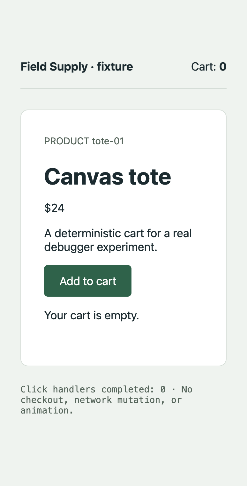
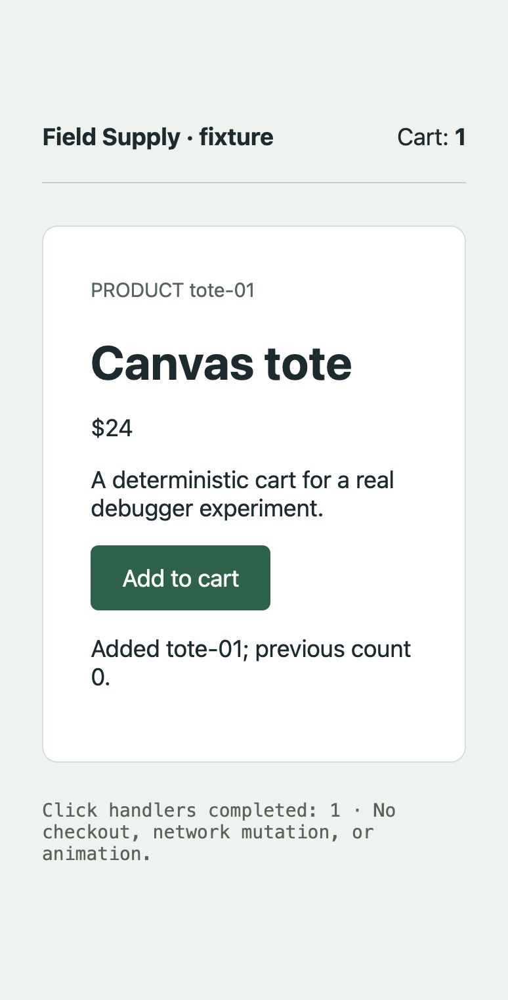

# Cycle 0001 evidence

Result: **demonstrated for the fixed synchronous fixture**, with explicit limits in [the cycle](../../0001-click-pause-resume.md). The evidence comes from the actual Extension Development Host, integrated browser, and js-debug. These are fixture screenshots, not the approved product mockup.

- [Environment and tested implementation hashes](environment.json)
- [15 scenario results and assertions](results.json)
- [Unit/native verification and visual inspection](verification.json)
- [Unsuccessful and intermediate attempts](attempts.json)
- [Review coverage and remaining limits](review.json)
- [Provenance and sanitization](provenance.json)
- [SHA-256 checksums of this sanitized bundle](SHA256SUMS)
- [Reproduction and control contract](../../../../experiments/cycle-0001/README.md)

## Baseline evidence

Run `4ddfb2ec-a1d6-4f73-97c4-4994f1c15f6b`: verified `fixture/cart.ts:9`, real thread 0, pause generation 1. Captured values: product `tote-01`, price `24`, cart count `0`. Continued DOM: cart count `1`, completed handlers `1`.

[Manifest](runs/4ddfb2ec-a1d6-4f73-97c4-4994f1c15f6b/manifest.json) · [ordered events](runs/4ddfb2ec-a1d6-4f73-97c4-4994f1c15f6b/events.jsonl) · [snapshot](runs/4ddfb2ec-a1d6-4f73-97c4-4994f1c15f6b/snapshot-1.json) · [executed JavaScript](runs/4ddfb2ec-a1d6-4f73-97c4-4994f1c15f6b/executed.js) · [source map](runs/4ddfb2ec-a1d6-4f73-97c4-4994f1c15f6b/build/cart.js.map) · [explanation](runs/4ddfb2ec-a1d6-4f73-97c4-4994f1c15f6b/explanation.md)

| Before input | At the verified pause | After continuation |
| --- | --- | --- |
|  |  |  |

Before and paused images have identical pixels: code is stopped before mutation. Their independent request/receipt events and pause generation establish capture correspondence. Screenshots alone do not prove debugger identity; inspect the manifest, source, snapshot, and event sequence together. Images are unmodified and contain only the dedicated fixture.

## Scenario matrix

A negative-case pass means expected rejection/cleanup. `capture-timeout` intentionally has no accepted paused image and is only partial visual evidence. The supplemental decoy run is retained alongside the 15 primary cases.

| Scenario / manifest | Assertion outcome | Runtime outcome |
| --- | --- | --- |
| [normal](runs/4ddfb2ec-a1d6-4f73-97c4-4994f1c15f6b/manifest.json) | pass | completed |
| [hold](runs/6fd51281-512a-4c01-b996-72fa0de0ef86/manifest.json) | pass | completed |
| [duplicate](runs/c2269ecc-12c3-4da2-97d0-bdeb38acccec/manifest.json) | pass | completed |
| [continue-race](runs/dafce5d1-4d3f-4c70-a954-14471fe03159/manifest.json) | pass | completed |
| [manual-race](runs/8b8eb971-ca69-466f-934f-986995addd3f/manifest.json) | pass | failed |
| [cdp-resume](runs/9903126d-be3c-4c6a-8a38-9ffec808aaee/manifest.json) | pass | failed |
| [decoy](runs/423d8143-5f09-4b4f-b808-e320305e6c60/manifest.json) | pass | completed |
| [stale-script](runs/5cc4d70b-52ee-4c27-bbe0-d003473ab6c2/manifest.json) | pass | failed |
| [source-drift](runs/50671d9f-2b67-46e0-853f-69009682e1c3/manifest.json) | pass | failed |
| [unbound](runs/0e0bd4c2-c3b0-4895-adb3-ace5b989b783/manifest.json) | pass | failed |
| [capture-timeout](runs/bd551adb-e7b8-434b-a75a-aacc84719bab/manifest.json) | pass | completed |
| [disconnect](runs/a823e4e5-0507-4a0f-af2f-dd3369e1677b/manifest.json) | pass | failed |
| [terminate](runs/8bb6b528-b511-41c9-8a7d-19cd76882446/manifest.json) | pass | failed |
| [disconnect-after](runs/d3ec7114-7565-4e34-8d8d-15bc45be2ee9/manifest.json) | pass | failed |
| [cancel-prepare](runs/8e6c424e-0896-4770-b6f2-4a8290d836e1/manifest.json) | pass | cancelled |

The 40-second hold lasted 40,006.52 ms; state retrieval took 5.24 ms and continue response 5.87 ms. These are one-machine observations, not a service-level guarantee. Response-delay injection occurred locally after a real CDP response; it is not measured natural network latency.

## Validity and portability

Use each final manifest's capture status/file and committed snapshot reference. An unreferenced file or invalidated generation is not valid pause evidence. Each run includes explicit environment, expectations, observations, hashes, failures, and final owned-resource state. JSONL times are local receipt times; they do not establish causality across separate services.

Text replaces the absolute repository prefix with `<repo>`. Raw credentials, connection descriptors, profiles, native logs, and harness configuration are not included. The bundle is about 3 MB and contains all final-suite fixture PNGs and allowlisted evidence. Earlier raw diagnostic profiles remain local; their committed summaries identify availability and limitations.

The environment accurately records base revision `5294d56fb0d5f56a8a0f2feb8115579c5e995695` and a dirty worktree during execution. Compare every `sourceHashes` entry against `experiments/cycle-0001/` in the containing implementation commit; the later commit must not be misrepresented as the revision already checked out at execution time. `SHA256SUMS` covers the sanitized files and excludes itself.

No recording/replay, LLM explanation service, product MCP, complete checkout, real-repository support, alternate layouts, installed VSIX, or external-model review is established here.
