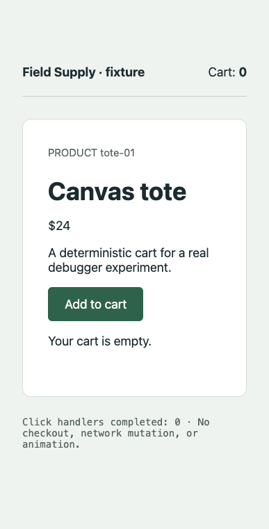
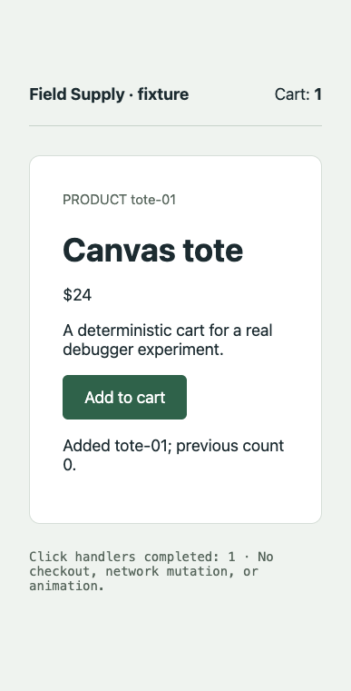
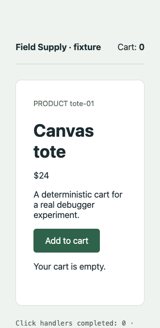
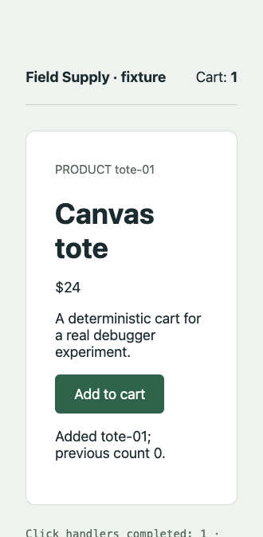
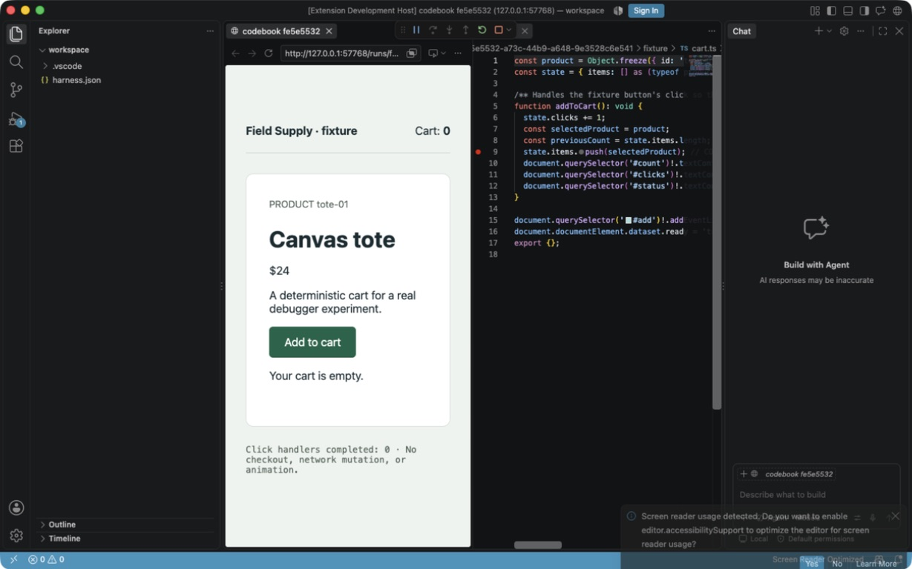
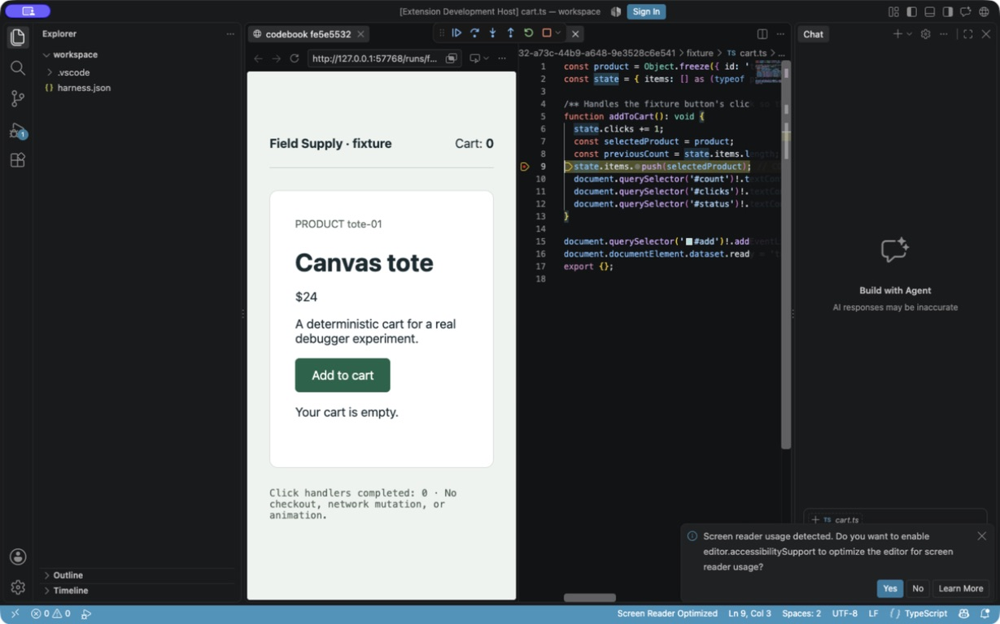
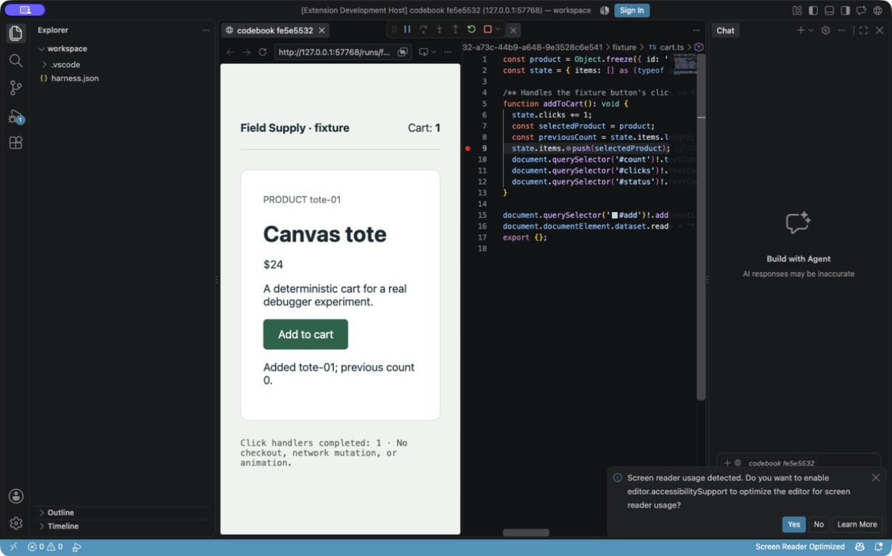
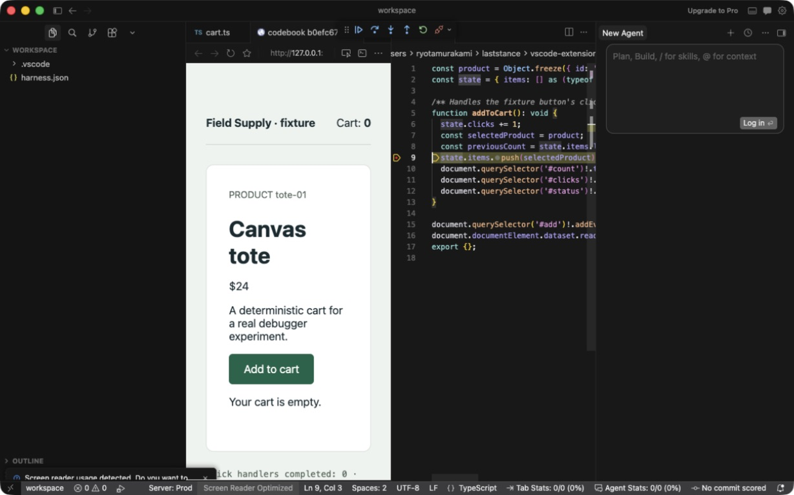

# Cycle 0002 evidence

Result: **shared synchronous runtime control demonstrated in both real hosts**. Isolated fixture experiment; not a packaged product or full native UX acceptance. See [cycle result](../../0002-cursor-runtime-compatibility.md).

| Host | Native cases | Product / API / debugger | 40-second hold: GET / continue |
| --- | --- | --- | --- |
| vscode | 17/17 | 1.138.0 / 1.138.0 / 1.117.0 | 4.76 ms / 8.34 ms |
| cursor | 20/20 | 3.21.12 / 1.128.0 / 1.93.0 | 1.80 ms / 4.04 ms |

Both actual extension hosts used Node 24.18.1 / Electron 42.10.0 on macOS arm64. These are one-machine observations, not latency guarantees. **26 unit tests passed**, including injected acquisition/cleanup failures and alternate-bundle metadata. Injected tests are distinct from native runs.

- [VS Code environment](vscode/environment.json), [results](vscode/results.json), [process teardown](vscode/teardown.json).
- [Cursor environment](cursor/environment.json), [results](cursor/results.json), [process/TCP endpoint teardown](cursor/teardown.json).
- [Attempts](attempts.json), [original/sanitized provenance](provenance.json), [review limits](review.json), [verification](verification.json), [bundle checksums](SHA256SUMS).
- [Reproduction](../../../../experiments/cycle-0001/README.md).

## Baselines

Both stop at bound `fixture/cart.ts:9`, capture `tote-01 / 24 / 0`, verify executed JavaScript against sealed JS/map/TS, then observe cart 1 and one completed click. Before/paused pixels are identical because the mutation has not executed; events and source/pause identities establish their correspondence.

### vscode: 555c986e-d73f-4660-a13a-27e80b1fa39d

[Manifest](vscode/runs/555c986e-d73f-4660-a13a-27e80b1fa39d/manifest.json) · [events](vscode/runs/555c986e-d73f-4660-a13a-27e80b1fa39d/events.jsonl) · [snapshot](vscode/runs/555c986e-d73f-4660-a13a-27e80b1fa39d/snapshot-1.json) · [executed JS](vscode/runs/555c986e-d73f-4660-a13a-27e80b1fa39d/executed.js) · [explanation](vscode/runs/555c986e-d73f-4660-a13a-27e80b1fa39d/explanation.md)

| Before | Paused | After |
| --- | --- | --- |
|  |  |  |

### cursor: 9a1a35a3-e27d-49ac-aa10-6317283799b6

[Manifest](cursor/runs/9a1a35a3-e27d-49ac-aa10-6317283799b6/manifest.json) · [events](cursor/runs/9a1a35a3-e27d-49ac-aa10-6317283799b6/events.jsonl) · [snapshot](cursor/runs/9a1a35a3-e27d-49ac-aa10-6317283799b6/snapshot-1.json) · [executed JS](cursor/runs/9a1a35a3-e27d-49ac-aa10-6317283799b6/executed.js) · [explanation](cursor/runs/9a1a35a3-e27d-49ac-aa10-6317283799b6/explanation.md)

| Before | Paused | After |
| --- | --- | --- |
|  |  |  |

## Native editor observations

The VS Code native images below are from a successful earlier observation run **before the final cleanup retry and metadata changes**. They show app and source together across all three phases. The narrow experiment panes/accessibility notification remain visible; this is not finished Study workspace QA.

| Before | Paused TS line 9 | After |
| --- | --- | --- |
|  |  |  |

Cursor has an inspected **historical native paused image**, with its own source fingerprint and manifest. Five later optional native observer attempts could not reliably select the dedicated Cursor process while another Cursor process was open; all attempts remain listed. No unrelated screen was retained. Final-source Cursor native-editor before/after coverage is missing. The final-source runtime/page evidence above is separate.

## Cases

A negative-case pass means expected rejection/cleanup. The deliberate pause-capture timeout remains unavailable. The independent decoy completes after primary deletion.

| Case | VS Code | Cursor |
| --- | --- | --- |
| normal | [pass; completed](vscode/runs/555c986e-d73f-4660-a13a-27e80b1fa39d/manifest.json) | [pass; completed](cursor/runs/9a1a35a3-e27d-49ac-aa10-6317283799b6/manifest.json) |
| hold | [pass; completed](vscode/runs/4bf5f476-e0d9-4ae4-8f01-1b4e1d2284af/manifest.json) | [pass; completed](cursor/runs/095f98b0-f3e7-4dc3-a3e0-3bc24ffcd41e/manifest.json) |
| duplicate | [pass; completed](vscode/runs/f435ac6d-bd90-4cac-bf87-0ab41d042b74/manifest.json) | [pass; completed](cursor/runs/3f0664d3-9e9a-44cf-b3a6-fcc204a42e66/manifest.json) |
| continue-race | [pass; completed](vscode/runs/9ed39209-62ff-4a8a-8f14-6cbb9fbbee37/manifest.json) | [pass; completed](cursor/runs/df22d8b1-0fdd-4801-b79c-81cebed4d8cc/manifest.json) |
| manual-race | [pass; failed](vscode/runs/6abcf333-5b69-4ff2-ba9b-5fee36ed5f3e/manifest.json) | [pass; failed](cursor/runs/703456f8-75c9-4265-8462-3c4661fd5302/manifest.json) |
| cdp-resume | [pass; failed](vscode/runs/f4510cac-a49c-473f-85ca-d4d3c626d50e/manifest.json) | [pass; failed](cursor/runs/b1b55f79-861a-4228-b962-d94f9dbf681b/manifest.json) |
| decoy | [pass; completed](vscode/runs/20c75322-f0b1-4036-a7ad-256a32694ec2/manifest.json) | [pass; completed](cursor/runs/9b36fd06-dbe7-4d65-a5b1-4e29a5c6da71/manifest.json) |
| stale-script | [pass; failed](vscode/runs/3d1022c7-5ef7-4527-855c-9f48b9dae03e/manifest.json) | [pass; failed](cursor/runs/490455a3-f442-4f22-b5d4-497f3ecbd376/manifest.json) |
| source-drift | [pass; failed](vscode/runs/29d2c88e-ba7a-4511-934f-8261280618f9/manifest.json) | [pass; failed](cursor/runs/62ca2308-f885-4992-8ea4-3fba616dfe4a/manifest.json) |
| unbound | [pass; failed](vscode/runs/4c092da9-d72a-468a-b882-1831cb9b0b3b/manifest.json) | [pass; failed](cursor/runs/0bd6522e-3a8b-415f-bfd4-ebe1ff05ce9e/manifest.json) |
| capture-timeout | [pass; completed](vscode/runs/50f37183-3ac8-4c1b-99d7-14ed6574704c/manifest.json) | [pass; completed](cursor/runs/a93003aa-f46d-4317-86d8-69c66cdcad7b/manifest.json) |
| disconnect | [pass; failed](vscode/runs/0ebf04b4-14c1-4698-84b0-84d613c1ac27/manifest.json) | [pass; failed](cursor/runs/7d9a8367-20bb-414d-b358-b2d92d957d7c/manifest.json) |
| terminate | [pass; failed](vscode/runs/e9c21f00-eea3-4378-9008-40a4ad98c27b/manifest.json) | [pass; failed](cursor/runs/33411fcb-1430-4576-b468-a260055001b1/manifest.json) |
| disconnect-after | [pass; failed](vscode/runs/bcd02fc5-e1c9-45a1-931c-53c9c12072e4/manifest.json) | [pass; failed](cursor/runs/444d8852-5638-49ff-b10c-f02d10237e6e/manifest.json) |
| cancel-prepare | [pass; cancelled](vscode/runs/4568d67d-440c-4de8-8f32-336448392cc6/manifest.json) | [pass; cancelled](cursor/runs/22e30db0-fafe-401f-8f6d-280b971c0491/manifest.json) |
| cancel-browser | [pass; cancelled](vscode/runs/f0c09316-23d4-43e8-9206-536942909706/manifest.json) | [pass; cancelled](cursor/runs/cfc38d1e-27ea-4601-8751-f05191b1bc76/manifest.json) |
| cancel-attach | [pass; cancelled](vscode/runs/0d64d3b4-1e96-4efe-a042-500872f267fd/manifest.json) | [pass; cancelled](cursor/runs/de13754f-05be-4778-b6e5-c6ad3993164e/manifest.json) |
| missing-capability | Cursor-specific | [pass; failed](cursor/runs/cc5e3545-d5a8-436e-80a0-aa63bdc8acd9/manifest.json) |
| missing-endpoint | Cursor-specific | [pass; failed](cursor/runs/42fd6308-b3a6-463d-944c-f16373671bc6/manifest.json) |
| ambiguous-target | Cursor-specific | [pass; failed](cursor/runs/0e55c346-0253-4e10-ace6-6cd221d36cfb/manifest.json) |

## Source and review boundaries

Final native source fingerprint: `4a1a75c035d657f0ad2589f885f53a4af59134921f95bf669d8cbf77972f87e6` (equal in both hosts); base revision `19fd2da98a62a4422d020e6803f7b8f1d2c72f7e`, dirty at capture. Per-file hashes match the committed source; the later documentation commit does not pretend to be the runtime capture revision.

Five native/core P2 findings were fixed across three review fix cycles. The last fix selects actual executable-bundle metadata. Per the skill limit, the review is **non-converged**, with no known unresolved finding after fixes; both external Claude Code passes timed out without a review. This is not formal GitHub approval or final-product acceptance. Final-product review streak: **0/10**.
