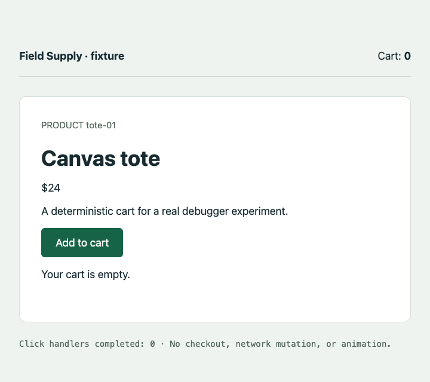
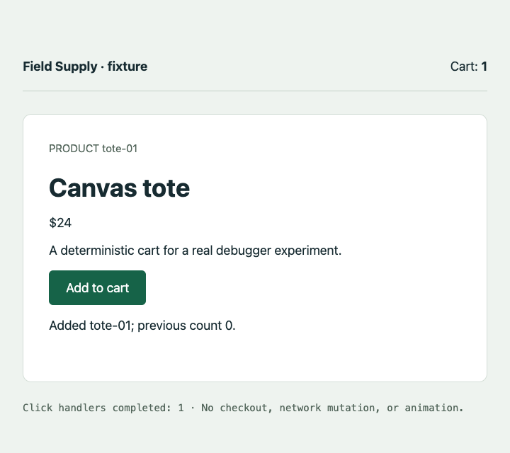

# Cycle 0003 managed-browser evidence

The browser-scoped transport is demonstrated on the recorded synchronous fixture in both real extension hosts. **The cycle is inconclusive for native editor presentation**: final native screenshots were blocked by the locked Mac. A renderer acknowledgement is not an independently observed editor screenshot. See [Cycle 0003](../../../0003-scoped-browser-transport.md).

| Host | Native scenarios | 40-second hold: GET / continue |
| --- | --- | --- |
| vscode | 21/21 | 6.18 ms / 9.26 ms |
| cursor | 21/21 | 1.41 ms / 10.04 ms |

Versions: VS Code 1.138.0 / js-debug 1.117.0; Cursor 3.21.12 / API 1.128.0 / js-debug 1.93.0; Chrome 153.0.8010.50; extension-host Node 24.18.1 / Electron 42.10.0; macOS arm64. Per-suite environment files record actual executable/version and source fingerprints. **38 unit tests passed.** These numbers are observations on one machine, not latency guarantees.

Both editors launch without an editor remote-debugging argument. js-debug owns Chrome through a debugging pipe and a unique canonical profile. Each run records actual Chrome arguments and verifies no DevToolsActivePort file, followed by profile-process absence and owned debugger/panel cleanup. No browser TCP-closure assertion is invented when no browser TCP endpoint was opened.

- [VS Code environment](vscode/environment.json), [launch arguments](vscode/editor-launch.json), [results](vscode/results.json), [editor teardown](vscode/teardown.json).
- [Cursor environment](cursor/environment.json), [launch arguments](cursor/editor-launch.json), [results](cursor/results.json), [editor teardown](cursor/teardown.json).
- [Attempts](attempts.json), [original/shared hashes](provenance.json), [review](review.json), [verification](verification.json), [checksums](SHA256SUMS).
- [Reproduction](../../../../../experiments/cycle-0001/README.md).

## Source and pixels

Source revision `8ceb901ee5183ee80cc5060a338446ffba949e7c`, clean at both matrix launches. Fingerprint `acacf9c45d07548db803a1dd8a6acb2905b5edbb3ef91591a82793454d5a14e5` matches in both hosts and every current source/configuration file. Tests include actual compiled coordinator/presenter boundaries; they do not replace native runs.

### vscode baseline

Bound `fixture/cart.ts:9`; actual tote-01 / 24 / 0; executed JS equals sealed JS/map/TS; continue observes cart 1 and one handler. The exact evidence PNG hashes match renderer receipts.
[Manifest](vscode/runs/7c49fe35-359f-40a5-8fd0-988e6d304a7c/manifest.json) · [events](vscode/runs/7c49fe35-359f-40a5-8fd0-988e6d304a7c/events.jsonl) · [snapshot](vscode/runs/7c49fe35-359f-40a5-8fd0-988e6d304a7c/snapshot-1.json) · [executed source](vscode/runs/7c49fe35-359f-40a5-8fd0-988e6d304a7c/executed.js) · [explanation](vscode/runs/7c49fe35-359f-40a5-8fd0-988e6d304a7c/explanation.md)

| Before | Paused | After |
| --- | --- | --- |
|  |  |  |

### cursor baseline

Bound `fixture/cart.ts:9`; actual tote-01 / 24 / 0; executed JS equals sealed JS/map/TS; continue observes cart 1 and one handler. The exact evidence PNG hashes match renderer receipts.
[Manifest](cursor/runs/d6a91dcb-4f16-4d7e-bc7e-766b2beabdb4/manifest.json) · [events](cursor/runs/d6a91dcb-4f16-4d7e-bc7e-766b2beabdb4/events.jsonl) · [snapshot](cursor/runs/d6a91dcb-4f16-4d7e-bc7e-766b2beabdb4/snapshot-1.json) · [executed source](cursor/runs/d6a91dcb-4f16-4d7e-bc7e-766b2beabdb4/executed.js) · [explanation](cursor/runs/d6a91dcb-4f16-4d7e-bc7e-766b2beabdb4/explanation.md)

| Before | Paused | After |
| --- | --- | --- |
|  |  |  |

## Failures remain visible

The attempts ledger includes incorrect pre-fix profile discovery (`/tmp` versus `/private/tmp`), the missing-browser launch modal, stale readiness after a decoy hides the primary pane, and the too-strong viewport-close runner assertion. Their allowlisted raw evidence is retained under each host's `unsuccessful-attempts/`. Native UI observer run `e81953e4-3860-4f87-8ea7-dbb01cb8788f` timed out before input because CUA reported “The Mac is locked and automatic unlock could not unlock it.” Its missing screenshot is not replaced with the page PNG.

A negative-case pass means correct rejection/cleanup. `capture-timeout` and `viewport-timeout` deliberately lack a certified paused image, even though the cart action can finish. Delays/reloads/closure are labeled fault injections against real hosts. The 21-case matrices have no user-facing browser-input UI, full checkout, recording, offline replay, product MCP, wiki/progress, approved layouts, packaged install or real-repository claim.

Fresh in-host development review of 8ceb901 returned NO_FINDINGS after three P2 fixes. Parent also corrected one negative-test ordering assumption. External adversarial and structured reviews each timed out after 540 seconds. The whole tree is not certified converged: external coverage is missing, and managed evidence/docs were added after the source review. Final-product streak remains **0/10**. No additional durable review learning beyond the recorded renderer-lifetime investigation.
