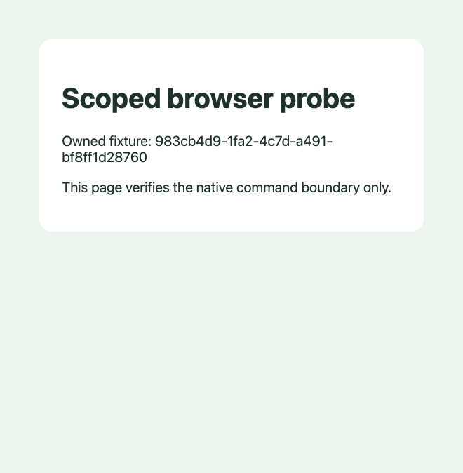

# Cursor native browser facade probe

Source: `1ec90ea72ce5bdee9a035a508cc3d4aef3fd9823`. Actual Cursor 3.21.12 / API 1.128.0, empty owned profile; editor remote debugging disabled. Reproduce with [probe runner](../../../../../experiments/cycle-0003/README.md).

[Environment and source hashes](environment.json), [command results](result.json), [owned teardown](teardown.json), [provenance](provenance.json). Repository and temporary profile paths are replaced; page pixels are unchanged. No credentials or other tabs are included.

Observed: unique fixture URL evaluation; Debugger.enable response; screenshot; owned tab absence and editor exit. Target.getTargetInfo was rejected as not allowed, JsDebug.subscribe as not found. Twenty-nine browserView commands and active browser automation exports (empty) were inspected. Installed IPC handler forwards command responses; no general third-party event stream was found on this facade.

**Interpretation:** this observed facade does not provide the target/event transport required to back js-debug directly. This is not proof that all current or future Cursor APIs lack such support. No vendor modification or restriction bypass was attempted. No DAP stop, source matching, complete native UX or product acceptance is claimed.

