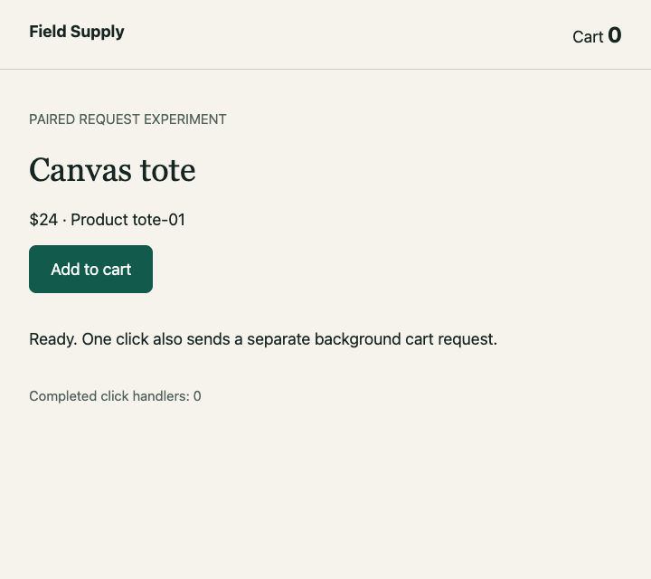

# Cycle 0004 evidence

**Demonstrated:** the frozen, instrumented browser-to-Node request boundary in both actual extension hosts. One physical click creates two concurrent, distinguishable requests; the selected server stops at TypeScript line 19 before mutation, the browser stops at line 23 before display, and continuation produces cart 1 with exactly one completed handler. This does not verify arbitrary-repository causality or the final product.

Source: `f968e02a7219743d121a01176d4a56ac6df1d779`, clean at both final suite launches. Shared fingerprint: `e89d14e46d5763ec88ba02508ae0a8a29d0b3633c7b0aa06c04928a0aee94717`.

| Host | Native matrix | 40-second hold: GET / server continue / browser continue |
| --- | --- | --- |
| VS Code | 18/18 | 6.41 / 6.44 / 2.21 ms |
| Cursor | 18/18 | 6.24 / 7.04 / 4.84 ms |

**26 paired unit tests; 40 shared unit tests.** Shared normal/stale-script/source-drift native checks also passed in each host at `37420c1`; every shared source/configuration hash still matches the final tree. These are local observations, not latency guarantees. Negative-case passes mean the intended rejection and cleanup occurred; `capture-timeout` deliberately ends partial and `late-request` invalidates a candidate success.

Versions: VS Code 1.138.0 / js-debug 1.117.0; Cursor 3.21.12 / API 1.128.0 / js-debug 1.93.0; Chrome 153.0.8010.50; extension-host Node 24.18.1 / Electron 42.10.0; runner Node 26.8.2; macOS arm64. Editors do not expose a remote-debugging port; js-debug owns a separate Chrome through a debugging pipe.

- [VS Code environment](vscode/environment.json), [results](vscode/results.json), [editor teardown](vscode/teardown.json).
- [Cursor environment](cursor/environment.json), [results](cursor/results.json), [editor teardown](cursor/teardown.json).
- [Shared regression: VS Code](shared-regressions/vscode/results.json), [Cursor](shared-regressions/cursor/results.json).
- [Original/shared hashes](provenance.json), [verification](verification.json), [attempt ledger](attempts.json), [review record](review.json), [checksums](SHA256SUMS).
- [Reproduce](../../../../experiments/cycle-0004/README.md); [frozen cycle contract and findings](../../0004-async-request-boundary.md).

## Baselines

### vscode

[Manifest](vscode/runs/f3bb60a6-4532-4668-984f-63b3fa25eda1/manifest.json) · [events](vscode/runs/f3bb60a6-4532-4668-984f-63b3fa25eda1/events.jsonl) · [server snapshot](vscode/runs/f3bb60a6-4532-4668-984f-63b3fa25eda1/server-snapshot.json) · [browser snapshot](vscode/runs/f3bb60a6-4532-4668-984f-63b3fa25eda1/browser-snapshot.json) · [server explanation](vscode/runs/f3bb60a6-4532-4668-984f-63b3fa25eda1/server-explanation.md) · [browser explanation](vscode/runs/f3bb60a6-4532-4668-984f-63b3fa25eda1/browser-explanation.md)

| Before | Server paused | Browser paused | After |
| --- | --- | --- | --- |
|  |  |  |  |

### cursor

[Manifest](cursor/runs/43929613-fe22-4421-b431-cb9220ba7c64/manifest.json) · [events](cursor/runs/43929613-fe22-4421-b431-cb9220ba7c64/events.jsonl) · [server snapshot](cursor/runs/43929613-fe22-4421-b431-cb9220ba7c64/server-snapshot.json) · [browser snapshot](cursor/runs/43929613-fe22-4421-b431-cb9220ba7c64/browser-snapshot.json) · [server explanation](cursor/runs/43929613-fe22-4421-b431-cb9220ba7c64/server-explanation.md) · [browser explanation](cursor/runs/43929613-fe22-4421-b431-cb9220ba7c64/browser-explanation.md)

| Before | Server paused | Browser paused | After |
| --- | --- | --- | --- |
|  |  |  |  |

## Interpretation and limits

Every baseline executed JavaScript hash matches the sealed generated file; source-map content, original TypeScript and mapped stop agree. Both actual pause values match the selected identity, product `tote-01`, price `24`, cart `0` then `1`, with admission count `2`. Five causal links include the exact request and response; screen completion references the actual DOM observation event. Each page PNG matches its renderer receipt and the inspected pixels from the preceding source revision.

816 allowlisted exported files were checked against original and sanitized hashes. PNG bytes are unchanged. Connection descriptors/tokens, profiles and editor logs are excluded; local home/repository paths, owned temporary paths and WebSocket endpoints are redacted. Sanitized text hashes intentionally differ from raw hashes. Raw private evidence remains under `artifacts/cycle-0004/`; required shareable observations are copied here.

Earlier failures remain in the attempts ledger and unsuccessful-attempt folders: parent CDP selection, map URL binding, source-pane placement, Cursor tab-handle replacement, decoy focus, cancelled-launch endpoint assumptions, and one missed renderer deadline during simultaneous host runs. Historical manifests are preserved as emitted; an earlier false `demonstrated` despite missing images is specifically superseded by the final outcome checks. No unsuccessful attempt is counted as a final pass.

Implementation review found six concrete defects across three fixing passes. They are repaired with unit/native regressions. The latest fix gates public completion on successful evidence persistence and retains storage failures. **Review is not certified converged:** the third pass required a fix, and four outside Claude Code invocations timed out after 540000 ms. No fourth full review or external approval is claimed.

Independent native editor presentation remains **unverified** because the Mac was locked. Page PNGs and renderer acknowledgements do not replace an editor screenshot or video. No full checkout, natural-language planning, product MCP, recording/replay, wiki/progress, three-layout UX, VSIX, real-repository usefulness or final acceptance is claimed. Final-product reviewers: **0/10, not started**.
