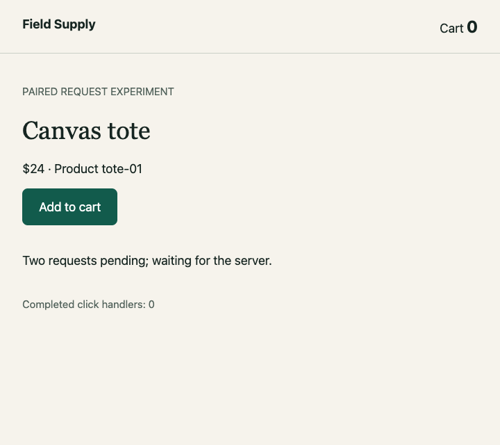

# Cycle 0005 evidence

**Demonstrated:** a real external MCP SDK client discovers and drives the fixed `paired-cart-demo` through the extension-owned server in both required editors. One click, exact server and browser TypeScript stops, actual values, source-bound agent interpretations, continuation, cart 1, reconnect and owned cleanup use the MCP surface. This is an integration increment, not full checkout or arbitrary-repository support.

Source: `c813053d732cad4c5b0a6a1581e199de412eccfe`, clean at final suite launch. Source fingerprint: `4be3d512c89df69f9ffea3fb26eab59645241e9a3f7a50acd84a1e8e489b5cde`.

**33 product, 43 shared, and 28 paired unit tests passed.** The final six-case matrices exercise normal / 40-second hold / reconnect / source drift / server restart / wall-deadline expiry. Negative cases pass by rejecting unsafe control and preserving partial history; they do not become successful studies.

| Host | Native cases | Discovery to first real snapshot | Hold / state-read latency |
| --- | --- | --- | --- |
| VS Code | 6/6 | 1681.95 ms | 40004.70 / 3.08 ms |
| Cursor | 6/6 | 1805.72 ms | 40005.60 / 3.00 ms |

These are individual local measurements, not percentiles or guarantees. Prerequisite installation/build time is separate. The existing normal/stale-script/source-drift shared native regressions also pass **3/3 in each host**, with every shared-source hash matching this tree.

- [VS Code environment](vscode/environment.json), [actual host runtime](vscode/host-runtime.json), [results](vscode/results.json), [teardown](vscode/teardown.json).
- [Cursor environment](cursor/environment.json), [actual host runtime](cursor/host-runtime.json), [results](cursor/results.json), [teardown](cursor/teardown.json).
- [Shared regressions: VS Code](shared-regressions/vscode/results.json), [Cursor](shared-regressions/cursor/results.json).
- [Driving-agent smoke](agent-smoke/agent-finished.json), [actual MCP transcript](agent-smoke/agent-transcript.json), [earlier expired attempt](agent-expired-attempt/agent-result.json).
- [Verification](verification.json), [raw/shared hashes](provenance.json), [attempt ledger](attempts.json), [review coverage](review.json), [checksums](SHA256SUMS).
- [Reproduce and connect](../../../../extension/README.md), [frozen cycle and conclusion](../../0005-live-study-mcp.md).

## Baseline evidence

### vscode

[Manifest](vscode/runs/a2bb127b-038f-419e-83b7-1d1333486d83/manifest.json) · [events](vscode/runs/a2bb127b-038f-419e-83b7-1d1333486d83/events.jsonl) · [server snapshot](vscode/runs/a2bb127b-038f-419e-83b7-1d1333486d83/server-snapshot.json) · [browser snapshot](vscode/runs/a2bb127b-038f-419e-83b7-1d1333486d83/browser-snapshot.json). The case transcript contains discovery, tool calls, sealed source reads, explanations and image-resource hashes.

| Server paused | Browser paused | After continuation |
| --- | --- | --- |
|  |  |  |

### cursor

[Manifest](cursor/runs/5fc5309c-7320-4d50-8525-a4f8fd00864c/manifest.json) · [events](cursor/runs/5fc5309c-7320-4d50-8525-a4f8fd00864c/events.jsonl) · [server snapshot](cursor/runs/5fc5309c-7320-4d50-8525-a4f8fd00864c/server-snapshot.json) · [browser snapshot](cursor/runs/5fc5309c-7320-4d50-8525-a4f8fd00864c/browser-snapshot.json). The case transcript contains discovery, tool calls, sealed source reads, explanations and image-resource hashes.

| Server paused | Browser paused | After continuation |
| --- | --- | --- |
|  |  |  |

## Interpretation and limits

The baseline server stops at TypeScript line 19 with `tote-01 / 24 / cart 0`; the browser stops at line 23 with the same selected operation and `cart 1` before rendering. Executed JavaScript, generated JavaScript, source maps, original TypeScript, captured values and all five instrumented causal links agree. Four PNG hashes match their renderer receipts. Exactly one input, two accepted continuations and two persisted interpretations are recorded; understanding is never auto-marked.

Closed MCP event pages are checked against persisted event values and remain stable through later run/focus activity. The final review caught an earlier mutable-detail mismatch; those prior suites are superseded in the attempt ledger. Source-display acquisitions now settle before owned tab cleanup, including independent debugger failure. Released resources and failed evidence persistence remain separate states; a storage error cannot become success or permanently return a dead connection descriptor.

The driving-agent smoke is a separate observation: Codex reads actual discovery/state/source and chooses each MCP operation through an external SDK console. It is not the scripted matrix and not a statistical evaluation or proof that one natural-language request plans an entire checkout. The earlier attempt exceeded the demo's 120-second wall deadline and remains explicitly partial. A [later attempt](agent-late-marker-attempt/agent-finished.json) completed the study within its deadline, but missed the separate harness completion marker during context compaction; its exit 1 is retained separately. The final smoke completed both the study and harness with exit 0, without changing either timeout.

Seven concrete implementation-review findings were repaired across three fixing passes, with focused regression coverage and final native checks. **Review is not certified converged:** the third pass required fixes, and four outside Claude Code invocations timed out after 540000 ms. The preceding DX outside review also timed out. No fourth full review, external approval, PR approval or CI claim follows from these tests.

Only allowlisted demo evidence is shared. Credential descriptors, bearer tokens, editor logs and private profiles are excluded. Local home/repository/owned-profile paths and WebSocket endpoints are redacted. PNG bytes remain unchanged; original and sanitized text hashes are separate. Required observations are copied here; ignored originals remain under `artifacts/cycle-0005/`.

Independent native editor presentation remains **unverified** because the desktop was locked. Page pixels and renderer acknowledgements are narrower evidence. Full checkout, recorded replay/video, wiki/codemap/progress, all three layouts, installed VSIX, real-repository usefulness and intended-use feedback remain open. Final-product reviewers: **0/10, not started**.
