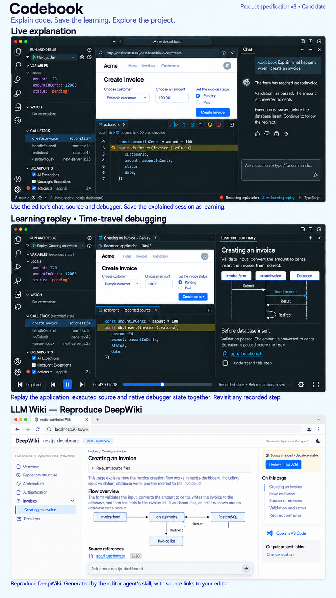
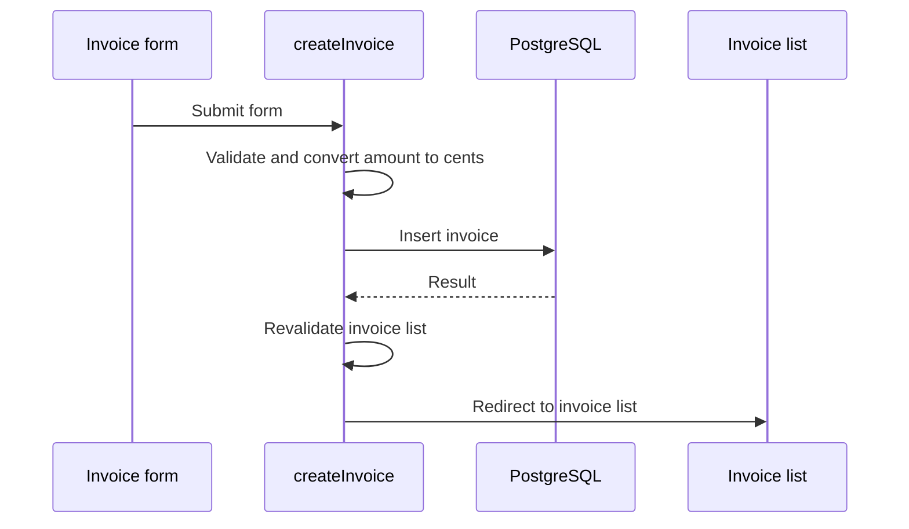

# Codebook version 8 visual specification — candidate

> Historical review checkpoint. Superseded by the owner-approved [version 9 visual specification](codebook-product-spec-v9.md). Pending questions and status below describe the earlier v8 cut, not current work.

Status: GStack design review in progress; no final visual approval.\
Cycle: [0029](../cycles/0029-feature-specification.md) / [Issue #46](https://github.com/laststance/codebook/issues/46)\
Review: [plan and decisions](../plans/cycle-0029-product-design.md)\
Authority: [PRODUCT_GOAL version 8](../../PRODUCT_GOAL.md), D030/D031/D032/D033 and the [behavioral design](codebook.md)

## Candidate image

This single board contains three separate moments in one product design family. It is not three selectable themes, a requirement to display all features simultaneously, or a screenshot of the implemented product. Native VS Code/Cursor chrome remains owned by each host; matching the feature contract does not require identical host pixels.

The image is a review proposal. D032 approves replay's central hierarchy: retain application/source/native debugger together and replace the live chat area with learning summary. Other control placement and decorative details do not become requirements merely because the generator drew them. The final accepted image and written screen specification must agree before implementation uses them as its visual target.

## Feature relationships and required visible outcomes

| Screen | Required outcome | Visible in candidate | Acceptance authority |
| --- | --- | --- | --- |
| Live explanation | Explain actual project execution in standard editor chat at meaningful native debugger stops; source, app and native debugging remain available | Standard Chat, app form, stopped source, Run and Debug; bottom capture/save placement approved as 2A | G01/G03/G06/G11/G12 |
| Save explained learning | Save the explanation and acquired execution as a durable learning replay | Save learning replay action; capture state | G04; [learning contract](../specs/learning-replay.md) |
| Learning replay / time-travel debugging | Reopen after runtime/chat exit and repeatedly inspect synchronized application video, the source executing at that time and native historical values/stack; summary supports this primary task | Same main composition as live explanation, recorded application/source/debugger state, backward/forward controls and a Learning summary pane in place of chat; sequence and explicit understanding remain | G03/G04/G05/G07; D032 |
| Independent DeepWiki | Reproduce DeepWiki itself through the editor agent's generation skill, with chapters, diagrams, citations, reader/navigation and repository Q&A | DeepWiki repository header, chapter tree, substantial article/relevant-source disclosure, outline, diagram, source references and question composer | G02; D033; [Wiki contract](../specs/llm-wiki.md) |
| Wiki maintenance and source navigation | Project-local/configurable output, chat/button updates, freshness and links to the correct editor/source | Browser Update LLM Wiki approved as 3A, local-editor source links under D033; output/change-location geometry remains a proposal, and chat update is specified in text | G02/G11 |

Live explanation produces saved learning. Its playback must synchronize the application, historical executed source and native debugger through one recorded moment; a video/summary reader with source links cannot pass. Wiki generation and updating are independent of both. A Wiki article is not automatically a lesson, and a Wiki update cannot rewrite a saved replay or its learner state. No Codebook Variables/Watch clone or selectable layout trio is introduced. The Activity Bar library entry remains required even though this board concentrates on selected replay rather than a separate library screenshot.

## Final design deliverables and acceptance

These are design completion checks, separate from installed-product acceptance:

- [x] Preserve the owner's feature model and map every illustrated screen to the active goals.
- [x] Produce one current candidate board with native chat/debugger context and distinct learning/Wiki screens.
- [x] Inspect the candidate against actual source-derived example flow; save the prompt and artifact identity.
- [x] Record the owner's replay hierarchy and revise both specification and image to prioritize synchronized video/source/native-debugger history, with learning summary replacing chat.
- [ ] Resolve each actual screen/navigation/control-placement decision through the GStack review and record the owner's individual choice.
- [x] Specify loading, empty, failure, complete, partial/stale and recovery appearances for each feature in the review state table, including approved 4A gap playback and preservation of the last usable Wiki output.
- [ ] Specify keyboard/focus/reading-return behavior, constrained editor widths, browser widths, theme support and accessibility. Verify those requirements on the eventual implementation; static imagery is insufficient.
- [ ] Complete all seven GStack passes and reconcile the report, written screen requirements and final image. No unapproved remedy is silently applied.
- [ ] Obtain approval of the final visual target and link the same committed artifact from the design entry, Cycle 0029 and Issues #1/#46.

After those checks, implementation must match the accepted hierarchy and interactions while respecting user-movable editor panes. Native functionality, synchronized historical values/stack through repeated backward/forward seeking, motion, both hosts and the unchanged nine-project acceptance still require actual testing. Before that campaign, development behavior trials use `/Users/ryotamurakami/repository/nextjs-dashboard` under D031.

## Example accuracy and evidence boundary

The illustration uses invoice creation from the owner-designated `ryota-murakami/nextjs-dashboard` checkout at source revision `26e5b2c`. Read-only inspection of `app/ui/invoices/create-form.tsx` and `app/lib/actions.ts` establishes the form/server-action relationship and the following successful source path:

This is a source-derived illustration, not an observed execution. The sample customer, amount, debugger frames, timings, line numbers and localhost routes are illustrative. No app, database, editor debugger or AI explanation was run for this image. A selected before-insert frame cannot establish that insertion has completed. The complete lesson summary and the selected moment must remain distinguishable. Failed validation/database operations take different paths and must be represented when they occur in a real lesson.

The first image incorrectly drew the database as the owner of the redirect and used inconsistent sample amounts. A second corrected those facts, before-insert explanation and invented output folder, but still emphasized a document-like replay. The owner then supplied D032, requiring synchronized native-debugger replay. The third image changes that hierarchy; the fourth repairs its compact summary's redirect as a self-call on createInvoice. The fifth applies the owner's DeepWiki reference. The sixth makes agent-skill generation explicit, removes hosted-service promotional actions and uses a source-grounded Wiki flow figure. The simplified raster omits revalidation; the precise source flow above controls any later implementation/sample explanation. Generated line labels are illustrative. This sample must not become a prepared answer for real acceptance.

## Pending visual decisions and limitations

1. **Replay hierarchy — resolved by D032:** the owner's individual response requires the live composition with summary replacing chat, synchronized application/source/native debugger and repeated time travel. The rejected document-like/sidebar-player alternatives are not pending options. Fine control/state details remain under review.
2. **Capture/save location — approved 2A:** the owner selected the image's bottom status-area capture state and Save learning replay, outside native chat. Do not reopen this decision or inject controls into the chat composer.
3. **Wiki actions — approved 3A / D033:** the browser Update LLM Wiki starts the same skill-driven update in the project's editor; normal reading stays independent. The owner also selected faithful DeepWiki reproduction with local-editor source links. Output settings use ordinary editor configuration; generation quality belongs to the agent skill.
4. **Partial history — approved 4A:** continue available video, mark missing intervals on the timeline and show **Not recorded at this moment** on affected source/debugger surfaces. Clear other moments' highlights/values; restore matching state at recorded points. The same rule applies to seeking. The current populated-state image is unchanged; this approved state is defined in the replay contract and review table.
5. **Constrained replay width — question 5 pending:** when all replay panes cannot remain readable, collapse the learning summary behind an explicit button while prioritizing app/source/native debugger (5A), or retain all panes and let the learner resize them (5B). Neither is approved yet. Remaining responsive/accessibility review and final image reconciliation are pending. The board does not establish keyboard, screen-reader, narrow-width, contrast, theme or motion verification. Small generated text is not a pixel-exact native UI specification.

These are pending decisions or limitations, not deferred product requirements. They must be settled or explicitly recorded before calling the design complete.

## Artifact record

| Field | Value |
| --- | --- |
| Created | 2026-09-26 |
| Tool | Built-in image-generation tool; GStack design binary unavailable |
| Current file | `assets/codebook-product-spec-v8-candidate.png` |
| Actual dimensions | 941 × 1672 pixels |
| SHA-256 | `4727eca649352a342e2b1767db13230c49eb44a425cae876e91506e53901079e` |
| Prompt and correction | [Saved prompt](prompts/cycle-0029-product-spec-v8.md) |
| Specification checkpoint | Version 8 / D032 and D033 introduced with this artifact; preceding version 7 checkpoint was `47b0019105e1415f3a8304023e235c4a49f54313` |
| Approval | D032 replay hierarchy, 2A bottom capture/save, 3A browser update, 4A partial-history playback and D033 DeepWiki reference approved individually; complete image remains a candidate |

Local GStack review artifacts preserve all six sequential attempts under `/Users/ryotamurakami/.gstack/projects/codebook/designs/cycle-0029-product-spec-20260926/`. Original generated files were copied, not moved or deleted. Only the current corrected version 8 candidate is committed here; these iterations are not product theme variants.

## Native UI references

The feature entry follows the existing host vocabulary. VS Code's [Views guidance](https://code.visualstudio.com/api/ux-guidelines/views) describes sidebar containers, movable views and concise navigation; its [Webviews guidance](https://code.visualstudio.com/api/ux-guidelines/webviews) requires theme/accessibility integration and avoiding duplicate native functionality. These primary sources were checked on 2026-09-26. The Activity Bar opens Codebook navigation; it must not directly launch an editor webview. Wiki actions need appropriate view actions rather than fake data-tree rows. D032's selected replay composition controls over the initial document-like list/detail proposal.

Native editor conventions take precedence over generic marketing typography or decorative motion rules. Codebook-owned surfaces must fit the host's theme, font, focus and keyboard expectations. This is an editor extension and a documentation reader, not a marketing landing page.

## DeepWiki reference and generation ownership

D033 explicitly makes DeepWiki itself the Wiki product target. The generated board labels this requirement and shows the inspected reader hierarchy, source references and repository question composer. The editor AI's carefully authored generation skill produces the codebase Wiki. Runtime/debug MCP is supporting infrastructure for other features, not a prerequisite for generating these files. See [the generation-skill contract](../plans/deepwiki-generation-skill.md).

Reference inspected on 2026-09-26: [DeepWiki repository reader](https://deepwiki.com/microsoft/vscode) and [official feature description](https://docs.devin.ai/work-with-devin/deepwiki). The real rendered reader used Geist, 16px/24px body text, 22px/30px bold page headings, foreground `#333333` and background `#F8F7F6`. These observed values support reference alignment; the raster does not prove exact CSS. Repository chapters, on-page outline, relevant-source disclosure, inline citations and a question composer were directly visible. No question was submitted, source uploaded or indexing requested. Local Wiki source links target the user's editor. The reference's hosted-service promotional/publishing actions are not requirements for locally generated output.
