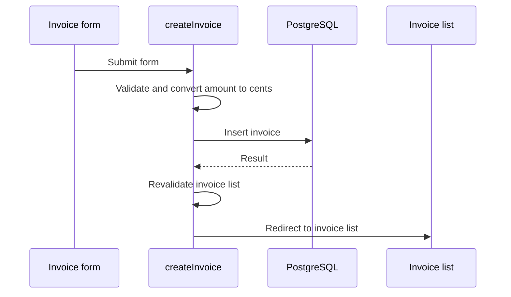

# Codebook version 9 — approved visual specification

Status: **owner approved on 2026-09-26**; corrected iteration 8 adopted unchanged.\
Cycle: [0029](../cycles/0029-feature-specification.md) / [Issue #46](https://github.com/laststance/codebook/issues/46)\
Review: [GStack plan-design-review](../plans/cycle-0029-product-design.md)\
Authority: [PRODUCT_GOAL version 9](../../PRODUCT_GOAL.md), D030–D036, [behavioral design](codebook.md)\
Machine-readable identity: [visual-target.json](visual-target.json)

## Open this image before implementing

**This is the product's visual target. Open the actual PNG and inspect it with an image-viewing tool.** Follow [IMPLEMENTATION.md](../../IMPLEMENTATION.md) and record the inspection in the active cycle. The image's generated header says Review candidate because it predates the owner's adoption; the approval above and D036 establish its current status. Its bytes have not changed since approval.

This is one design family with separate feature screens. Host-owned VS Code/Cursor chrome uses each actual editor's native UI. Sample values, filenames, line numbers and timestamps illustrate the experience; they are neither pixel-exact native requirements nor execution evidence. The whole sheet is a specification board, not a screen containing all features at once.

## Required visible outcomes

| Image region | Implement this outcome | Local acceptance |
| --- | --- | --- |
| 1 — Live explanation | Actual app, stopped source and native debugger support an explanation in standard Copilot Chat/Cursor Agent. Native source/value inspection stays available. Bottom status shows capture and **Save learning replay** (2A). | G01/G03/G06/G11/G12; AC-LIVE/AC-SAVE |
| 2 — Learning replay | Keep the live composition, replacing chat with **Learning summary**. One recorded playhead synchronizes application video, executed source and historical native-debugger values/scopes/stack. Replay, step and repeatedly seek backward/forward after the original runtime exits, without repeating target side effects. | G03/G04/G05/G07; D032; [replay contract](../specs/learning-replay.md) |
| 2 — Summary and gaps | Summary/sequence support time travel; understanding is explicit. Summary can collapse/reopen through **Learning summary** (5A), preserving moment and reading/focus context. Across missing history, continue video, mark timeline gaps and show **Not recorded at this moment** on affected source/debugger surfaces (4A). | AC-REPLAY/AC-GAPS/AC-LEARNING; D032/D034 |
| 3 — Independent DeepWiki | **Reproduce DeepWiki itself**, using the editor agent's generation skill: chapters, substantial articles, diagrams, relevant-source/inline citations, reader/outline navigation and repository Q&A. Reading and generation are independent of live/replay and runtime/debug MCP. | G02/G06/G12; D033; [Wiki contract](../specs/llm-wiki.md), [generation skill](../plans/deepwiki-generation-skill.md) |
| 3 — Update/output/source | Browser **Update LLM Wiki** starts the same editor-agent procedure as chat (3A). Show freshness and project-local/configurable output; Change location reaches ordinary settings. Citations open the matching file/location in the user's local editor. | AC-WIKI-UPDATE/AC-SOURCE-LINKS |
| Shortcut strip | Every assigned shortcut appears in its action tooltip. **?** opens a searchable **Keyboard shortcuts** list with actual applicable action/key pairs. Normal question-mark typing remains usable. | D035; [shortcut contract](../specs/keyboard-shortcuts.md); AC-SHORTCUTS |

The Codebook Activity Bar entry and learning library are required even though this board emphasizes an opened learning item. The image does not exhaust loading, empty, error or unavailable states; implement the full [review state table](../plans/cycle-0029-product-design.md#pass-2--interaction-states-complete) and linked feature contracts. No custom Variables/Watch clone or selectable theme trio is introduced. Wiki update cannot rewrite saved replay or learner progress.

## Layout and accessibility baseline

D034 requires an ordinary desktop display with the editor/browser window expanded to available space at normal/default zoom. OS full-screen is optional. Extremely small windows and extreme zoom such as 200% are outside mandatory design/acceptance. At the supported layout, preserve keyboard access, meaningful labels, focus/reading return, native themes, readable contrast and reduced-motion behavior. Verify actual UI and motion in both hosts; this raster proves none of those behaviors.

## Example causality and evidence boundary

The illustration uses the owner's `nextjs-dashboard` at the inspected source revision `26e5b2c`. Read-only inspection of `app/ui/invoices/create-form.tsx` and `app/lib/actions.ts` established this source path:

Both compact raster diagrams preserve ownership: PostgreSQL returns a result; createInvoice revalidates and redirects. The replay sequence represents that final action as a self-loop; the Wiki figure uses a note. The exact source flow above expands the simplification. Failed validation/database operations take their actual paths in real explanations.

No application, database, debugger or editor AI flow was executed for this image. Sample amount/customer, frames, line numbers, times and URLs are illustrative. The selected before-insert moment is distinct from the full summary; it does not establish that insertion or redirect has completed. Do not embed this example as an answer key in skills or acceptance.

## Design review and approval

- [x] Preserve the three feature lifecycles and map visible outcomes to active goals.
- [x] Resolve D032, 2A, 3A, 4A, 5A, D033, D034 and D035 from explicit owner direction.
- [x] Evaluate all seven GStack passes, including state coverage and normal-desktop keyboard/focus/theme requirements.
- [x] Reconcile the image with those contracts and inspect both diagrams for causal accuracy.
- [x] Obtain whole-image approval: owner answered **採用する。修正版v9を視覚仕様にする（推奨）**.
- [x] Store the actual PNG, prompts, identity and required visual-inspection instructions in this repository.

Design completion does not establish implementation, native accessibility, motion, packaging or final acceptance. The final nine-project protocol remains unchanged. Before that campaign, development behavior trials use `/Users/ryotamurakami/repository/nextjs-dashboard` under D031.

## Artifact identity and history

| Field | Value |
| --- | --- |
| Current approved file | `assets/codebook-product-spec-v9.png` |
| Dimensions / bytes | 1024 × 1536 / 1,878,402 |
| SHA-256 | `f189ee82541a72ed981e3f7a0e21bd35a19b6601df1c7208671117a335caf2aa` |
| Tool | Built-in image generation; installed GStack design binary unavailable |
| Prompts | [v9 update and correction](prompts/cycle-0029-product-spec-v9.md) |
| Prior current candidate | [v8 historical record](codebook-product-spec-v8.md), superseded by this image |
| Original generation | `/Users/ryotamurakami/.codex/generated_images/01a0dc12-5778-7582-8742-eb844b132411/exec-66032de8-43a2-4cca-9765-d1f37f868aa8.png` |

All eight sequential attempts remain under `/Users/ryotamurakami/.gstack/projects/codebook/designs/cycle-0029-product-spec-20260926/`. Original generated files were copied, not moved. Iterations 1–6 establish the prior direction; 7 adds desktop/shortcut decisions; 8 corrects both diagrams. These are revisions of one target, not selectable product variants.

## Inspected references

Native editor surfaces follow [VS Code Views](https://code.visualstudio.com/api/ux-guidelines/views) and [Webviews](https://code.visualstudio.com/api/ux-guidelines/webviews). The Activity Bar exposes navigation rather than directly launching a webview. Codebook actions use appropriate view controls. Native editor vocabulary controls over generic marketing typography.

D033's reference is the [DeepWiki repository reader](https://deepwiki.com/microsoft/vscode) and [official description](https://docs.devin.ai/work-with-devin/deepwiki), inspected read-only on 2026-09-26. Observed reader typography was Geist 16px/24px body and 22px/30px headings, text `#333333`, background `#F8F7F6`. The generated raster is not CSS measurement. Chapters, on-page outline, relevant-source disclosure, citations and question composer were visible; no external question, upload or indexing request was sent. Local source links replace hosted destinations; hosted publishing/promotional actions are outside this local product requirement.
