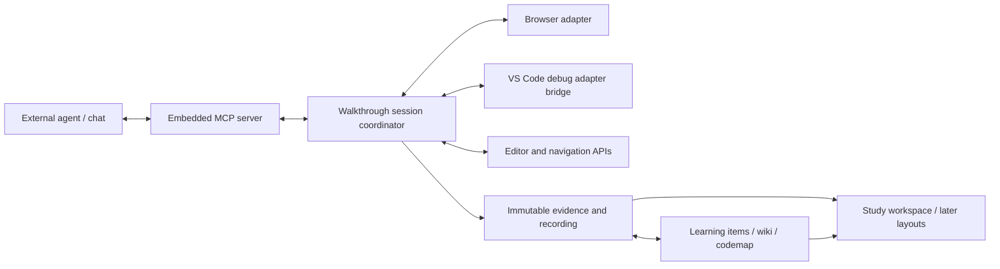

# Design: codebook — understand an application through its execution

Generated by /office-hours on 2026-09-18  
Branch: unknown (working directory is not a Git repository)  
Project: codebook, /Users/ryotamurakami/laststance/vscode-extension/codebook  
Status: APPROVED  
Approved by: Raphtalia on 2026-09-18T16:07:16+09:00  
Mode: Builder

## Problem statement

Raphtalia wants to understand AI-written code, unfamiliar codebases at work, and interesting OSS. Static explanations and isolated debugging tools currently fail to connect what an application does on screen with the code and runtime values responsible for it.

The defining request is: “Explain the process from adding a product to the cart through completing checkout.” An agent must operate the application, pause execution at meaningful points, explain the actual code and values, continue toward completion, and record the walkthrough for later study. DeepWiki-style macro explanations, source-linked codemaps, and course-like learning progress belong to this same product.

## What makes this useful

A learning item such as “Cart state update” connects its architectural explanation, source path, observed execution, recorded moment, and personal understanding check. Clicking between these views preserves the subject being studied. The product turns agent reasoning into explanations that the learner can inspect against actual execution.

## Approved decisions and constraints

- **Architecture B:** the extension owns execution state and durable evidence; external agents plan, investigate, and explain through its embedded MCP server. This prevents agent conversation state from becoming the authority for runtime truth.
- **Default layout: Study workspace (01).** Learning outline at left, application above source in the center, explanation and captured values at right, recording timeline below. Raphtalia selected the attached image explicitly.
- **Later selectable layouts:** Living book (02) and Guided walkthrough (03). These are approved future display modes, sharing the same data and live session. They are not required for the first default-layout delivery.
- **One feature-level experience:** screen operation → meaningful debugger stop → explanation using captured values → continue → completed scenario → replayable recording. A collection of disconnected tools does not meet this requirement.
- **Separate evidence and understanding:** the agent can establish what was observed; understanding is marked by the learner. An execution success must never check a lesson automatically.
- **Agent-neutral API:** expose every editor, browser, debug, navigation, recording, and learning operation needed for this workflow. “All necessary VS Code features” means accessible supported APIs and commands, not unrestricted access to the workbench DOM.
- **Design-only session:** no implementation, scaffolding, source-project modification, publication, or Git initialization is part of this office-hours deliverable.

## Selected approach

The external agent uses codebook as the authority for the current workspace, selected runtime, action status, debugger suspension, and captured evidence. It can use an existing chat client; an additional embedded LLM or proprietary chat service is not required.

The coordinator is a local extension service, not a distributed workflow platform. It maintains a session event stream, targets, operation states, and snapshots. Browser, debugger, and editor adapters share this service. Agent-issued low-level operations must obey the same target and pause checks as high-level walkthrough operations.

**Other approaches:** A, a thin tool bridge with agent-owned orchestration, was not selected because target selection and recording consistency would depend too heavily on the agent. C, a separate managed browser and recording application, was not selected because the desired primary experience lives in VS Code. Useful adapter or recording code from either approach may still be reused.

### Default experience and native UI boundaries

1. The learner asks the connected agent for the checkout walkthrough. The agent reads the repository, proposes meaningful learning items, and identifies the application/debug targets needed for that scenario.
2. A preflight reports launch prerequisites, source-map/breakpoint binding, browser control, runtime targets, and recording availability. Missing capabilities must be visible before claiming the walkthrough is ready.
3. Study workspace opens the learning outline, application, source, and explanation. The current learning item drives the wiki article, codemap selection, captured values, and timeline selection.
4. The agent acts on the application. At each meaningful stop, codebook freezes the source location, relevant stack frames, captured values, and associated screen evidence before the explanation is shown.
5. The learner can ask follow-ups, take over stepping, pause the tour, or continue. Agent-driven continuation uses the same state checks as manual continuation.
6. The recorded session can be replayed after the debug process has stopped. Replay is visibly separate from the live session and does not send browser or debugger mutations.

Use native tree views for the outline and native source editors/debugging where practical; use extension webviews for the wiki, explanation, codemap, and replay. The integrated browser and source editor occupy editor groups. The mockup expresses layout intent: exact group arrangement and resizing behavior must be validated against supported VS Code APIs/commands. No workbench DOM injection or proposed browser API is a prerequisite.

**Content view** (Overview / Live / Recording) and **display layout** (Study workspace / Living book / Guided walkthrough) are separate settings. Later layout changes preserve the selected item, active run, current pause, playback position, and progress. They must not start another run, recreate a debug session, or fork learning records. Adapt panel widths and offer focused panes when the available window is narrow.

Approved concept: [Study workspace](assets/01-study-workspace.png). Future concepts: [Living book](assets/02-living-book.png), [Guided walkthrough](assets/03-guided-walkthrough.png). These generated images are visual references, not working-product evidence. Sample line numbers, step numbering, text, and times are not specifications; live recordings do not display a fabricated final duration.

### Data and truth model

| Record | Responsibility |
| --- | --- |
| Learning item | Stable identity, goal, wiki content, source anchors, child items, and links to observed runs. |
| Walkthrough run | Scenario, workspace/revision, explicit runtime targets, ordered events, lifecycle, and recording manifest. |
| Operation | Requested action, target, acceptance, pending/paused/completed/failed/cancelled outcome; browser action completion is separate from business completion. |
| Pause snapshot | Session/thread and suspension generation, actual bound source location and version, selected stack/scopes/values, screen reference, and capture limitations. Immutable once published. |
| Explanation | Text linked to specific source versions and evidence IDs; observed statements, source-based reasoning, and unresolved links are distinguishable. |
| Learner progress | User-marked understanding linked to an item and source revision; independent of execution evidence. |

Each mutable debug request specifies the workspace, run, debug session, thread where applicable, and expected suspension generation. Continuing invalidates live DAP references. Captured values are stored as bounded serializable data with explicit truncated, unavailable, or redacted states; never retain a variables reference as if it were a durable value. Capturing all heap data is neither required nor promised.

Use source version hashes alongside workspace revision because a dirty working tree may differ from its commit. Recorded source remains readable after files change. Current-source navigation warns about drift. Previously marked understanding remains a historical user decision; affected items are flagged for review instead of silently marked understood for the new code or silently unchecked.

### Action and pause lifecycle

The MCP action call starts an operation and returns an operation ID promptly. It must not wait for the browser click to complete before the coordinator can process a debugger stop caused by that click. Agents can query operation status and events by cursor; clients may additionally receive notifications.

A run has an explicit selected target set, not an ambient “active debugger.” Within an application target, serialize competing application mutations such as a second click or navigation. A pending browser action must not block debugger events, pause inspection, or the debugger continuation needed to complete that action. Debug mutations are separately ordered per session/thread and checked against the suspension generation; no application-action lock may be held across a wait that prevents those controls from running. For example: click pending → pause received → snapshot captured → continue accepted → click completes. Adapter timeouts must distinguish intentional debugger suspension from active execution; an uncertain timeout must not trigger an automatic duplicate click. A pause creates a new suspension generation; snapshots and explanations name that generation. The agent sees distinct events for action accepted, debugger paused, snapshot captured, execution resumed, browser action completed, and scenario outcome observed. A successful continue response alone does not prove that the next desired stop was reached.

If the user resumes manually during capture, reject unfinished capture as stale; do not combine values from different suspensions. Duplicate mutation requests with the same request key return the existing operation instead of repeating clicks. Cancellation and agent disconnection stop scheduling new actions, keep partial evidence, and surface any process still paused. Do not auto-resume, terminate unrelated sessions, or silently rerun a purchase on recovery. A stopped session cannot accept old operations after reconnect; the learner explicitly resumes or starts another run.

### Correctness contract

- A verified source location is the debugger's actual bound location, not merely the line requested for a breakpoint. An unbound or missed breakpoint is reported.
- A paused call stack is evidence for that suspension. It is not proof of every function executed between stops. The codemap distinguishes observed segments, source-derived segments, and unresolved boundaries.
- Associate a UI action with runtime evidence using explicit target identity and available request/action/domain identifiers, async stack information, or supported instrumentation. Time proximity alone is not a causal link. Same-function background calls and unrelated windows must not be narrated as the user's checkout.
- If a cross-process or asynchronous boundary cannot be established, show the gap and obtain more evidence. Do not invent a continuous verified path. Before the feasibility run, freeze a fixture expectation table naming the five business steps, the required source/value/screen evidence, and the required causal links between them. Required links include the selected UI action to cart mutation and the checkout action through the backend request to order creation and the matching confirmation. Every required link must be established by observed evidence for a complete pass. An unresolved required boundary makes the run partial/unverified, even if all five screens or stops were individually observed; unresolved out-of-scenario branches may remain visible without failing the selected scenario.
- Use stack/scopes reads by default. Explicit expression evaluation is marked as evaluated evidence; executing an expression can have side effects and cannot be treated as a passive heap read.
- Confirm the final scenario result through an observable application outcome and the relevant runtime/request result. Button-click completion alone is insufficient.

### MCP capability surface

Expose discoverable capabilities and target descriptors before actions. Required groups are repository/source exploration; editor reveal/selection/diagnostics/navigation; launch/attach and target management; breakpoint management/stepping/scopes/variables; browser navigation/DOM/actions/screenshots; run/operation/event inspection; wiki and codemap read/write; explanation attachment; recording start/stop/replay inspection; and learner navigation. These are product API responsibilities, not a frozen list of tool names.

The extension-owned MCP server is reachable by supported external clients over an authenticated local transport. A small launcher may bridge stdio clients into that server if needed; there is still one state owner. Registering a VS Code MCP server definition makes it discoverable to VS Code's client but does not itself host the service. Scope requests to an authorized workspace, validate target IDs, use bounded responses, and disclose unavailable capabilities. Do not expose arbitrary IDE commands as a substitute for defined contracts. Learning-progress writes require an explicit learner action or explicit learner instruction; agent inference is insufficient.

Local recordings, wiki content, and progress persist independently of agent chat history. Redact configured sensitive runtime fields before persistence or transmission to an agent. External service/model choice remains the learner's choice. Remote development and multi-root identity require an explicit connection/port-forwarding design before being advertised as supported; the first feasibility proof runs locally.

### Recording and replay

Recording is a required part of the complete experience. Persist application screen frames, source versions and selected locations, captured values/stacks, explanations, and operation/pause events on one ordered timeline. A browser-only video or an event-only log does not meet this contract. The standard deliverable is a locally playable walkthrough that reconstructs all these panes from captured material after the app and debugger have exited.

Assign event sequence numbers and local monotonic receipt timestamps; retain original source timestamps where available. Bind frames and snapshots through explicit capture/pause IDs, with capture skew or missing frames visible. Ordering by receipt time is not proof of simultaneous state. Capture a pause-associated screen frame when supported, or display the last captured frame with its age. Never present a later frame as the screen at an earlier stop.

Save incrementally and finalize a manifest; interrupted runs remain labelled partial. Playback never fabricates missing runtime data or silently reexecutes the app. Any future reexecution creates a separate run with its own evidence. Standalone video export format and packaging are an engineering decision still to settle; replayable screen-plus-code-plus-values-plus-explanation recording remains mandatory regardless of export format.

## Reuse and implementation evidence

Read-only inspection found useful pieces; their combination has not been validated live.

| Source | Reuse candidates | Gap to close |
| --- | --- | --- |
| Entrance | Ordered event envelope/sequencer, browser capture, source-map mapping, persisted sessions, replay, explicit reexecution divergence. | Electron ownership does not transfer directly to a VS Code extension; extract suitable logic, not the whole application. Its previous client-only scope is not a constraint on codebook. |
| deep-trace-extension | Hierarchical trace navigation, source reveal/highlight, next/previous steps, owned breakpoints, persisted trace selection. | Connect static trace steps to learning items and immutable runtime evidence. |
| vscode-debug-mcp | Debug-session tracking, JS debug root/child resolution, DAP operations, MCP schemas. | Replace ambient targeting with explicit session/thread contracts, generation checks, async operation status, and immutable captures. Existing separate stdio server/HTTP bridge is not the final embedded architecture. |
| Public integrated-browser MCP | Concrete example of controlling VS Code's integrated browser through js-debug's CDP proxy. | Verify current compatibility, licensing, target isolation, authentication, pause behavior, and recording; example code is not proof of this combined product. |

Inspected source entry points:
- `/Users/ryotamurakami/laststance/Entrance/src/shared/envelope.ts`
- `/Users/ryotamurakami/laststance/Entrance/src/main/recorder/`
- `/Users/ryotamurakami/laststance/Entrance/src/main/redebug/redebug-session.ts`
- `/Users/ryotamurakami/laststance/vscode-extension/deep-trace-extension/src/services/navigationService.ts`
- `/Users/ryotamurakami/laststance/vscode-extension/deep-trace-extension/src/services/breakpointService.ts`
- `/Users/ryotamurakami/laststance/vscode-extension/vscode-debug-mcp/vscode-extension/src/debug-controller.ts`
- `/Users/ryotamurakami/laststance/vscode-extension/vscode-debug-mcp/mcp-server/src/index.ts`

## Independent native perspective

A fresh-context agent in the same Codex environment reviewed the premises. This was not independent-model or independent-provider validation. It supported a single coherent walkthrough and highlighted three failure modes: a browser action waiting forever while the debugger is paused, unrelated runtime stops being mistaken for the requested operation, and recorded screens/code/values losing alignment.

Its recommended proof was the full cart-to-checkout scenario with asynchronous work and deliberately unrelated background calls. A later comparison between successful and failed runs could teach branch behavior; that is a future candidate, not added scope for initial delivery.

## Feasibility and open engineering questions

The [integrated browser](https://code.visualstudio.com/docs/debugtest/integrated-browser) supports debugging web applications. [js-debug's extension-author interface](https://github.com/microsoft/vscode-js-debug/blob/main/EXTENSION_AUTHORS.md) exposes a proxy for a specific debug target. That endpoint must not be assumed to be a browser-level [Playwright CDP connection](https://playwright.dev/docs/api/class-browsertype#browser-type-connect-over-cdp). Multiple targets, workers, and backend processes require explicit association. The public [integrated-browser MCP implementation](https://github.com/thimo/vscode-integrated-browser-mcp) provides a reuse lead, not full-session correctness proof.

[VS Code's MCP extension guide](https://code.visualstudio.com/api/extension-guides/ai/mcp) covers server discovery. [DAP lifetime rules](https://microsoft.github.io/debug-adapter-protocol/overview) require values to be copied before continuing. [Extension capability boundaries](https://code.visualstudio.com/api/extension-capabilities/overview) and [proposed API restrictions](https://code.visualstudio.com/api/advanced-topics/using-proposed-api) constrain implementation and distribution.

Resolve these during engineering planning/proof, without changing the approved user experience implicitly:
1. Pin VS Code/js-debug versions and prove integrated-browser control, pause-time capture, source maps, and native editor arrangement together. If a required capability is missing, return a concrete adapter or companion proposal with evidence; do not silently remove recording or replace the IDE experience.
2. Choose the first reproducible JS/TS web fixture with a Node backend, then a real repository from Raphtalia's three use cases. This fixture tests browser/backend association; it is not an assertion that every language or framework is supported.
3. Prove screen-frame cadence and encoding adequate for ordinary application transitions, define storage limits/retention, and settle standalone video export expectations and format.
4. Choose the initial external MCP client and reconnection behavior; no model/vendor dependence is required by the architecture.
5. Define the supported environment matrix after the local proof. General remote workspaces, all debug adapters, and arbitrary OSS launch environments are not yet verified.

## Success criteria

These are acceptance targets, not results already obtained.

| Check | Required evidence |
| --- | --- |
| Complete walkthrough | Freeze the five-step fixture expectation table before running. One chat request reaches each step with its required evidence and causal links, with no manual wiring of each individual pause. An unresolved required link is partial/unverified and fails complete-walkthrough acceptance. |
| Macro/micro continuity | A learning item links its wiki, source map, observed pauses, recording moments, and manual check in both directions. |
| Runtime truth | Actual stop location, source version, and captured values match the predefined fixture expectations for each explained pause. Required causal links are verified; unresolved optional branches remain visibly unverified. |
| Action/pause concurrency | A click remains pending while debugger events, inspection, explanation, and continuation succeed, including an intentionally prolonged pause; a second competing app mutation is held back. No deadlock or duplicate click occurs. |
| Target isolation | In a controlled fixture, unrelated targets and background invocations of the same function are never attributed to the checkout without evidence. |
| Pause invalidation | Manual continue, target termination, and late requests cannot publish mixed-generation or stale values as current. |
| Recording fidelity | Replay after process exit reproduces the observed screen, source, values, and explanation at tested stops. Inspect a recorded animated transition through video/frame sequences, not a single screenshot. |
| Recovery | Cancellation, agent loss, and partial recording preserve evidence and identify any still-paused process; replay does not perform application actions. |
| Learning ownership | Observed execution never auto-completes understanding. Source drift is surfaced without rewriting the learner's history. |
| Later layouts | Once 02/03 are implemented, switching layouts preserves the same live run, selection, playback position, and progress. |

## Delivery and distribution

First delivery is a personally installed VSIX, built with pinned dependencies. Proposed CI builds/packages the extension, checks types and meaningful lifecycle tests, and runs VS Code integration scenarios against the supported environment. Real browser/debug/recording verification is required in addition to unit tests. Select a distribution-compatible way to supply any browser/encoding dependencies before release. Marketplace/Open VSX publishing is a later explicit delivery decision; no release is authorized in this design session.

## Next steps and the assignment

**Concrete next task:** after design approval, write the engineering plan and build a bounded feasibility proof of the full cart-to-confirmation walkthrough in a reproducible local fixture. First fix the five-step evidence/causality expectation table; do not weaken it after observing a failed run. Include a second unrelated target and a same-function background request. Deliver its replayable recording and an evidence table for action/pause coordination, target association, source/values accuracy, and screen alignment. A convincing static demo alone does not pass. Use sandbox checkout behavior, not a real purchase.

Then implement the default Study workspace around the proven session contracts, connect the wiki/codemap/learning records, harden recording and interruption recovery, and validate on a real repository. Implement Living book and Guided walkthrough as later renderings of those same contracts. Engineering review may reorder internal tasks; it must retain the complete user-visible experience.

## Design review

Two native-agent review rounds completed on 2026-09-18. Both material issues were fixed: application-action ordering now explicitly permits debugger inspection/continuation while a click is pending, and the complete-walkthrough criterion now rejects unresolved required causal boundaries. Final verdict: PASS, 9/10, no remaining review findings. This score evaluates the design document; combined runtime behavior still requires the feasibility proof.

## Observations from the discussion

- “自分がAIに書かせたコード、仕事で扱うUnfamilarなコードベース、興味のあるOSSを理解する” identifies the initial learner and the three practical contexts for validation.
- “↓ができない” referred back to the screen-driven checkout walkthrough; the missing outcome is the connected experience, so acceptance must test that whole interaction.
- “これをデフォルトに残りの2つも表示モードの選択肢として後に実装する” establishes a default and a clear ordering for additional layouts while preserving their shared underlying model.
