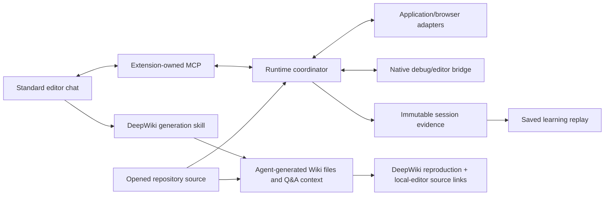

# Design: Codebook feature relationships and behavior

Authority: PRODUCT_GOAL version 8 and D030/D032/D033, owner direction and clarification of 2026-09-26.\
Status: functional specification updated; GStack screen review in progress with a [replacement visual candidate](codebook-product-spec-v8.md), not yet approved.

The [2026-09-18 design](https://github.com/laststance/codebook/blob/22e25c5ace8773214649bf085fb8cf6fdea3facc/docs/designs/codebook.md) and its three images preserve their historical approval. Their required display variants, combined Wiki/learning model, custom runtime-value pane and first cart-fixture assignment are superseded by the current contracts below. Their recorded review score is not a review of this revision.

## Feature model

Codebook has three feature areas with distinct lifecycles. “One UI design” removes alternative presentations of the same feature; it does not collapse these features into one screen.

| Area | Primary input | User-facing result | Dependencies |
| --- | --- | --- | --- |
| Live explanation | Natural `/codebook` question plus an actual opened repository | Standard editor chat explains application/runtime operations at meaningful debugger stops in real source | Real source, public MCP connection and the applicable runtime/debugger prerequisites; no Wiki or saved learning required |
| Learning replay | An explained session and captured execution | Synchronized application playback, historical executed source and recorded values/stack in the native debugger; learning summary/sequence replaces the live chat area | Durable recorded source/runtime evidence; can reopen after original chat, application and debugger exit; no Wiki required |
| Independent LLM Wiki | Repository source, output configuration and editor-agent generation skill | Reproduce DeepWiki documentation/reader/diagrams/citations/Q&A; browser updates and source links target the local editor | Source and normal agent/skill prerequisites; no debug MCP, application browser or learning replay required |

The [learning replay specification](../specs/learning-replay.md) owns saved-content and playback behavior. The [Wiki specification](../specs/llm-wiki.md) owns site generation, output location, updates and deep links. Source identities and optional cross-links are shared conveniences; they do not impose a common selected lesson, progress record or live session on all features.

## Live explanation experience

1. Open an actual project in VS Code or Cursor. Before final acceptance, the owner requires the nextjs-dashboard checkout identified by D031 / DEVELOPMENT.md; final acceptance uses its fixed nine projects. Ask a natural code-path question through ordinary Copilot Chat or Cursor Agent using the common `/codebook` skill.
2. The AI checks current workspace/instance/capabilities, inspects actual source and determines applicable launch/debug prerequisites. Missing capabilities remain explicit.
3. The AI operates the application, server, extension, test or supplied Example. It pauses actual execution at meaningful locations and explains in the standard chat what the observed operation and source mean.
4. Native source editors show the stopped code. Native debugger variables, watches and call stacks serve runtime inspection. Codebook does not add a duplicate values panel or its own live-chat replacement.
5. The learner asks follow-ups, steps manually or lets the AI continue with current pause authority. Observed outcomes and source-derived reasoning remain distinguishable.
6. The learner can save the explanation and captured execution as learning material, then open its separate replay screen later.

The purchase-button-to-POST explanation is an example for a project that actually has that behavior. It is not a requirement to package a shopping app or rename unrelated projects into a checkout scenario. Required real-project use cases stay fixed by the acceptance matrix.

## Learning and Wiki screens

The Codebook icon in the editor's left Activity Bar is the proposed common entry for feature navigation. It exposes saved learning and replay, plus Wiki generation/open/update actions. Standard chat, source and debugger remain native editor surfaces. A replay screen and a browser Wiki page can be opened separately; simultaneous visibility with live chat/debug/browser/source is not generally required.

D032 fixes the replay hierarchy: reuse the live explanation's application/source/native-debugger composition and replace the chat area with a learning summary. Application video, the source executing at that time and historical native debugger values/stack remain synchronized while playing, stepping backward/forward and seeking repeatedly. Summary and sequence explain the processing alongside this primary experience. A video thumbnail plus a document-like reader is insufficient. Replay is clearly identified as captured history and does not repeat target side effects.

The Wiki's primary presentation is a web-browser site generated inside the project by default, with a configurable output location. It may also open inside the extension. Updates requested in chat and through the owner-approved browser **Update LLM Wiki** button (3A) start the same independent generation-skill operation in the correct editor. D033 requires DeepWiki itself as the reader/content/Q&A reference; source links open the local editor. Source changes and update state remain understandable to the learner. Links from the Wiki open the correct source location in the editor being used.

The three named display variants (Study workspace, Living book, Guided walkthrough) and their selector are retired requirements. Functional navigation among live work, learning replay and Wiki is not that retired theme selector. Preserve the ability to read learning summaries/sequence diagrams and independent Wiki pages.

## Visual review boundary

The owner requested a separate design review **after** these documents are updated. Exact splits, widths, tabs, navigation hierarchy, responsive behavior and visual styling are open for that review. Do not impose a permanent four-pane layout or draw every feature in one composite screen.

The owner subsequently authorized this review and the matching image within Cycle 0029. The [current visual candidate](codebook-product-spec-v8.md) illustrates the three distinct feature screens in one board, with acceptance mapping and factual corrections. It is not approved screen geometry. Continue the [individual design decisions](../plans/cycle-0029-product-design.md) before promoting a final visual target. Do not generate competing theme variants or treat one image as the entire feature inventory. The three old images lack the desired native chat/debugger context and are archived references. See [visual reference status](README.md).

Retain the useful behavior from D016: compact explicit understanding actions, complete source-citation context, readable narrow content and return to the prior section/reading position. Apply those principles to the relevant feature screen; they no longer mandate a Wiki inside a shared three-mode study. Validate keyboard focus, constrained panes/200% zoom, all supported editor themes and reduced motion in the final design. Motion claims require recorded video and inspected frames.

## Architecture and evidence ownership

Architecture B remains for live execution and replay: the extension owns runtime state, immutable evidence, source identities and recording correspondence; the standard editor AI plans and explains through MCP. D033 makes independent DeepWiki skill-first: the editor agent reads source and generates Wiki files using detailed shared guidance. The extension supports output/update/status/source links; runtime/debug MCP is not a Wiki-generation prerequisite.

| Record | Responsibility |
| --- | --- |
| Walkthrough run | Natural question/scenario, source/revision, selected runtime targets, operations/events and capture status |
| Pause snapshot | Session/thread/generation, actual bound source/version, bounded captured facts and screen references; immutable after publication |
| Saved explanation | Chat explanation linked to specific source/evidence; observations, reasoning and unknowns distinguished |
| Learning replay | Saved session, processing summary, evidence-linked sequence diagram, recording manifest and shared playback/source/debugger identity; historical state remains inspectable through native debugging |
| Learner progress | Explicit learner decisions about saved learning and source context; independent of execution completion |
| Wiki build | Included source/version manifest, generated site/output identity, freshness and generation/update result; independent of runtime and replay |

Captured facts ground truthful reasoning and saved explanations; they also supply historical inspection in the native debugger during replay under D032. Removing a custom value panel does not remove replay values. Bound and redact captures while retaining required inspectable history, copy values before continuation and never persist a DAP reference as if it were a durable value. Source hashes account for uncommitted changes. A source change warns about drift without rewriting a replay or past understanding.

### Action and pause lifecycle

The MCP action call starts an operation and returns an operation ID promptly. It must not wait for the browser click to complete before the coordinator can process a debugger stop caused by that click. Agents can query operation status and events by cursor; clients may additionally receive notifications.

A run has an explicit selected target set, not an ambient “active debugger.” Within an application target, serialize competing application mutations such as a second click or navigation. A pending browser action must not block debugger events, pause inspection, or the debugger continuation needed to complete that action. Debug mutations are separately ordered per session/thread and checked against the suspension generation; no application-action lock may be held across a wait that prevents those controls from running. For example: click pending → pause received → snapshot captured → continue accepted → click completes. Adapter timeouts must distinguish intentional debugger suspension from active execution; an uncertain timeout must not trigger an automatic duplicate click. A pause creates a new suspension generation; snapshots and explanations name that generation. The agent sees distinct events for action accepted, debugger paused, snapshot captured, execution resumed, browser action completed, and scenario outcome observed. A successful continue response alone does not prove that the next desired stop was reached.

If the user resumes manually during capture, reject unfinished capture as stale; do not combine values from different suspensions. Duplicate mutation requests with the same request key return the existing operation instead of repeating clicks. Cancellation and agent disconnection stop scheduling new actions, keep partial evidence, and surface any process still paused. Do not auto-resume, terminate unrelated sessions, or silently rerun a purchase on recovery. A stopped session cannot accept old operations after reconnect; the learner explicitly resumes or starts another run.

### Correctness and causal links

- The debugger's actual bound source location is authoritative. Report unbound or missed breakpoints.
- Freeze each real scenario's necessary source/runtime/result checks and causal boundaries before its trial. A source-derived sequence arrow is distinct from a verified runtime interaction.
- Associate actions with runtime evidence through explicit target/request/action identity and supported async evidence. A nearby timestamp, a same-function background call or an unrelated target is insufficient.
- Required unresolved boundaries make a result partial/unverified even if individual stops occurred. A completed click alone does not establish business completion or a sent request.
- Passive scopes/stack inspection is distinct from explicit expression evaluation, which may cause side effects and must be identified.
- A pending action must permit capture and debugger continuation. Wrong-target, manual-resume, timeout, duplicate-action and stale-generation failures retain their evidence and cannot manufacture success.

### Recording and replay

Persist ordered operations, pause/source identities, application frames where applicable and their saved explanations. Use event sequence numbers and monotonic receipt timestamps, explicit capture/pause IDs and visible skew/missing-frame status. A later image must not be represented as an earlier pause. Record enough before the learner saves to retain the explained execution; disclose any uncaptured interval.

Finalize incrementally to preserve partial recordings. Replay remains usable after the original application/debugger exit and never performs runtime mutations. A shared selected moment synchronizes recorded application, historical executed source and inspectable native debugger values/stack; repeated backward/forward steps and seeking reproduce that same history. The chat area becomes a learning summary containing the sequence diagram and explanation. Use a clearly identified historical debug context, never unrelated live state or a custom Variables/Watch clone. Missing capture, skew and drift remain visible. See the replay specification for completeness and source-drift checks.

### Capability and ownership boundaries

The public API must support source exploration/navigation, actual runtime launch/attach/targeting, breakpoint/step/continue/inspection, applicable application/browser operations, explanation attachment, learning save/open/replay/progress while Wiki exposes supported update/status/open/source-link integration to the skill-driven agent without requiring debug MCP. Detailed tool names and adapter implementations are engineering decisions; discover capabilities and current state rather than inventing tools or reusing stale arguments.

Use supported editor APIs and commands; unrestricted workbench DOM mutation is not the product architecture. Authenticated local connections remain bound to the correct workspace/instance. Preserve unrelated groups, drafts, breakpoints, settings, skills and processes. Wiki output changes touch owned generated material and preserve manual changes. Private evidence and generated private documentation stay out of public changes.

## Validation and delivery

The [final protocol](../acceptance/FINAL_REVIEW.md) applies to all active capabilities and nine required real projects in both hosts. Mechanism/unit checks remain useful but neither fixtures nor old mode checks prove version 8 behavior. Runtime, replay and independent Wiki/source-link evidence must identify their own source/package/host versions.

Cycle 0029 starts with these written contracts. The next stage is the separately requested design review, followed by its current concept image and bounded implementation work: remove the bundled demo, retire duplicate value/theme UI, implement learning/Wiki gaps and validate the designated nextjs-dashboard development target before the fixed nine-project acceptance. A documentation change or generated concept does not complete the cycle or authorize a public release.
