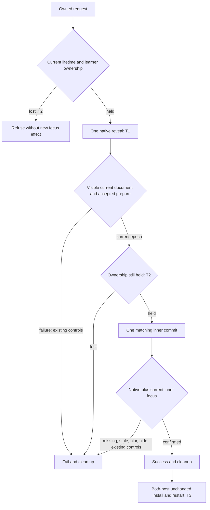

# Cycle 0018 — Explicit native activation for owned focus

Date: 2026-09-22\
Scope: [Cycle 0018](../cycles/0018-editor-group-scope.md), amendment to [owned focus handoff](cycle-0018-owned-focus-handoff.md)\
Review base: `dffed5f01b12f224978c3f7b0f9b0bdd7bcd8b48`; product source `9a9fd7cf50ed9c64f912048d5556a41407ddbc14`

The driving agent selected this bounded scope under the owner's explicit authorization to adopt recommended technical choices. It is not a user-named file. The existing product goal, G12 backlog and final ten-reviewer gate are unchanged. This plan is development work, not final acceptance.

## Step 0 — Scope and evidence

Unchanged v21 fails Cursor's restarted Guided-to-Study restoration. Diagnostic D reaches the same timeout during the initial restoration: a matching current renderer receipt reports focus, while the native active group remains the captured source and Context stays inactive throughout the five-second deadline. Native window focus remains true. This establishes an incomplete native handoff, independently of the explanation for the missed event.

The installed Cursor webview host samples document focus every 250 ms. The traced Context blur/refocus interval is 195 ms. A missed sampling edge is an inference; the host's actual sampling ticks were not instrumented. Do not claim that mechanism as directly observed.

Diagnostic E changes only the existing reveal's preserve-focus argument to false, retaining the request/epoch protocol and all ownership checks. The initial/restarted twelve Wiki Returns, twelve Wiki/Study pairs, twenty-four Living/Guided transfers with final Study restoration, and ninety rapid transfers pass. Its installed bundle is modified, so this is a functional experiment, not unchanged-VSIX validation. Diagnostic C is a harness startup refusal, not a product result.

### What already exists

- `extension/src/utils/focusWebview.ts` owns one bounded reveal, current-document prepare/commit/cancel, transport deadline, cleanup and native-plus-renderer confirmation.
- `extension/src/studyWorkspace.ts` supplies lifetime, work-window, native group/tab/text ownership and interruption guards. It admits the original focus or the intended owned target, never an unrelated learner target.
- `experiments/cycle-0001/src/utils/installWebviewFocus.ts` rejects stale epochs, expired/hidden requests and repeated commits. It requests inner focus once and observes the outcome.
- `extension/src/tests/webviewFocus.test.ts` already tests delivery, replacement, cancellation, missing native/document focus, stale receipts and cleanup. Existing workspace suites cover learner interruptions and failed recovery.
- Frozen ordinary-install runners already exercise replay, Wiki, presentation modes and learner-group controls independently in both hosts. The new diagnostic runner checks child exits, exclusive capture paths, CDP readiness and passive native window focus.

### Not in scope

No new protocol, focus polling, retries, deadline extension, renderer changes, new service/dependency, layout redesign, G12 implementation, support-scope reduction, Marketplace publication or final reviewer campaign. Diagnostic heartbeat/instrumentation must never enter the product archive.

Repository decisions are authoritative. Brain product/recent-decision caches are unavailable. Context7 is quota-limited and Serena is unavailable; the official [VS Code Webview guide](https://code.visualstudio.com/api/extension-guides/webview#visibility-and-moving) and exact installed host source support the API investigation. Aside is unavailable; native editor evidence remains separate from web documentation.

## 1. Architecture review

**A1 — Inner document focus cannot certify native activation (P1, confidence 10).** `focusWebview.ts` currently reveals with preserved focus and relies on an inner `window.focus()` to select the native editor. D demonstrates that the implication is false.

- **A1A, selected:** use the existing public reveal to request native activation once, then retain the current-document handshake and require both native and inner confirmation. Recheck ownership at existing boundaries; no retry. Completeness 10/10; human ~1h / Codex ~15min, excluding native validation.
- **A1B, declined:** accept renderer focus without native confirmation. This would publish success while source remains the active editor; completeness 3/10.
- **A1C, declined:** delay until the vendor poll observes blur or extend/retry focus. This depends on private timing, adds latency and may override newer learner input; completeness 4/10.

Native activation can occur before renderer preparation, so the operation must already own its target at the reveal boundary. Existing guards protect admission. The in-host challenge found that equality with the original source can incorrectly reauthorize a later return after activation. Track target-tab acquisition for the operation lifetime through native view/group/tab notifications and synchronous guard reads; once acquired, any observed departure irrevocably retires focus and recovery authority. Dispose subscriptions on every outcome. Add pre-reveal refusal and actual-caller return-to-original-source controls, including a changed selection and a departure/reentry entirely inside a delayed preparation response. Failure may leave an already accepted native selection visible, but cannot publish success or reclaim focus from a newer learner action. No atomic OS transaction is claimed.

## 2. Code quality review

No new issue. Reuse the existing helper, caller ownership scope and renderer contract. Change the reveal argument with one concise comment explaining why native and DOM activation are distinct. Extend the existing test harness to model native activation independently of inner focus; keep the explicit missing-native negative control. No duplicated helper, type, abstraction or dependency is needed.

## 3. Test review

**T1 — Native activation regression (P1).** Add an initially inactive owned editor whose document can acknowledge focus but whose native selection changes only after the public activation request. It must fail before the product fix and pass afterward. Assert actual native-plus-document outcome, one request, and cleanup; flag-only assertions are insufficient.

**T2 — Ownership at the native effect (P1).** Cover refusal before reveal, and ownership loss after the native request but before the renderer commit. Exercise the actual workspace caller: observe owned native activation, hold prepare, return to the original source and change its selection, then release. Preserve the new focus/selection, issue no later commit/recovery reveal and publish no success. Also reject a departure followed by reentry while the response is held; equality at the next polling checkpoint cannot renew expired authority. Add a no-interruption counterpart and assert subscription cleanup. Preserve the existing transport/epoch/missing-focus/abort cases and workspace-level foreign-focus protections. Do not weaken them to make the new activation pass.

**T3 — Fresh unchanged archive and original route (P1).** E does not validate shipping bytes. Build a clean new candidate, freeze source/input/archive/helper identities, normally install the same archive in fresh owned VS Code and Cursor profiles, verify loaded bytes, and run the complete retained schedule sequentially. Include the original restart failure, all three modes, exact replay before corrective seek, rapid transfers and fourth-group/foreign-scope refusal. Record video and inspect frames. Stop on the first failure without corrective retries; distinguish environment and product failures.

Selected complete controls replace no existing tests. Unit confidence cannot replace installed verification.

Failure matrix: undelivered/rejected/stalled transport → bounded error; closed/aborted/replaced target → no later commit; foreign focus/window blur → retire authority; wrong request/epoch → ignore; inner blur/hide or inactive native editor → no success; post-failure recovery → existing learner-ownership guards. No unresolved critical design gap; validation tasks remain open.

## 4. Performance review

No new issue. One existing reveal changes its argument, and bounded per-operation native event subscriptions preserve ownership between awaits. No production timer, additional round trip, retry, new queue or longer timeout is introduced. The private 250 ms diagnostic logger is excluded from packaging.

## Implementation review amendment

Two fresh implementation reviews identify the same ownership rule at source-display boundaries. Presentation placement must declare its requested cursor before display and reject changed returned/current selections before moving more panes or restoring old selections. Cold Wiki must retain the exact requested, document-clamped citation selection before display and carry its acquisition observer through the response and later navigation; taking a fresh baseline after the response is unsafe. Reuse the reader's focus observer, include selection events, and retire observed departure/reentry permanently. Add delayed-response selection, tab-roundtrip and normal counterparts through the public callers. Preserve multi-selection restoration and the existing late-reading-restoration control.

The [source repair report](../cycles/evidence/0018/explicit-native-activation-repair.md) records failing-before proof, fourteen focused passes and complete **841/841 + 96/96** checks on the stated source inventory. The third fixing review adds post-move selection guards and an exact closed-source fallback; twelve selected checks pass. CodeRabbit completes with zero findings on all seven source/test files. The independent workflow ends non-converged at its three-fixing-pass limit. T3 installed evidence and controlled probes for Sidebar/Terminal focus and MCP-first tabs-only registration remain pending; those static concerns are not established native product failures or completed fixes.

## Independent plan challenge

Claude Code CLI is skipped by explicit owner instruction. The fresh bounded Codex in-host challenge `cycle0018_native_activation_plan` identifies one P1: returning to the original source after target activation can pass the initial-state equality guard. Accepted and incorporated into A1/T2 above, including one-way focus authority and actual-caller regression. This is one in-host development review, not external-provider coverage or final acceptance. The same-reviewer follow-up also identifies missing tab-model events when panel notifications arrive first. A separate failing-before same-group departure/reentry control justifies subscribing to tab changes as well. No model-diversity claim is made.

## Implementation Tasks

- [x] **T1 (P1, human: ~45min / Codex: ~10min)** — focus utility/tests — Reproduce inactive native editor despite a focused current document, then request explicit native activation. Surfaced by A1/T1. Verify failing-before and passing-after focused tests.
- [x] **T2 (P1, human: ~45min / Codex: ~15min)** — focus utility/workspace tests — Preserve pre-effect refusal and irrevocable post-activation learner ownership, including return to the original source and transient departure/reentry. Surfaced by T2. Run focused guards, complete product/shared tests, serial packaging tests and typechecks.
- [ ] **T3 (P1, human: ~2h / Codex: ~40min)** — packaging/native evidence — Freeze and install a new unchanged candidate in both hosts; run retained schedule and inspect video. Surfaced by T3. Retain all failed attempts, source/helper/archive identities and profile preservation; perform fresh diff/provider review before delivery.

One sequential implementation lane: tests → product repair → complete checks → freeze → Cursor → VS Code → evidence/review/delivery. Documentation/evidence preparation can proceed independently of test execution, but only one native editor window is driven at a time. No competing module edits or extra active cycle. No deferred TODO is introduced.

## GSTACK REVIEW REPORT

| Review | Runs | Status | Findings |
| --- | --- | --- | --- |
| Engineering sections | 1 | Complete plan; execution pending | 1 architecture issue, 3 test gaps incorporated; no code-quality/performance issue |
| Claude Code CLI | 0 | Owner-skipped | Missing external coverage; no substitute claim |
| Codex in-host challenge | 1 | Finding incorporated | Original-source return must retire focus authority; not final acceptance |

Scope accepted; existing components, exclusions, coverage diagram and failure modes recorded. One sequential lane; Lake Score 1/1. Source tasks T1/T2 have recorded regression and full-suite evidence; T3 remains open. Test plan, task JSONL and review provenance are recorded under the project GStack directory. Source changes require red/green proof and unchanged native validation.

VERDICT: Proceed with the bounded native activation repair and irreversible ownership retirement. Four-section review and the in-host challenge are complete; implementation, unchanged native validation and delivery remain open.

NO UNRESOLVED DECISIONS

## v22 departure investigation — 2026-09-22

[The v22 A–E report](../cycles/evidence/0018/native-departure-investigation.md) supersedes the assumption that explicit native activation plus the current inner-focus receipt is sufficient for the installed transfer schedule. A logging-only reproduction observes Context acquiring native focus, then Application reacquiring it without another Codebook request. Removing the internal Keep Editor inner-focus protocol is a functional diagnostic only: C/D stop at window-focus prerequisites, while E reaches it and fails rapid transition 52 after six Wiki Returns and 51 successful transfers. Do not merge this intervention or describe its partial sequence as T3/T4 completion.

The next experiment is attribution, not another source fix: correlate only focus message names, target identities and timing from the owned outer webviews, inner documents and public native events. Preserve existing message delivery exactly, keep payloads/private connection data out of committed evidence, freeze the diagnostic before launch and stop at the first failed prerequisite/assertion. A delayed host message is currently an inference from installed host code; an observed causal sequence and a meaningful failing-before regression are required before revising the implementation. Every later source change still requires a newly frozen unchanged archive and the complete both-host schedule.
